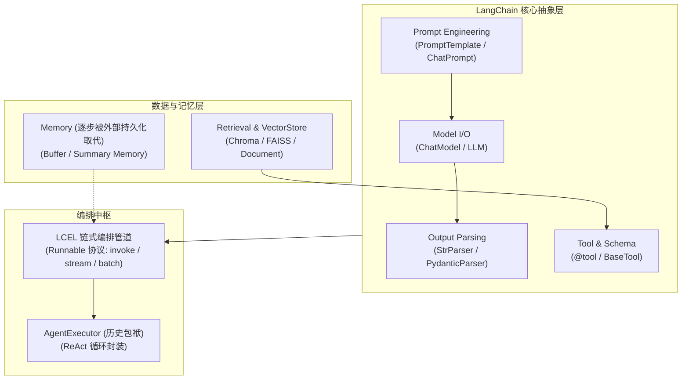
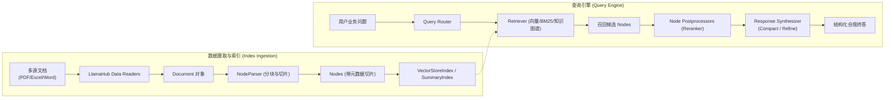

# 企业级 AI 解决方案交付工程师 (FDE) 架构演进与技术解析

## 专题解析：LangChain / LlamaIndex 核心解构与 LCEL 链式编排演进决策

**所属模块**：第二阶段：RAG 数据工程、黄金问题集与单 Agent 工具交付  
**专题定位**：开源 Agent 框架技术底层拆解、LCEL 管道机制剖析与企业级工业化落地选型决策  
**适用对象**：初中级交付工程师 (Junior FDE) / 资深技术骨干 / 解决方案架构师  

---

## 📌 架构演进与设计权衡背景

在课程总纲《[AI企业深度培训大纲_1.5个月_FDE版.md](file:///Users/lucas/Documents/项目/武汉柯莱特企培/AI企业深度培训大纲_1.5个月_FDE版.md)》的第二阶段（Day 16 ~ Day 20）中，大纲规划了：

> `LangChain / LlamaIndex 核心解构与 LCEL 链式编排。`

然而在实际工程落地教学（Day 16 ~ Day 20 实战讲义与代码工程）中，学员会发现我们并没有采用 LangChain、LlamaIndex 或 LCEL 作为业务核心实现，而是采用了 **“原生底层协议 + 生产级防御拦截 + Anthropic 确定性工作流”**。

本文档作为 Day 19 的专项架构拓展材料，旨在：

1. **正面回答架构演进动因**：深度阐明为什么实际交付实战中坚决剥离框架黑盒；
2. **系统解构三大开源核心**：深入剖析 LangChain、LCEL、LlamaIndex 的底层机制、源码级抽象模式与适用边界；
3. **建立工业级选型度量标准**：帮助交付工程师在真实客户现场具备客观、严谨的技术栈选型决策能力。

---

## 第一篇 为什么实际讲义没有用 LCEL / LangChain / LlamaIndex？

### 1.1 真实交付痛点：开源框架的“黑盒封装陷阱”

在大量企业级 AI 交付事故中，开发者常陷入“Demo 跑得飞起，上线全盘崩溃”的尴尬境地：

* **框架层层黑盒封装**：LangChain 与 LlamaIndex 为了兼容成百上千种模型与工具，设计了极其庞大臃肿的类继承与装饰器体系。单次工具调用可能穿透 15 层以上的底层源码，一旦下游 API 格式微调或网络波动，抛出的错误栈长达数屏，现场交付工程师根本无法定位到底是 Prompt 拼错、参数提取失败，还是网络超时。
* **学员离开 Demo 就不会排查底层报错**：高度依赖 `AgentExecutor` 或封装好的 `QueryEngine`，学员往往不知道大模型通信报文里 `finish_reason: "tool_calls"` 的 JSON 格式细节，更缺乏对 SQL 注入、超时熔断、参数校验等生产级防护的直观掌控力。
* **脆弱的链式管道**：LCEL 虽然优雅，但在处理带有复杂分支、循环重试、状态回滚与人工审批（Human-in-the-Loop）的严肃业务时，调试极为困难。

### 1.2 架构全面重塑：底层原生协议 + 生产级防御 + Anthropic 确定性工作流

为了解决上述致命痛点，Day 16 ~ Day 20 实战讲义与工程代码进行了系统性的架构升维，用更贴合企业严肃业务交付的标准完成了能力替代：

| 大纲规划项                                    | 实际 Day 16 ~ Day 20 讲义落地方案                                                                                                                                                                                                                                                                                        | 架构与教学考量                                                                                                                                    |
|:---------------------------------------- |:---------------------------------------------------------------------------------------------------------------------------------------------------------------------------------------------------------------------------------------------------------------------------------------------------------------- |:------------------------------------------------------------------------------------------------------------------------------------------ |
| **LangChain 核心解构 & 原生 Function Calling** | **[Day 16：Function Calling 原生协议解构](file:///Users/lucas/Documents/项目/武汉柯莱特企培/武汉柯莱特企培_Day16_Function_Calling协议解析、安全Text2SQL与外部API集成讲义.md)**<br>• 手撕 OpenAI / Ollama 原生 tools JSON Schema<br>• Pydantic v2 严格模式 (`Fast-Fail`) 前置门禁<br>• SQL AST 语法树四重拦截防御门禁<br>• 原生 HTTP 超时、指数退避加抖动重试网关                             | **剥离 LangChain 的黑盒封装**：让学员直面大模型网络通信报文与 Pydantic 校验门禁，掌握真正能过甲方安全攻防与审计的企业底层能力。                                                               |
| **LCEL 链式编排**                            | **[Day 17：确定性工作流编排与状态机控制](file:///Users/lucas/Documents/项目/武汉柯莱特企培/武汉柯莱特企培_Day17_确定性工作流编排、状态机控制与Langfuse链路追踪讲义.md)**<br>• 落地 **Anthropic 官方生产实践军规四大设计模式**（Prompt Chaining、Routing、Parallelization、Evaluator-Optimizer）<br>• Python 状态机强约束执行骨架<br>• 工业级 **Langfuse APM** 链路追踪（Trace/Span/Generation 耗时与 Token 成本） | **生产环境中 LCEL 管道语法 (`prompt \| model \| parser`) 调试栈深、跨步骤传递动态状态与容错能力较脆**。讲义改用 Anthropic 推荐的确定性状态机与原生代码控制，配合 Langfuse 可观测性，更符合企业严谨交付与成本核算标准。 |
| **LlamaIndex 核心解构**                      | **[Day 18：三位一体架构攻坚](file:///Users/lucas/Documents/项目/武汉柯莱特企培/武汉柯莱特企培_Day18_三位一体架构攻坚：知识库+数据库+API全链路协同Agent讲义.md)**<br>• 规章知识库（非结构化）+ 数据库（结构化）+ 外部 API（动作）三位一体深度融通<br>• 人机回环 (HITL) 审批门禁                                                                                                                           | **破除单一 RAG 检索的局限**：直接手撕三位一体业务 Agent 原型，取代了 LlamaIndex 的通用 QueryEngine 封装，使非结构化制度与结构化数据库能够进行数学级精准核对。                                        |

---

## 第二篇 LangChain 核心架构解构与设计模式

尽管在生产环境底层我们主张去黑盒化，但 LangChain 作为目前最主流的开源应用开发框架，其在生态建设与抽象封装上有着不可替代的参考价值。



### 2.1 六大核心抽象组件

1. **Model I/O 适配层**：
   * 将各家大模型厂商（OpenAI、Anthropic、Ollama、vLLM）各异的 SDK 统一抽象为 `BaseChatModel`（标准化输入 `BaseMessage`，标准化输出 `AIMessage`）。
2. **Prompts 模板引擎**：
   * `ChatPromptTemplate`：支持角色划分（SystemMessage、HumanMessage、AIMessage）与动态占位符注入。
3. **Output Parsers 输出解析器**：
   * 将非结构化文本响应转化为结构化数据（如 `StrOutputParser`、`JsonOutputParser`、`PydanticOutputParser`）。
4. **Tools 与 Schema 定义**：
   * 使用 `@tool` 装饰器将 Python 普通函数自动反射为 OpenAPI / JSON Schema 工具定义。
5. **Memory 状态管理（演进痛点）**：
   * LangChain 早期主推的 `ConversationBufferMemory`、`ConversationSummaryMemory` 本质是纯内存状态维护。在分布式多实例微服务中无法天然共享，且极易导致上下文 Token 超限，目前在生产环境中已基本被 Redis / 关系数据库 + 外部状态快照所取代。
6. **Agent 与 AgentExecutor**：
   * 负责驱动思考-行动-观察循环（Thought $\to$ Action $\to$ Observation）。

### 2.2 核心代码范式（经典 LangChain 范式）

```python
from pydantic import BaseModel, Field
from langchain_core.prompts import ChatPromptTemplate
from langchain_core.output_parsers import PydanticOutputParser
from langchain_openai import ChatOpenAI

# 1. 结构化契约定义
class EmployeeAuditResult(BaseModel):
    employee_name: str = Field(description="员工姓名")
    is_compliant: bool = Field(description="是否合规")
    discrepancy_amount: float = Field(default=0.0, description="超标违规金额")

# 2. 组件声明
parser = PydanticOutputParser(pydantic_object=EmployeeAuditResult)
prompt = ChatPromptTemplate.from_messages([
    ("system", "你是一名严肃的财务合规审计员。请依据给定事实输出审查结论。\n{format_instructions}"),
    ("human", "单据内容：{audit_content}")
]).partial(format_instructions=parser.get_format_instructions())

model = ChatOpenAI(model="gpt-4o-mini", temperature=0)

# 3. 经典调用方式（通过 invoke 或 generate）
formatted_prompt = prompt.format_prompt(audit_content="王大明申请2月报销1800元，新规标准600元/天，实际出差2天")
response = model.invoke(formatted_prompt.to_messages())
result = parser.parse(response.content)
```

---

## 第三篇 LCEL (LangChain Expression Language) 链式编排底层解构

### 3.1 为什么 LangChain 要推倒旧机制搞 LCEL？

在 LangChain 0.1 之前，编排主要依赖 `LLMChain`、`SequentialChain` 等厚重的类组合。这种模式带来以下痛点：

* 类继承层级过深，配置繁琐；
* 同步调用、异步调用（`ainvoke`）、流式调用（`stream`）和批量调用（`batch`）需要分别写不同的逻辑代码；
* 无法统一注入重试、降级（Fallbacks）与中间件追踪。

为此，LangChain 从底层重构出 **LCEL**，其核心灵魂就是 **`Runnable` 协议与 Unix 管道操作符重载**。

### 3.2 Runnable 统一协议接口

在 LCEL 中，一切组件（Prompt、Model、Retriever、Parser、自定义函数）都是一个 `Runnable` 对象。所有 `Runnable` 均实现了一致的接口契约：

| 协议接口     | 方法签名                                | 核心机制                     |
|:-------- |:----------------------------------- |:------------------------ |
| **单次同步** | `invoke(input)`                     | 阻塞式处理单一输入并返回输出           |
| **单次异步** | `ainvoke(input)`                    | 基于 asyncio 的非阻塞异步执行      |
| **流式输出** | `stream(input)`                     | 返回迭代器，按 Token 粒度流式推流     |
| **异步流式** | `astream(input)`                    | 异步生成器，用于 Web 后端 SSE 流式推流 |
| **批量并行** | `batch(inputs)`                     | 内部自动线程池并发处理批次输入          |
| **降级兜底** | `with_fallbacks([backup_runnable])` | 主链失败时无缝自动重定向到备用链路        |

### 3.3 管道符 `|` 的底层重载机制

LCEL 最具代表性的语法是管道符：

```python
chain = prompt | model | parser
```

**底层技术原理**：Python 语言允许类重载 `__or__` 和 `__ror__` 运算符。当你在两个 `Runnable` 对象之间写 `|` 时，Python 并没有执行算术按位或运算，而是实例化了一个 `RunnableSequence` 复合对象：

```python
# Runnable 基类底层的精简伪代码实现原理
class Runnable:
    def __or__(self, other):
        # 将当前 Runnable 与后置 Runnable 包装为一个顺序流转的序列
        return RunnableSequence(first=self, last=other)

    def invoke(self, input_data):
        raise NotImplementedError

class RunnableSequence(Runnable):
    def __init__(self, first, last):
        self.first = first
        self.last = last

    def invoke(self, input_data):
        # 管道流水线：上游的输出直接作为下游的输入
        mid_output = self.first.invoke(input_data)
        return self.last.invoke(mid_output)
```

### 3.4 典型 LCEL 高级链式组合（带检索与并行扇出）

```python
from langchain_core.prompts import ChatPromptTemplate
from langchain_core.output_parsers import StrOutputParser
from langchain_core.runnables import RunnablePassthrough, RunnableParallel
from langchain_openai import ChatOpenAI

# 模拟检索器与模型
def fake_retriever(query: str):
    return "华科智造规章：2024年3月1日后一线城市总监住宿上限为800元/天。"

prompt = ChatPromptTemplate.from_template("""
依据以下背景事实回答业务问题：
【背景事实】：{context}
【用户问题】：{question}
""")
model = ChatOpenAI(model="gpt-4o-mini", temperature=0)

# 通过 RunnableParallel 构造输入字典并接入链条
chain = (
    RunnableParallel({
        "context": fake_retriever,           # 并行抽取或检索上下文
        "question": RunnablePassthrough()    # 透传用户原始提问
    })
    | prompt                                 # 格式化组装 Prompt
    | model                                  # 送入大模型推理
    | StrOutputParser()                      # 提取纯文本字符串
)

# 执行链
output = chain.invoke("周建华总监在上海出差3天，住宿上限总额是多少？")
```

### 3.5 LCEL 在企业级交付中的边界与局限

* **隐式键名依赖**：上游吐出的 dict key（如 `"context"`）必须与下游 Prompt 的变量名完全一致，编译期无法检查，全靠运行时动态反射，极易在团队协同中产生难以发现的 `KeyError`。
* **分支与循环能力受限**：对于包含“如果超标则打回修改，修改后再次核对，最多重试 3 次”的状态机循环，LCEL 表达极其晦涩难懂，必须强行使用复杂的 `RunnableBranch`。
* **这就是为什么**：LangChain 官方自身在处理复杂 Agent 时，也逐步淡化纯 LCEL 链式组装，转而推出了基于有向图状态机的 **LangGraph**。

---

## 第四篇 LlamaIndex 核心架构解构与数据优先哲学

如果说 LangChain 的核心是 **“语言模型流水线编排（Orchestration-First）”**，那么 LlamaIndex 的核心则是 **“数据连接与检索增强（Data-First）”**。



### 4.1 四大核心数据层解构

1. **Document 与 Node（最小知识单元）**：
   * `Document`：原始容器，挂载文件全局元数据；
   * `Node`：经过切分后的最小原子块（Chunk），深度支持父子节点（Parent-Child）、前后相邻关系指针（`prev_node`, `next_node`）以及富元数据嵌入。
2. **Index（知识索引架构）**：
   * `VectorStoreIndex`：最常见的语义向量索引；
   * `SummaryIndex`（原 ListIndex）：针对全篇摘要的高密度检索；
   * `KnowledgeGraphIndex`：基于实体关系三元组的图结构索引。
3. **Retriever 与 Node Postprocessor（检索与后处理）**：
   * 负责从 Index 中召回候选块，并利用重排模型（如 `SentenceTransformerRerank`）对候选块进行精准重打分过滤。
4. **Response Synthesizer（响应合成策略）**：
   * LlamaIndex 针对大上下文超限问题，内置了高度工程化的回答合成模式：
     * `compact`（默认）：将多个切片尽量拼满上下文单次请求，性价比最高；
     * `refine`：先用切片 1 生成初稿，再用切片 2 对初稿进行修正完善，适合极其严密的技术合同审阅；
     * `tree_summarize`：分层树状汇总归纳。

### 4.2 典型 LlamaIndex 检索查询范式

```python
from llama_index.core import VectorStoreIndex, SimpleDirectoryReader, StorageContext
from llama_index.core.postprocessor import SimilarityPostprocessor

# 1. 摄取本地企业 Wiki 资产
documents = SimpleDirectoryReader(input_files=[
    "day11/wiki_kb_v1.0/WIKI-FIN-TRAVEL-202403_华科智造员工差旅住宿与交通报销标准.md"
]).load_data()

# 2. 构建向量索引
index = VectorStoreIndex.from_documents(documents)

# 3. 构造带后置过滤器的 Query Engine
query_engine = index.as_query_engine(
    similarity_top_k=5,
    node_postprocessors=[
        # 相似度阈值硬门禁：过滤掉相似度低于 0.75 的无关噪声块
        SimilarityPostprocessor(similarity_cutoff=0.75)
    ],
    response_mode="compact"
)

# 4. 执行问答检索
response = query_engine.query("周建华作为总监，去上海出差住宿标准上限是多少？")
print(response.response)
```

### 4.3 企业级局限与 Day 18 的替代选择

* **黑盒隐藏了数据流动**：LlamaIndex 的 `query_engine.query()` 一行代码包揽了向量检索、提示词拼接、LLM 推理和格式化。在真实项目中，客户常要求“在检索到切片后、送入模型前，必须先调用本地敏感词脱敏服务”，此时如果改动 LlamaIndex 内部组件，学习曲线极陡峭。
* **业务边界割裂**：企业实际业务不仅仅是查知识（RAG），往往是“查知识 $\to$ 查订单库 $\to$ 计算发票差额 $\to$ 写入 ERP”。LlamaIndex 虽然有 Agent 模块，但本质仍偏向数据检索，无法像原生 Python + Pydantic 状态机那样轻量、无缝地管控数据库事务与外部 RESTful 状态。

---

## 第五篇 架构选型全景矩阵与未来演进

### 5.1 工业级技术栈对比决策全景图

| 评估维度            | 原生协议 + 确定性工作流<br>**(Day 16 ~ Day 20 采用方案)** | LangChain / LCEL 管道      | LlamaIndex 引擎    | 状态图智能体<br>**(Day 21+ LangGraph 规划)** |
|:--------------- |:------------------------------------------- |:------------------------ |:---------------- |:------------------------------------ |
| **底层透明度**       | ⭐⭐⭐⭐⭐ (完全掌控原始报文)                            | ⭐⭐ (多层封装，报错栈深)           | ⭐⭐ (重度数据封装)      | ⭐⭐⭐⭐ (状态机与节点显式定义)                    |
| **安全防御门禁**      | ⭐⭐⭐⭐⭐ (原生 AST/Pydantic 硬防御)                 | ⭐⭐⭐ (需自定义拦截器)            | ⭐⭐ (偏通用，防注入弱)    | ⭐⭐⭐⭐⭐ (节点级拦截与状态回滚)                   |
| **可观测性支持**      | ⭐⭐⭐⭐⭐ (原生直连 Langfuse APM)                   | ⭐⭐⭐⭐ (通过 LangSmith 深度绑定) | ⭐⭐⭐ (需适配回调)      | ⭐⭐⭐⭐⭐ (支持快照 Checkpoint 导出)           |
| **复杂分支控制**      | ⭐⭐⭐⭐⭐ (Python 状态机天然支持)                      | ⭐⭐ (管道语法表达条件分支困难)        | ⭐⭐ (依赖外部编排)      | ⭐⭐⭐⭐⭐ (支持循环、分流与汇聚)                   |
| **人机回环 (HITL)** | ⭐⭐⭐⭐⭐ (原生 Token 挂起与恢复)                      | ⭐ (极难在管道中间优雅暂停)          | ⭐ (缺乏挂起机制)       | ⭐⭐⭐⭐⭐ (内置 Interrupt 机制)              |
| **适合阶段与定位**     | **生产环境商业化落地、交付封版**                          | 快速概念验证 (PoC)、生态插件集成      | 纯海量知识检索、复杂文档深度研读 | **高复杂度长任务、自愈型多智能体系统**                |

---

## 🛠️ 交付工程师决策总结

1. **“会调框架”不等于“能交付”**：
   在向企业客户交付 AI 系统时，客户关心的核心指标永远是：**安全（防越权防注入）、稳定（零死循环零白屏）、成本（Token 与时延可控）、可审计（带证据出处与操作日志）**。
2. **教学设计**：
   从 Day 16 的手撕原生 Function Calling，到 Day 17 的 Anthropic 确定性编排与 Langfuse 成本大盘，再到 Day 18 的三位一体全链路打通——这种“脱掉轮子跑原厂”的训练，是为了让每位交付工程师具备在客户机房断网、缺乏外部大包支持时，依然能凭借原生 Python 和严谨工程范式交付商业级 AI 系统的硬核手艺。
3. **向更高阶进发**：
   在打牢底层通信协议与确定性工作流的地基后，后续进入第三阶段（第 5 周）的高级智能体演进时，我们将在掌握底层的基础上，从容迈向更高维度的状态图架构（如 **LangGraph Stateful Graph**）与图知识库（GraphRAG）。
