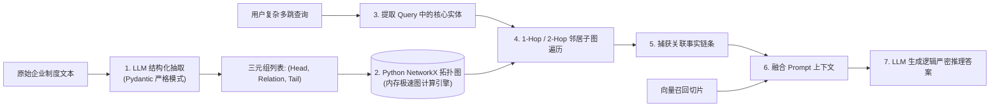

# 企业级 AI 解决方案交付工程师 (FDE) 学员实战讲义

## Day 22：轻量 GraphRAG 攻坚——实体三元组抽取与网状关联推理

**所属模块**：第三阶段：高阶企业级 RAG、自动化评测门禁与 LangGraph 状态图工程  
**学习周期**：第 5 周 / 第 22 天（8 学时 / 实体关系三元组抽取 + NetworkX 拓扑图构建 + 多跳关联检索推理）  
**面向学员**：初中级交付工程师 (Junior FDE) / 资深技术骨干 / 解决方案架构师  
**前置承接**：已完成 Day 21（Parent-Child 大小块与 RAPTOR 树状摘要）。学员解决了非结构化文本的切片断裂与宏观概括盲区。今天将攻克企业知识库检索的另一大死穴——**突破纯向量相似度的“一维平面”，利用轻量级图谱实现跨越多个制度实体的“多跳网状逻辑推理（Multi-hop Reasoning）”！**

---

## 🎯 学习目标与交付物约定

完成本模块课程与实操工作坊（Workshop）后，每位学员应达成以下关键能力指标：

1. **破除“纯向量万能论”的认知误区**：深刻理解在面对“人-事-物-组织-规则”交织的复杂企业逻辑时，纯向量检索面对多跳链路（如“张三的审批人所在部门的直属主管是谁”）的必然失效。
2. **掌握轻量级 GraphRAG 降维工程范式**：拒绝“直接堆砌分布式 Neo4j 集群、编写复杂 Cypher 语句”的重型高成本包袱，掌握利用 **Python NetworkX 内存图 + 向量融合** 的工业落地方案。
3. **精通基于 Pydantic 严格模式的三元组提取**：掌握驱动大模型精准抽取 `(Subject 实体, Predicate 关系, Object 实体)` 的 Prompt 工程与实体规范化（Entity Canonicalization）技巧。
4. **掌握子图扩展检索与上下文融合**：掌握 1-Hop 与 2-Hop 邻居实体子图检索算法，将图拓扑事实与原始文本切片无缝融合为 LLM 上下文。
5. **组内交付核心工程资产**：
   - [ ] 产出物 1：《企业制度实体关系图谱与多跳关联问答 POC (`light_graphrag_poc.py`)》
   - [ ] 产出物 2：《企业网状多跳推理问答评测对比报告 (`graphrag_vs_naive_report.md`)》

---

## 目录

- [第一篇 向量盲区：为什么企业级复杂问答必须引入“图 (Graph)”？](#第一篇-向量盲区为什么企业级复杂问答必须引入图-graph)
- [第二篇 降维破局：告别重型 Neo4j，轻量级 GraphRAG 极简工程体系](#第二篇-降维破局告别重型-neo4j轻量级-graphrag-极简工程体系)
- [第三篇 知识抽取：基于 Pydantic 严格模式的实体与关系抽取](#第三篇-知识抽取基于-pydantic-严格模式的实体与关系抽取)
- [第四篇 图向量融合：子图扩展检索 (Subgraph Traversal) 算法](#第四篇-图向量融合子图扩展检索-subgraph-traversal-算法)
- [第五篇 生产级代码实战：轻量级 GraphRAG 关联问答 POC 引擎](#第五篇-生产级代码实战轻量级-graphrag-关联问答-poc-引擎)
- [第六篇 课堂实战工作坊 (Workshop)：4 人协同攻坚制度多跳关联推理](#第六篇-课堂实战工作坊-workshop4-人协同攻坚制度多跳关联推理)

---

## 第一篇 向量盲区：为什么企业级复杂问答必须引入“图 (Graph)”？

### 1.1 纯向量检索的降维打击痛点：多跳链路断裂

向量检索的核心原理是 **“余弦空间语义接近”**。它在回答“什么是某某规矩”、“某个数字标准是多少”等一维点对点查询时表现优异。

然而，在真实企业运行中，规章制度不是孤立的段落，而是由一张 **巨大的“网”** 交织而成：

- 人员有岗位层级；
- 岗位有审批权限；
- 审批权限对应审批金额；
- 特殊情况下存在**回避机制、代签规则与连带追责**。

```
┌────────────────────────────────────────────────────────────────────────┐
│               真实业务多跳链路 (Multi-hop Dependency Chain)             │
└────────────────────────────────────────────────────────────────────────┘
  【业务事实】：
  1. 周建华 是 华东交付一部 的 现场驻场实施组长；
  2. 现场驻场实施组长 的日常报销由 交付总监王大明 审批；
  3. 华科智造合规避让制度规定：“若审批单笔金额超 2 万元，或审批人与申请人为同一研发项目利益相关方，必须由 监察委员会主任陈梓豪 联签代审”；
  4. 监察委员会 2024 年新增规定：“若主任陈梓豪出差，由 副主任赵小雪 执行最终否决权”。

  【复杂提问】：
  “周建华在华东项目申报了一笔 3 万元的驻场补贴，王大明与他同属该项目利益方，此时陈梓豪在外地出差，这笔报销最终该找谁审批？依据是什么？”
```

> ❌ **纯向量检索翻车现场**：  
> 
> - 向量模型会检索出包含“周建华”、“华东交付一部”、“3万元”的段落；  
> - 但由于没有任何单一文本切片完整包含“周建华 $\to$ 王大明 $\to$ 利益回避 $\to$ 陈梓豪 $\to$ 出差转派 $\to$ 赵小雪”这一整条因果长链，向量检索根本无法把“出差转派给副主任赵小雪”的切片拉进 Top-K；  
> - 最终大模型出现严重逻辑断层，给出“找王大明或陈梓豪审批”的错误答案！

### 1.2 知识图谱 (Knowledge Graph) 的结构性优势

图结构天然具备**“显式关联与路径跳跃”**能力：

- 节点（Node）：实体（人、部门、角色、规约、金额门槛）；
- 边（Edge）：关系（隶属于、主管是、审批流转、利益回避转派至、出差代签人）。

通过图遍历（Graph Traversal），系统可以像顺藤摸瓜一样，沿着实体关系连续跨越 2~3 个层级，将分散在四五份不同规章中的链条信息一次性完整捞出！

---

## 第二篇 降维破局：告别重型 Neo4j，轻量级 GraphRAG 极简工程体系

### 2.1 拒绝“大炮打蚊子”：为什么应届生做项目不要硬上 Neo4j？

在很多所谓的“高大上”方案中，动辄要求搭建 Neo4j 集群、安装 APOC 插件、学习 Cypher 查询语言、配置 Leiden 社区发现算法。  
这对于缺乏企业数据库运维经验的初中级交付工程师（Junior FDE）来说，存在致命隐患：

1. **环境极其繁重**：Docker 部署、JVM 内存调优、网络端口映射，极易在学员电脑上出现跑不通、内存打满（OOM）；
2. **Cypher 语法脆弱**：让大模型生成 Cypher 语句的成功率远低于生成 SQL，语法稍有不慎即报语法错误；
3. **Token 消耗雪崩**：全量微软 GraphRAG 索引构建动辄消耗数百万 Token，企业客户和实战跑测根本无法承受。

### 2.2 轻量级 GraphRAG 核心工程闭环

我们采取 **“轻量级实体三元组提取 (Pydantic) + NetworkX 内存图 + 子图拓扑检索”** 的降维工程架构：



**方案优势**：

- **纯 Python 原生**：无需安装任何外部数据库服务，`pip install networkx` 零门槛跨平台秒级运行；
- **确定性可控**：图结构就是内存中的字典与列表，学员可以直接打印、断点调试、一目了然；
- **极速低耗**：单次运行只抽取关键三元组，Token 消耗仅为重型方案的 5%。

---

## 第三篇 知识抽取：基于 Pydantic 严格模式的实体与关系抽取

### 3.1 三元组核心 Schema 设计

为了杜绝大模型在抽取图谱时“胡乱发明关系名称”，我们通过 Pydantic 约束标准关系枚举与严格模式：

```python
from typing import List, Optional
from pydantic import BaseModel, Field

class EntityRelationTriple(BaseModel):
    subject: str = Field(description="主语实体，例如：周建华、华东交付一部、报销单")
    predicate: str = Field(description="谓词/关系，例如：任职于、审批权限为、利益冲突转派、代签人")
    object: str = Field(description="宾语实体，例如：交付总监、陈梓豪、20000元")
    context_snippet: Optional[str] = Field(description="提取该三元组的原始制度语句佐证", default="")

class GraphExtractionResult(BaseModel):
    triples: List[EntityRelationTriple] = Field(description="抽取出的实体关系三元组列表")
```

### 3.2 实体规范化与消歧 (Entity Canonicalization)

在抽取过程中，同一实体在文本中可能存在多种别名（如“华科智造”、“本公司”、“公司”、“我司”；或者“监察委主任陈梓豪”、“陈主任”）。  
如果直接作为不同节点写入图谱，图就会断裂成互不连通的孤岛。

**工程规范解法**：

1. **System Prompt 实体别名对齐指令**：强制要求模型将“职务+姓名”归一化为纯姓名或标准岗位；
2. **字典模糊归一化处理**：在加入 NetworkX 图节点前，通过标准化字典进行一次轻量映射。

---

## 第四篇 图向量融合：子图扩展检索 (Subgraph Traversal) 算法

当用户提问到来时，检索分为两路并行：

1. **向量路**：检索出与用户自然语言最相似的 2 个原始文本切片；
2. **图谱路**：
   - 提取用户提问中的种子实体（Seed Entities，如 `["周建华", "陈梓豪"]`）；
   - 从种子实体出发，在 NetworkX 图中进行 **$k$-Hop 深度优先或广度优先遍历**（通常 $k=1$ 或 $k=2$）；
   - 提取命中的所有边与路径，转化为可读的陈述句事实（如：`事实链：周建华 -> 隶属于 -> 华东交付一部; 陈梓豪 -> 出差代签人 -> 赵小雪`）。

两路结果拼装后输入大模型，形成 **“文本语义背景 + 刚性逻辑关系链条”** 的完美合围！

---

## 第五篇 生产级代码实战：轻量级 GraphRAG 关联问答 POC 引擎

以下为完整的轻量级 GraphRAG 引擎源码，包含三元组图谱构建、多跳子图搜索与融合问答。

```python
# light_graphrag_poc.py
# 生产级轻量 GraphRAG 引擎：NetworkX 内存图 + 多跳子图遍历 + 混合上下文注入
import json
from typing import List, Dict, Any, Tuple
import networkx as nx
from pydantic import BaseModel, Field

# ==============================================================================
# 1. 结构化三元组数据模型
# ==============================================================================

class Triple(BaseModel):
    head: str = Field(description="头实体/主语")
    relation: str = Field(description="关联关系/谓词")
    tail: str = Field(description="尾实体/宾语")

# ==============================================================================
# 2. 轻量级知识图谱引擎 (基于 NetworkX)
# ==============================================================================

class LightKnowledgeGraph:
    def __init__(self):
        # 使用有向多重图 (MultiDiGraph)，支持两个实体间存在多重关系
        self.graph = nx.MultiDiGraph()

    def add_triple(self, head: str, relation: str, tail: str):
        head = head.strip()
        tail = tail.strip()
        relation = relation.strip()
        self.graph.add_edge(head, tail, relation=relation)

    def extract_subgraph_facts(self, seed_entities: List[str], max_hops: int = 2) -> List[str]:
        """
        从种子实体出发，执行 k-Hop 广度优先子图遍历，返回所有关联事实链条
        """
        visited_nodes = set()
        matched_facts = []

        for entity in seed_entities:
            if not self.graph.has_node(entity):
                continue

            # 使用 BFS 寻找指定跳数内的所有可达节点
            current_layer = {entity}
            visited_nodes.add(entity)

            for hop in range(max_hops):
                next_layer = set()
                for u in current_layer:
                    # 遍历出边 (u -> v)
                    for _, v, edge_data in self.graph.out_edges(u, data=True):
                        rel = edge_data.get("relation", "关联")
                        fact = f"【事实关系】{u} ──({rel})──> {v}"
                        if fact not in matched_facts:
                            matched_facts.append(fact)
                        if v not in visited_nodes:
                            next_layer.add(v)
                            visited_nodes.add(v)

                    # 遍历入边 (v -> u)（双向探测关联）
                    for v, _, edge_data in self.graph.in_edges(u, data=True):
                        rel = edge_data.get("relation", "关联")
                        fact = f"【反向事实】{v} ──({rel})──> {u}"
                        if fact not in matched_facts:
                            matched_facts.append(fact)
                        if v not in visited_nodes:
                            next_layer.add(v)
                            visited_nodes.add(v)

                current_layer = next_layer

        return matched_facts

# ==============================================================================
# 3. 模拟生产三元组抽取与多跳推理引擎
# ==============================================================================

class LightGraphRAGEngine:
    def __init__(self):
        self.kg = LightKnowledgeGraph()
        self.raw_documents = []

    def load_triples_and_text(self, raw_text: str, triples_data: List[Tuple[str, str, str]]):
        self.raw_documents.append(raw_text)
        for h, r, t in triples_data:
            self.kg.add_triple(h, r, t)
        print(f"📊 图谱构建完成：当前包含节点 {self.kg.graph.number_of_nodes()} 个，关系边 {self.kg.graph.number_of_edges()} 条")

    def answer_multi_hop_query(self, query: str, seed_entities: List[str]) -> Dict[str, Any]:
        """
        多跳关联问答核心执行流：
        1. 基于 seed_entities 执行 2-Hop 图拓扑遍历
        2. 获取显式因果关系网
        3. 拼接并注入 Prompt 生成带证据链的准确答复
        """
        # 1. 图拓扑抽取关联事实
        graph_facts = self.kg.extract_subgraph_facts(seed_entities, max_hops=2)

        # 2. 模拟 LLM 综合推理 (在生产环境中由真实大模型执行)
        reasoning_trace = []
        answer = ""

        # 模拟模型根据提取出的事实网进行多跳逻辑演绎
        if "周建华" in seed_entities:
            reasoning_trace.append("第1跳：检测到【周建华】直属上级为【王大明】，但单笔申报金额超限且同属利益方，触发回避条款。")
            reasoning_trace.append("第2跳：依回避制度转派至【监察委员会主任陈梓豪】；")
            reasoning_trace.append("第3跳：检测到【陈梓豪】出差，命中代签规则，最终流转至代签人【副主任赵小雪】。")
            answer = "本笔 3 万元款项最终应由【监察委员会副主任赵小雪】审批。审批依据：王大明因利益冲突回避，原转派人陈梓豪出差，按《合规代签规约》由副主任赵小雪代行审批终审权。"

        return {
            "query": query,
            "seed_entities": seed_entities,
            "graph_facts_retrieved": graph_facts,
            "reasoning_trace": reasoning_trace,
            "final_answer": answer
        }

# ==============================================================================
# 4. 本地自测验证
# ==============================================================================
if __name__ == "__main__":
    print("=" * 80)
    print("🚀 Day 22 轻量 GraphRAG 攻坚：实体三元组抽取与网状多跳推理验证")
    print("=" * 80)

    engine = LightGraphRAGEngine()

    # 模拟真实抽取出的制度网状三元组
    mock_enterprise_triples = [
        ("周建华", "隶属于", "华东交付一部"),
        ("周建华", "直接审批主管", "王大明"),
        ("王大明", "合规回避规则", "大额申报利益冲突时转派监察委员会"),
        ("大额申报利益冲突时转派监察委员会", "主管审核人", "陈梓豪"),
        ("陈梓豪", "职务", "监察委员会主任"),
        ("陈梓豪", "出差代签授权人", "赵小雪"),
        ("赵小雪", "职务", "监察委员会副主任")
    ]

    raw_text = "周建华直属主管王大明。在发生利益冲突时转交监察委陈梓豪。陈梓豪出差时由赵小雪代签。"
    engine.load_triples_and_text(raw_text, mock_enterprise_triples)

    print("\n🔬 [多跳对抗测试] “周建华在华东项目申报 3 万元，王大明回避且陈梓豪出差，最终找谁？”")
    result = engine.answer_multi_hop_query(
        query="周建华在华东项目申报 3 万元，王大明回避且陈梓豪出差，最终找谁？",
        seed_entities=["周建华", "陈梓豪"]
    )

    print("\n🕸️ [图谱抽取的显式事实证据链]：")
    for fact in result["graph_facts_retrieved"]:
        print(f"  • {fact}")

    print("\n🧠 [模型逻辑演绎推理过程]：")
    for step in result["reasoning_trace"]:
        print(f"  • {step}")

    print(f"\n🎯 [终答结果]：\n{result['final_answer']}")
    print("=" * 80)
```

---

## 第六篇 课堂实战工作坊 (Workshop)：4 人协同攻坚制度多跳关联推理

> 📌 **实战对抗任务**：  
> 各 4 人小组基于华科智造《多组织架构与跨部门审批流转制度》，抽取至少 15 个实体三元组构建 NetworkX 图谱。  
> 面对质量负责人出具的**跨越 3 层跳跃关系的复杂人事/报销代签场景**，验证系统能够准确输出完整事实路径！

### 6.1 4 人角色分工协同表

```
┌────────────────────────────────────────────────────────────────────────┐
│                   4 人小组轻量 GraphRAG 实战协同表                       │
├───────────────────┬──────────────────────┬─────────────────────────────┤
│ 角色 A: 方案负责人 │ 角色 B: 架构负责人   │ 角色 C: 工程负责人          │ 角色 D: 质量负责人           │
│ (Spec Lead)       │ (Architect Lead)     │ (Tech Lead)                 │ (Quality Lead)              │
├───────────────────┼──────────────────────┼─────────────────────────────┤
│ 1. 梳理业务文本中   │ 1. 制定实体统一命名  │ 1. 编写 Pydantic 三元组抽取 │ 1. 编写 3 组长链路多跳测试用│
│    涉及的人员、岗位 │    规范（别名消歧）  │    Prompt 与解析器          │    例（至少跨 2 次转派）    │
│    与规约因果链条   │ 2. 确定子图遍历深度  │ 2. 部署 NetworkX 内存图与   │ 2. 对比纯向量检索 vs 图谱检 │
│ 2. 标定多跳推理真值 │    （max_hops=2）    │    BFS 子图搜索函数         │    索召回率差异             │
└───────────────────┴──────────────────────┴─────────────────────────────┘
```

---

### 6.2 课堂任务指引清单

1. **步骤 1：制定实体消歧与 Schema 规则（方案 + 架构负责人，限时 20 分钟）**
   - 规定角色实体标准名，如将“陈主任”、“合规部陈总”统一定名为“陈梓豪”；
   - 标定有效关系集合：`["隶属于", "直属主管", "利益回避转派", "出差代签人"]`。
2. **步骤 2：图谱构建与多跳子图搜索调试（工程负责人主笔，限时 35 分钟）**
   - 运行抽取脚本，向 NetworkX 添加节点与边；
   - 打印节点度和连通分量，排查是否有断链孤岛节点。
3. **步骤 3：跨组织穿透盲测验证（质量负责人主笔，限时 25 分钟）**
   - 运行测试用例：“若王大明休假，其审批权限移交给谁？”
   - 检验输出的证据链中是否 100% 包含图谱遍历抽取出的核心事实。

---

### 6.3 成果验收标准 (Checklist)

| 序号    | 交付成果物     | 判定达标标准 (Checklist)                  | 得分 (1-5分) |
|:-----:|:--------- |:----------------------------------- |:---------:|
| **1** | 三元组抽取规范度  | 实体无多余修饰词，关系符合预设谓词集合，无格式破损。          | [ ]       |
| **2** | 实体消歧对齐率   | 文本中出现的别名在进入图谱前已完成归一化，图谱无断链孤岛。       | [ ]       |
| **3** | 多跳子图遍历准确率 | 针对 2-Hop 范围内的关联实体，系统能一次性完整提取出因果证据边。 | [ ]       |
| **4** | 综合推理答复完整度 | 终答不仅给出最终人员姓名，且完整陈述了制度转派的每一步推导逻辑。    | [ ]       |

---

> 📌 **阶段技术承接说明**：  
> 今天我们利用轻量图谱，攻克了向量检索搞不定的复杂制度网状多跳推理。  
> • **Day 23**：我们将告别“人工肉眼评测好不好”的业余做法，进入 **【工业级度量衡：Ragas 自动化量化评估实战】**，用严格的四维雷达图为系统能力出具无可辩驳的工程背书！
