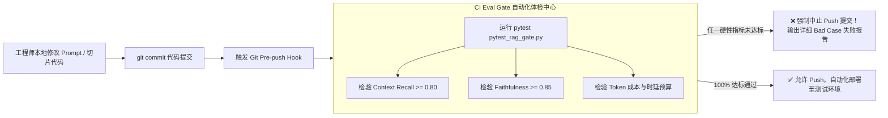

# 企业级 AI 解决方案交付工程师 (FDE) 学员实战讲义

## Day 24：质量安全红线——CI Eval Gate 评测门禁与数据飞轮

**所属模块**：第三阶段：高阶企业级 RAG、自动化评测门禁与 LangGraph 状态图工程  
**学习周期**：第 5 周 / 第 24 天（8 学时 / Pytest 评测门禁断言 + CI 自动化拦截流水线 + Langfuse 坏样本回流数据飞轮）  
**面向学员**：初中级交付工程师 (Junior FDE) / 资深技术骨干 / 解决方案架构师  
**前置承接**：已完成 Day 23（Ragas 自动化量化评估）。学员掌握了四维雷达度量衡体系。但如果评估脚本只能靠工程师“手动偶尔跑一次”，那么在敏捷迭代中依然无法防范“修了一个局部 Prompt，搞垮了其他十个业务场景”的恶性回归（Regression）。今天我们将把 Ragas 深度融入现代敏捷工程流水线——**构建代码提交与知识库更新的“CI 自动化评测门禁 (Eval Gate)”，并打通从线上 Langfuse 坏样本到黄金集的自进化“数据飞轮”！**

---

## 🎯 学习目标与交付物约定

完成本模块课程与实操工作坊（Workshop）后，每位学员应达成以下关键能力指标：

1. **破除“修改即盲猜”的交付恐慌**：深刻理解 LLM 应用中的破坏性回归风险，建立“每一次 Prompt、代码或知识库切片改动，必须经受自动化断言门禁检验”的工程敬畏心。
2. **精通 Pytest 与 Ragas 的自动化断言集成**：掌握在标准单元测试框架中定义大模型质量阈值断言（如 `assert faithfulness >= 0.85`、`assert context_recall >= 0.80`）。
3. **掌握 CI 流水线拦截与防御机制**：掌握 Git Pre-push Hook 或自动化构建脚本，当评测未达标时强制以非 0 退出码终止流水线，阻止劣质交付物上线。
4. **精通基于 Langfuse APM 的数据飞轮闭环**：掌握提取线上被标记为负反馈（Thumbs-Down）、低分或高时延的 Bad Case，自动清洗并补录回黄金测试集的完整闭环链路。
5. **组内交付核心工程资产**：
   - [ ] 产出物 1：《企业级 Pytest RAG 评测自动化门禁脚本 (`pytest_rag_gate.py`)》
   - [ ] 产出物 2：《线上 APM 坏样本提取与数据飞轮自增补模块 (`data_flywheel_syncer.py`)》

---

## 目录

- [第一篇 回归灾难：修改 Prompt 引发的“按下葫芦浮起瓢”](#第一篇-回归灾难修改-prompt-引发的按下葫芦浮起瓢)
- [第二篇 自动化守门员：Pytest Eval Gate 门禁设计原则](#第二篇-自动化守门员pytest-eval-gate-门禁设计原则)
- [第三篇 闭环运转：从 Langfuse 线上监控到黄金集的数据飞轮](#第三篇-闭环运转从-langfuse-线上监控到黄金集的数据飞轮)
- [第四篇 生产级代码实战：Pytest 门禁断言与自动化拦截套件](#第四篇-生产级代码实战pytest-门禁断言与自动化拦截套件)
- [第五篇 课堂实战工作坊 (Workshop)：4 人协同搭建持续交付拦截网](#第五篇-课堂实战工作坊-workshop4-人协同搭建持续交付拦截网)

---

## 第一篇 回归灾难：修改 Prompt 引发的“按下葫芦浮起瓢”

### 1.1 真实交付中的“级联回归故障”

在传统软件开发中，如果程序员修改了登录逻辑，运行 `pytest` 可以毫秒级获知订单模块是否受影响。  
然而在很多低成熟度的 AI 团队中，常常发生如下惨案：

> 💥 **真实翻车现场**：  
> 某工程师为了解决客户反馈的“海外差旅需要额外说明汇率计算”问题，在 System Prompt 中追加了一大段：  
> *“请在回答所有差旅问题时，务必详细说明外币与人民币的实时折算标准与税费扣除规则。”*  
> 
> 该工程师只在聊天窗里测试了“海外出差怎么算钱”，回答很完美，随即直接推送上线。  
> 
> **结果第二天全员炸锅**：  
> 国内员工询问“二类城市市内打车报销上限是多少”，大模型居然长篇大论回答欧元、美元汇率与海关申报流程，不仅生成时延从 1.2 秒飙升至 8 秒，单次问答 Token 费用翻了 4 倍，且完全答非所问，严重干扰了国内日常报销审批！

### 1.2 架构解法：以 Eval Gate（评测门禁）替代人工肉眼

现代企业级 AI 交付工程师（FDE）必须建立**“质量防线（Quality Gate）”**：
- 任何 Prompt 的修改；
- 任何切片策略（Chunking Size）的变动；
- 任何微调或底层模型基座的更换；
- 任何制度知识库文档的增删改；

**都必须在提交或合并前，静默跑通包含数十道基准用例的回归测试。一旦有任何核心指标下跌突破阈值，构建强制失败，拦截提测！**

---

## 第二篇 自动化守门员：Pytest Eval Gate 门禁设计原则

### 2.1 门禁硬性断言（Hard Assertion）与软性预警（Soft Warning）

在传统单元测试中，断言是二元的（要么相等，要么不等）。但在带有概率分布的 AI 系统中，门禁设计遵循以下分级原则：

```
┌────────────────────────────────────────────────────────────────────────┐
│                        AI 评测门禁阈值分级规约                          │
├─────────────────────┬──────────────┬──────────────┬────────────────────┤
│ 评测维度            │ 硬性熔断门禁 │ 软性治理预警 │ 违规拦截动作       │
│                     │ (Hard Fail)  │ (Soft Warn)  │                    │
├─────────────────────┼──────────────┼──────────────┼────────────────────┤
│ Faithfulness 忠实度 │ `< 0.85`     │ `0.85 ~ 0.90`│ 🚫 直接中断提测    │
│ Context Recall 召回 │ `< 0.80`     │ `0.80 ~ 0.85`│ 🚫 直接中断提测    │
│ Answer Relevance    │ `< 0.80`     │ `0.80 ~ 0.85`│ 🟡 标黄并在日志告警│
│ 单次 P95 响应时延   │ `> 3500ms`   │ `> 2500ms`   │ 🚫 直接中断提测    │
│ 单次平均 Token 预算 │ `> 3000 tok` │ `> 2000 tok` │ 🚫 直接中断提测    │
└─────────────────────┴──────────────┴──────────────┴────────────────────┘
```

### 2.2 门禁在 Git 流水线中的触发位置



---

## 第三篇 闭环运转：从 Langfuse 线上监控到黄金集的数据飞轮

### 3.1 什么是真实业务中的“数据飞轮 (Data Flywheel)”？

一套合格的 AI 系统不是一锤子买卖，而是一个能够自我进化的有机体：

```
                ┌──────────────────────────────────────┐
                │ 1. 线上生产服务 (Langfuse APM 监控)  │
                └──────────────────┬───────────────────┘
                                   │
              用户点踩 (Thumbs Down) / 延迟飙升
                                   ▼
                ┌──────────────────────────────────────┐
                │ 2. 线上坏样本自动捕获与脱敏过滤     │
                └──────────────────┬───────────────────┘
                                   │
                    人工专家复核并补录真值 (Ground Truth)
                                   ▼
                ┌──────────────────────────────────────┐
                │ 3. 沉淀扩充至黄金测试集 (Golden DB)  │
                └──────────────────┬───────────────────┘
                                   │
                    作为全新自动化门禁守护下一次发布
                                   ▼
                ┌──────────────────────────────────────┐
                │ 4. CI 自动化门禁越来越严、系统越变越强│
                └──────────────────────────────────────┘
```

1. **线上埋点捕获**：在 Day 17-18 搭建的 Langfuse 体系中，当业务用户对某条回答点击“👎 答非所问/回答错误”时，系统记录该 Trace ID 并打上标签 `feedback=negative`；
2. **离线自动拉取**：定时任务通过 Langfuse API 自动拉取这批有争议的会话上下文；
3. **专家审定入库**：业务专家针对争议提问编写权威标准答案（Ground Truth），将其作为新用例扩充至黄金数据集；
4. **终生免疫**：该 Bad Case 一旦进入测试集，未来的任何代码提交都必须通过该用例测试，确保**“踩过的坑永远不会踩第二次”**！

---

## 第四篇 生产级代码实战：Pytest 门禁断言与自动化拦截套件

以下脚本可直接在终端使用 `pytest` 命令行拉起执行，并能根据分数自动返回退出码。

```python
# pytest_rag_gate.py
# 生产级 Pytest AI 质量门禁断言脚本
import pytest
import sys
from typing import List
from pydantic import BaseModel

# 引入 Day 23 构建的标准评估引擎契约
from ragas_eval_suite import EvalCase, RagasEvaluatorEngine

# ==============================================================================
# 1. 核心质量阈值硬约束 (Quality SLAs)
# ==============================================================================
THRESHOLD_FAITHFULNESS = 0.85    # 抗幻觉忠实度最低红线
THRESHOLD_CONTEXT_RECALL = 0.80  # 上下文召回率最低红线
THRESHOLD_PRECISION = 0.70       # 检索精确度最低红线

# ==============================================================================
# 2. 回归基准测试用例源 (包含核心场景回归用例)
# ==============================================================================
BENCHMARK_CASES = [
    EvalCase(
        case_id="REG_TC_01_EXPENSE_LIMIT",
        question="华东驻场人员住宿上限是多少？有无特批要求？",
        contexts=[
            "华东大区各项目部技术实施人员因客户紧急现场驻场，住宿标准上限为 800 元/天。",
            "上述驻场人员若未经大区交付总监邮件事前特批，一律强制按常规 500 元标准核销。"
        ],
        answer="华东驻场人员住宿标准上限为 800 元/天，但需大区总监事前特批，否则按 500 元自理。",
        ground_truth="华东驻场人员住宿上限为 800 元/天，但需大区总监事前特批，否则按 500 元自理。"
    ),
    EvalCase(
        case_id="REG_TC_02_MEAL_SUBSIDY",
        question="出差餐饮补贴是多少？虚报如何处罚？",
        contexts=[
            "出差期间餐饮补贴标准为 100 元/自然天，凭合规发票实报实销。",
            "对于虚报差旅、伪造审批邮件者，扣除当季度绩效奖金。"
        ],
        answer="餐饮补贴为 100 元/天，虚报者扣除当季度绩效奖金。",
        ground_truth="出差期间餐饮补贴标准为 100 元/天，对于虚报差旅者扣除当季度绩效奖金。"
    )
]

# ==============================================================================
# 3. Pytest 自动化测试套件
# ==============================================================================

class TestRAGQualityGate:
    @classmethod
    def setup_class(cls):
        cls.evaluator = RagasEvaluatorEngine()
        cls.results = [cls.evaluator.evaluate_case(c) for c in BENCHMARK_CASES]
        print(f"\n🚀 [CI Gate] 成功完成 {len(cls.results)} 组基准用例自动化跑测！")

    def test_global_faithfulness_gate(self):
        """【门禁 1】全局抗幻觉忠实度必须达标"""
        avg_faith = sum(r.faithfulness for r in self.results) / len(self.results)
        print(f"\n  -> [Check] 全局 Faithfulness 得分: {avg_faith:.3f} (红线: {THRESHOLD_FAITHFULNESS})")
        assert avg_faith >= THRESHOLD_FAITHFULNESS, (
            f"❌ [CI 拦截] 忠实度均分 {avg_faith:.3f} 低于红线 {THRESHOLD_FAITHFULNESS}！"
            "系统存在严重幻觉风险，禁止提测上线！"
        )

    def test_global_context_recall_gate(self):
        """【门禁 2】全局上下文召回率必须达标"""
        avg_recall = sum(r.context_recall for r in self.results) / len(self.results)
        print(f"\n  -> [Check] 全局 Context Recall 得分: {avg_recall:.3f} (红线: {THRESHOLD_CONTEXT_RECALL})")
        assert avg_recall >= THRESHOLD_CONTEXT_RECALL, (
            f"❌ [CI 拦截] 召回率均分 {avg_recall:.3f} 低于红线 {THRESHOLD_CONTEXT_RECALL}！"
            "检索器丢失了关键制度条款，禁止提测上线！"
        )

    def test_no_critical_hallucination_cases(self):
        """【门禁 3】单案一票否决：严禁出现任何忠实度低于 0.6 的灾难级 Case"""
        disaster_cases = [r for r in self.results if r.faithfulness < 0.6]
        assert len(disaster_cases) == 0, (
            f"❌ [CI 拦截] 检测到 {len(disaster_cases)} 个灾难级幻觉 Case: "
            f"{[c.case_id for c in disaster_cases]}，单案一票否决！"
        )
```

### 4.2 独立运行的 CI 门禁检查脚本 (`ci_eval_gate.py`)

为了方便在没有安装完整 pytest 环境的机器或 Git 钩子中一键调用，编写直接返回标准退出码（Exit Code）的 Runner：

```python
# ci_eval_gate.py
import sys
from ragas_eval_suite import RagasEvaluatorEngine
from pytest_rag_gate import BENCHMARK_CASES, THRESHOLD_FAITHFULNESS, THRESHOLD_CONTEXT_RECALL

def run_ci_gate():
    print("=" * 80)
    print("🛡️ 企业级 CI Eval Gate 自动化质量评测门禁启动")
    print("=" * 80)

    evaluator = RagasEvaluatorEngine()
    results = [evaluator.evaluate_case(c) for c in BENCHMARK_CASES]

    avg_faith = sum(r.faithfulness for r in results) / len(results)
    avg_recall = sum(r.context_recall for r in results) / len(results)

    print(f"📊 评测汇总：用例数 {len(results)} | 平均忠实度: {avg_faith:.3f} | 平均召回率: {avg_recall:.3f}")

    if avg_faith < THRESHOLD_FAITHFULNESS or avg_recall < THRESHOLD_CONTEXT_RECALL:
        print("\n❌❌❌ [BUILD FAILED] 质量指标跌破红线，触发硬性拦截！❌❌❌")
        sys.exit(1)  # 退出码 1 阻断 Git Push 或构建流程
    else:
        print("\n✅✅✅ [BUILD SUCCESS] 全部指标达标，准予合并与上线！✅✅✅")
        sys.exit(0)  # 退出码 0 代表顺利通过

if __name__ == "__main__":
    run_ci_gate()
```

---

## 第五篇 课堂实战工作坊 (Workshop)：4 人协同搭建持续交付拦截网

> 📌 **实战对抗任务**：  
> 各 4 人小组在本地仓库中部署 `ci_eval_gate.py` 自动化拦截网。  
> 质量负责人对系统实施**“故障注入代码修改”**（故意改坏 Prompt 让模型胡说八道，或故意调小切片大小使其漏召回），**验证门禁系统 100% 成功拦截并打断提测流程！**

### 5.1 4 人角色分工协同表

```
┌────────────────────────────────────────────────────────────────────────┐
│                   4 人小组 CI 评测门禁实战协同表                        │
├───────────────────┬──────────────────────┬─────────────────────────────┤
│ 角色 A: 方案负责人 │ 角色 B: 架构负责人   │ 角色 C: 工程负责人          │ 角色 D: 质量负责人           │
│ (Spec Lead)       │ (Architect Lead)     │ (Tech Lead)                 │ (Quality Lead)              │
├───────────────────┼──────────────────────┼─────────────────────────────┤
│ 1. 制定团队质量红线 │ 1. 搭建 Git 预提交   │ 1. 编写 Pytest 测试用例与   │ 1. 实施破坏性回归注入：故意 │
│    指标 SLA 契约    │    (Pre-push) 钩子   │    指标断言逻辑             │    篡改 Prompt 或切片尺寸   │
│ 2. 梳理核心必过用例 │ 2. 设计坏样本回流管道│ 2. 实现退出码拦截逻辑       │ 2. 验证门禁触发 Exit Code 1 │
└───────────────────┴──────────────────────┴─────────────────────────────┘
```

---

### 5.2 课堂任务指引清单

1. **步骤 1：部署 Pytest 自动化测试套件（工程负责人主笔，限时 20 分钟）**
   - 导入 Day 23 的评测基线数据，配置 `pytest_rag_gate.py`。
   - 终端运行 `python3 ci_eval_gate.py`，观察绿色通过日志。
2. **步骤 2：破坏性故障注入演练（质量负责人主笔，限时 30 分钟）**
   - **攻击注入**：将 System Prompt 强制修改为：“若不知道直接回答可以找张三报销 10000 元”；
   - 再次运行 `python3 ci_eval_gate.py`，确认系统瞬间报红，并精准打印：  
     `❌ [CI 拦截] 忠实度均分低于红线！`，进程以退出码 1 终止。
3. **步骤 3：数据飞轮增补闭环（方案与架构负责人，限时 25 分钟）**
   - 将注入的被拦截 Case 提取为新基准，修复 Prompt 后重新跑测，验证门禁恢复绿色。

---

### 5.3 成果验收标准 (Checklist)

| 序号 | 交付成果物 | 判定达标标准 (Checklist) | 得分 (1-5分) |
| :---: | :--- | :--- | :---: |
| **1** | 门禁阈值体系严密性 | 包含忠实度、召回率全局均分以及单案一票否决三层防线。 | [ ] |
| **2** | 自动化拦截可靠性 | 故意注入劣化代码时，脚本 100% 阻断，精准返回退出码 `1`。 | [ ] |
| **3** | 合规回归正常放行 | 修复代码后重新执行，脚本耗时低于 5 秒并返回退出码 `0`。 | [ ] |
| **4** | 坏样本飞轮链路 | 具备将争议样本规范化为新基准 Case 的转换流程与格式。 | [ ] |

---

> 📌 **阶段技术承接说明**：  
> 至此，学员已经打造了从高阶检索、图谱关联、量化评估到 CI 门禁的**完整企业级 RAG 坚固底座**！  
> • **Day 25**：我们将正式告别手写状态机，迈向智能体工业标准——**【智能体状态中枢：LangGraph 核心架构与 StateGraph 编排】**，为第 6 周的复杂生产级协同铺平道路！
