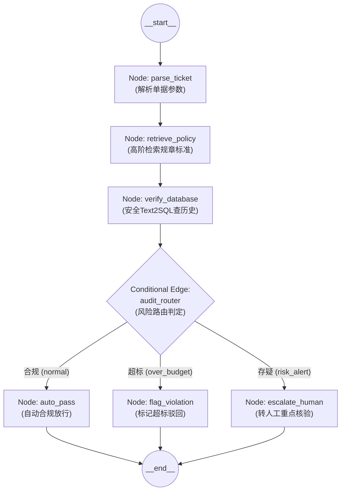

# 企业级 AI 解决方案交付工程师 (FDE) 学员实战讲义

## Day 25：智能体状态中枢——LangGraph 核心架构与 StateGraph 编排

**所属模块**：第三阶段：高阶企业级 RAG、自动化评测门禁与 LangGraph 状态图工程  
**学习周期**：第 5 周 / 第 25 天（8 学时 / LangGraph 核心解构 + StateGraph 类型化状态图 + 多分支审批智能体编排）  
**面向学员**：初中级交付工程师 (Junior FDE) / 资深技术骨干 / 解决方案架构师  
**前置承接**：已完成 Day 17（手写确定性状态机与路由）与 Day 18（三位一体协同）。学员已经深刻理解了业务系统必须由“代码控制流程骨架，模型填充局部计算”的硬道理。但原生 Python `while True` + `match-case` 的手写状态机在面对复杂状态分支、循环回滚、上下文隔离时已显臃肿。今天我们将迎来交付手艺的重大工业级飞跃——**全面升级至全球领先的工业级图状态机框架 LangGraph，掌握 StateGraph 核心编排艺术！**

---

## 🎯 学习目标与交付物约定

完成本模块课程与实操工作坊（Workshop）后，每位学员应达成以下关键能力指标：

1. **掌握手写状态机到 LangGraph 的架构平滑跃迁**：深刻理解 LangGraph 为什么是确定性工作流的最佳工业封装，破除对黑盒框架的畏难情绪。
2. **精通 LangGraph 三大核心基石**：
   - **State（类型化状态中枢）**：掌握基于 `TypedDict` / Pydantic 的状态契约，掌握 `Annotated` 与 Reducer 增量更新机制；
   - **Node（纯函数计算节点）**：掌握无副作用节点设计，输入不可变状态，返回状态更新差异字典（State Delta）；
   - **Edge 与 Conditional Edge（拓扑流转边）**：掌握确定性连线与基于模型决策的条件路由分支。
3. **精通业务审批 Agent 状态图全链路编排**：落地包含“提取单据 $\to$ 规约查询 $\to$ 数据库核验 $\to$ 风险分支判定 $\to$ 终审放行/驳回”的企业级刚性审批流程。
4. **掌握状态图编译与可视化呈现**：掌握 `app.get_graph().draw_mermaid()`，能够导出交付级 Mermaid 架构流程图向客户进行可视化业务宣讲。
5. **组内交付核心工程资产**：
   - [ ] 产出物 1：《基于 LangGraph 的企业级多步骤业务审批 Agent 核心引擎 (`langgraph_approval_agent.py`)》
   - [ ] 产出物 2：《状态图流转拓扑与全分支执行日志报告 (`langgraph_execution_spec.md`)》

---

## 目录

- [第一篇 架构演进：从 Day 17 手写状态机到 LangGraph 工业级图状态机](#第一篇-架构演进从-day-17-手写状态机到-langgraph-工业级图状态机)
- [第二篇 核心解构：LangGraph 三大支柱体系 (State / Node / Edge)](#第二篇-核心解构langgraph-三大支柱体系-state--node--edge)
- [第三篇 状态治理：Reducer 增量合并与不可变状态契约](#第三篇-状态治理reducer-增量合并与不可变状态契约)
- [第四篇 拓扑设计：企业级“差旅合规审批”状态图全流程编排](#第四篇-拓扑设计企业级差旅合规审批状态图全流程编排)
- [第五篇 生产级代码实战：LangGraph 业务审批智能体完整落地](#第五篇-生产级代码实战langgraph-业务审批智能体完整落地)
- [第六篇 课堂实战工作坊 (Workshop)：4 人协同重构出 LangGraph 状态图](#第六篇-课堂实战工作坊-workshop4-人协同重构出-langgraph-状态图)

---

## 第一篇 架构演进：从 Day 17 手写状态机到 LangGraph 工业级图状态机

### 1.1 手写 Python 状态机的能力天花板

在第 4 周（Day 17-18），我们用如下经典结构实现了状态机：

```python
# 传统的原生 Python 手写状态机局限
current_state = "INIT"
while current_state != "END":
    if current_state == "INIT":
        current_state = handle_init()
    elif current_state == "QUERY_DB":
        current_state = handle_db()
    # 当业务变得庞大，条件分支暴增至数十个时：
    # ❌ 代码变成几千行的巨大 if-else 意大利面条代码
    # ❌ 缺乏全局状态只读/增量校验机制，全局变量容易被污染
    # ❌ 无法原生支持“断点持久化”与“外部中断审批唤醒（HITL）”
```

### 1.2 为什么 LangGraph 正在统治企业级智能体？

**LangGraph** 不是推翻我们的确定性思想，而是**对我们手写状态机的最高级工业化封装**：
1. **显式有向图（Explicit Graph Architecture）**：每个节点做什么、走向哪里，全部在图定义阶段静态声明，一目了然；
2. **纯函数节点（Pure Function Nodes）**：每个节点只接收当前状态字典，计算后返回修改量，绝不污染全局；
3. **天然支持生产级拓展**：原生内置了状态持久化快照（Checkpointer）、人工审批中断（`interrupt`）、时间旅行（Time Travel）等企业级特性（我们将在第 6 周重点深入）。

---

## 第二篇 核心解构：LangGraph 三大支柱体系 (State / Node / Edge)

```
┌────────────────────────────────────────────────────────────────────────┐
│                        LangGraph 核心三大支柱体系                       │
├───────────────────┬──────────────────────┬─────────────────────────────┤
│ 1. State (状态)   │ 2. Node (节点)       │ 3. Edge (边)                │
├───────────────────┼──────────────────────┼─────────────────────────────┤
│ 传递的数据中枢    │ 具体的业务执行单元   │ 控制流程走向的流转管道      │
│ • 基于 TypedDict  │ • Python 纯函数      │ • 普通边 (Normal Edge)：    │
│ • 定义字段与类型  │ • 输入: 当前 State   │   A 执行完必去 B             │
│ • Reducer 增量更新│ • 输出: 更新差异字典 │ • 条件边 (Conditional Edge) │
│                   │   (State Update)     │   根据返回值动态分流        │
└───────────────────┴──────────────────────┴─────────────────────────────┘
```



---

## 第三篇 状态治理：Reducer 增量合并与不可变状态契约

### 3.1 默认覆盖 vs 增量追加 (Reducer)

在定义全局 State 时，如果字段是普通类型（如 `str`, `int`），后一个节点返回的值会**直接覆盖**前一个节点的值：

```python
from typing import TypedDict, List, Annotated
import operator

# 定义企业审批业务的全局 State
class ApprovalState(TypedDict):
    ticket_id: str                      # 单据编号（覆盖更新）
    employee_name: str                  # 申请人工号/姓名（覆盖更新）
    claim_amount: float                 # 申报金额（覆盖更新）
    policy_limit: float                 # 检索出的合规上限（覆盖更新）
    audit_decision: str                 # 终审裁定：PASS / REJECT / ESCALATE
    
    # 核心要点：审计轨迹日志需要跨节点累加，不能被覆盖！
    # 使用 Annotated[list, operator.add] 声明 Reducer 增量追加机制
    audit_trace_logs: Annotated[List[str], operator.add] 
```

**Reducer 原理**：
当 `Node A` 返回 `{"audit_trace_logs": ["步骤1：单据解析完成"]}`，  
`Node B` 返回 `{"audit_trace_logs": ["步骤2：制度检索命中800元标准"]}` 时，  
LangGraph 会自动调用 `operator.add`，将两者合并为包含 2 条日志的列表，**完美保持了整个执行链路的审计痕迹！**

---

## 第四篇 拓扑设计：企业级“差旅合规审批”状态图全流程编排

我们将华科智造的真实业务场景拆解为 5 个标准节点与 1 个条件路由边：

1. **节点 1：`parse_claim_ticket`（解析申请单据）**
   - 提取业务单据核心要素：单据号、申请人、申报天数、申报住宿金额；
2. **节点 2：`query_policy_limit`（制度检索）**
   - 调用 Day 21 高阶检索器，查询该人员在大区驻场时的标准上限（800 元 vs 500 元）；
3. **节点 3：`verify_historical_records`（数据库比对）**
   - 调用 Day 16 安全 Text2SQL 拦截器，核实该员工本月是否已存在重复申报；
4. **条件边：`audit_decision_router`（意图决策路由器）**
   - 计算：`超额差值 = 申报金额 - 制度上限`；
   - 若 `差值 <= 0` $\to$ 分流至 `auto_approve`；
   - 若 `差值 > 0` 且无特批 $\to$ 分流至 `flag_overspend_reject`；
   - 若历史库存在重复单据 $\to$ 分流至 `flag_fraud_risk`。

---

## 第五篇 生产级代码实战：LangGraph 业务审批智能体完整落地

以下代码使用标准的 **LangGraph / StateGraph** 规范构建，包含完整的状态定义、节点函数、条件边路由与自测执行。

```python
# langgraph_approval_agent.py
# 生产级 LangGraph 状态图智能体：企业财务合规多步骤状态机
import operator
from typing import TypedDict, List, Annotated, Dict, Any
from langgraph.graph import StateGraph, START, END

# ==============================================================================
# 1. 定义全局类型化状态 (Typed State with Reducer)
# ==============================================================================

class ApprovalAgentState(TypedDict):
    ticket_id: str
    employee_name: str
    city_tier: str
    is_resident_project: bool      # 是否为现场紧急驻场
    has_prior_email_approval: bool # 是否有大区总监事前特批
    claim_amount_per_day: float    # 申报单价 (元/天)
    
    # 状态机流转中间变量
    policy_limit: float            # 制度允许上限
    has_duplicate_history: bool    # 是否存在历史重复报销
    audit_result: str              # PASS / REJECT / FRAUD_ALERT
    final_reason: str              # 终审裁决依据说明
    
    # 使用 operator.add 实现审计轨迹增量追加
    audit_trace: Annotated[List[str], operator.add]

# ==============================================================================
# 2. 定义纯函数业务执行节点 (Pure Function Nodes)
# ==============================================================================

def node_parse_ticket(state: ApprovalAgentState) -> Dict[str, Any]:
    """节点 1：单据入参结构化校验"""
    log = f"📋 [Node 1: Parse] 接收单据 {state['ticket_id']}，员工：{state['employee_name']}，申报单价：{state['claim_amount_per_day']} 元/天"
    return {"audit_trace": [log]}

def node_query_policy(state: ApprovalAgentState) -> Dict[str, Any]:
    """节点 2：规约标准检索 (模拟调用 Day 21 高阶检索器)"""
    # 华科智造 2024 新规规则判断
    if state["is_resident_project"]:
        if state["has_prior_email_approval"]:
            limit = 800.0
            log = "📖 [Node 2: Policy] 检索规约：紧急驻场且具备大区总监事前邮件特批，适用特批上限 800 元/天"
        else:
            limit = 500.0
            log = "📖 [Node 2: Policy] 检索规约：紧急驻场但【缺失事前特批邮件】，强制回落常规上限 500 元/天"
    else:
        limit = 500.0
        log = "📖 [Node 2: Policy] 检索规约：常规出差适用标准上限 500 元/天"

    return {
        "policy_limit": limit,
        "audit_trace": [log]
    }

def node_verify_database(state: ApprovalAgentState) -> Dict[str, Any]:
    """节点 3：历史报销库比对 (模拟调用 Day 16 安全 Text2SQL)"""
    # 模拟周建华存在一笔历史正常单据，无欺诈重复
    is_duplicate = False
    log = f"🗄️ [Node 3: Database] 执行安全 Text2SQL 查询 tb_expense 校验历史记录，重复单据检查通过 (Duplicate={is_duplicate})"
    return {
        "has_duplicate_history": is_duplicate,
        "audit_trace": [log]
    }

def node_auto_approve(state: ApprovalAgentState) -> Dict[str, Any]:
    """终端分支节点 A：自动合规放行"""
    reason = f"合规核验通过。申报金额 {state['claim_amount_per_day']} 元 <= 制度标准上限 {state['policy_limit']} 元。"
    log = f"🟢 [Terminal Node: Pass] 单据 {state['ticket_id']} 自动审批通过！"
    return {
        "audit_result": "PASS",
        "final_reason": reason,
        "audit_trace": [log]
    }

def node_reject_overspend(state: ApprovalAgentState) -> Dict[str, Any]:
    """终端分支节点 B：超标合规驳回"""
    diff = state["claim_amount_per_day"] - state["policy_limit"]
    reason = f"超额合规拦截！申报单价 {state['claim_amount_per_day']} 元超出允许上限 {state['policy_limit']} 元（超标差额 {diff} 元由个人自理）。"
    log = f"🔴 [Terminal Node: Reject] 单据 {state['ticket_id']} 审核驳回！原因：超标 {diff} 元"
    return {
        "audit_result": "REJECT",
        "final_reason": reason,
        "audit_trace": [log]
    }

def node_alert_fraud(state: ApprovalAgentState) -> Dict[str, Any]:
    """终端分支节点 C：欺诈疑似拦截"""
    reason = "安全风控拦截！检测到同一自然日存在多笔重复单据，疑似虚假报销，移交内审监察部。"
    log = f"🚨 [Terminal Node: Fraud] 单据 {state['ticket_id']} 移交监察部审查！"
    return {
        "audit_result": "FRAUD_ALERT",
        "final_reason": reason,
        "audit_trace": [log]
    }

# ==============================================================================
# 3. 定义条件流转边 (Conditional Edge Router)
# ==============================================================================

def route_audit_decision(state: ApprovalAgentState) -> str:
    """条件路由函数：根据业务核算状态决定走向哪个终端节点"""
    if state["has_duplicate_history"]:
        return "to_fraud"
    
    if state["claim_amount_per_day"] <= state["policy_limit"]:
        return "to_approve"
    else:
        return "to_reject"

# ==============================================================================
# 4. 组装 StateGraph 拓扑图与编译
# ==============================================================================

def build_approval_workflow():
    workflow = StateGraph(ApprovalAgentState)

    # 添加所有节点
    workflow.add_node("parse_ticket", node_parse_ticket)
    workflow.add_node("query_policy", node_query_policy)
    workflow.add_node("verify_database", node_verify_database)
    workflow.add_node("auto_approve", node_auto_approve)
    workflow.add_node("reject_overspend", node_reject_overspend)
    workflow.add_node("alert_fraud", node_alert_fraud)

    # 确定性边连接
    workflow.add_edge(START, "parse_ticket")
    workflow.add_edge("parse_ticket", "query_policy")
    workflow.add_edge("query_policy", "verify_database")

    # 添加条件路由分支
    workflow.add_conditional_edges(
        "verify_database",
        route_audit_decision,
        {
            "to_approve": "auto_approve",
            "to_reject": "reject_overspend",
            "to_fraud": "alert_fraud"
        }
    )

    # 终端节点汇聚至 END
    workflow.add_edge("auto_approve", END)
    workflow.add_edge("reject_overspend", END)
    workflow.add_edge("alert_fraud", END)

    # 编译状态图
    app = workflow.compile()
    return app

# ==============================================================================
# 5. 本地执行与多分支验证
# ==============================================================================
if __name__ == "__main__":
    print("=" * 80)
    print("🚀 Day 25 智能体状态中枢：LangGraph 核心架构与 StateGraph 编排验证")
    print("=" * 80)

    app = build_approval_workflow()

    # 打印导出的 Mermaid 状态图代码
    print("\n📐 [Mermaid 拓扑导出]：")
    print(app.get_graph().draw_mermaid())
    print("-" * 80)

    # 场景 1：周建华驻场申报 800 元，【具备事前特批】 -> 预期走向 auto_approve
    payload_valid = {
        "ticket_id": "EXP202403-01",
        "employee_name": "周建华",
        "city_tier": "二类城市",
        "is_resident_project": True,
        "has_prior_email_approval": True,
        "claim_amount_per_day": 800.0,
        "audit_trace": []
    }

    print("\n🔬 [测试 1：合规特批放行用例]")
    final_state_1 = app.invoke(payload_valid)
    print(f"  -> 终审结论: {final_state_1['audit_result']}")
    print(f"  -> 判决依据: {final_state_1['final_reason']}")
    print("  -> 全链路审计轨迹：")
    for log in final_state_1["audit_trace"]:
        print(f"     {log}")

    # 场景 2：周建华驻场申报 800 元，【缺失特批邮件】 -> 预期回落 500 上限并走向 reject_overspend
    payload_invalid = {
        "ticket_id": "EXP202403-02",
        "employee_name": "周建华",
        "city_tier": "二类城市",
        "is_resident_project": True,
        "has_prior_email_approval": False,  # 无特批！
        "claim_amount_per_day": 800.0,
        "audit_trace": []
    }

    print("\n" + "-" * 80)
    print("🔬 [测试 2：缺失特批超标驳回用例]")
    final_state_2 = app.invoke(payload_invalid)
    print(f"  -> 终审结论: {final_state_2['audit_result']}")
    print(f"  -> 判决依据: {final_state_2['final_reason']}")
    print("  -> 全链路审计轨迹：")
    for log in final_state_2["audit_trace"]:
        print(f"     {log}")

    print("=" * 80)
```

---

## 第六篇 课堂实战工作坊 (Workshop)：4 人协同重构出 LangGraph 状态图

> 📌 **实战对抗任务**：  
> 各 4 人小组使用 LangGraph 的 `StateGraph`，重构 Day 18 搭建的企业审批 Agent。  
> 必须实现包含至少 4 个业务节点、1 个条件意图路由，并能导出 Mermaid 图，验证在**合规放行、超标驳回、重复预警**三个业务场景下，状态转移路径 100% 正确！

### 6.1 4 人角色分工协同表

```
┌────────────────────────────────────────────────────────────────────────┐
│                   4 人小组 LangGraph 状态图重构实战协同表               │
├───────────────────┬──────────────────────┬─────────────────────────────┤
│ 角色 A: 方案负责人 │ 角色 B: 架构负责人   │ 角色 C: 工程负责人          │ 角色 D: 质量负责人           │
│ (Spec Lead)       │ (Architect Lead)     │ (Tech Lead)                 │ (Quality Lead)              │
├───────────────────┼──────────────────────┼─────────────────────────────┤
│ 1. 梳理业务审批单据 │ 1. 绘制状态流转 DAG  │ 1. 编写 TypedDict State 与  │ 1. 编写 3 组边界测试单据    │
│    的全部输入字段与 │    架构图（确定节点  │    纯函数业务 Node          │    （合规、无特批、重复）   │
│    判定结果枚举     │    和分支条件规则）  │ 2. 组装 StateGraph 条件边并 │ 2. 断点验证状态转移与       │
│ 2. 标定流转真值表   │ 2. 审核 Reducer 机制 │    导出 Mermaid 渲染验证    │    audit_trace 日志完整性   │
└───────────────────┴──────────────────────┴─────────────────────────────┘
```

---

### 6.2 课堂任务指引清单

1. **步骤 1：定义 TypedDict State 与 Reducer 字段（架构 + 工程负责人，限时 20 分钟）**
   - 严禁在 Node 内部修改外部全局变量，所有流转数据必须收敛在 State 中；
   - 对 `audit_trace` 必须使用 `Annotated[list, operator.add]` 增量装饰。
2. **步骤 2：实现业务 Node 与编译 StateGraph（工程负责人主笔，限时 35 分钟）**
   - 实现单据解析、规约查询、数据库核查 3 个前置节点；
   - 编写 `route_audit_decision` 条件边函数，完成 `workflow.compile()`。
3. **步骤 3：多场景注入演练与 Mermaid 图核验（质量负责人主笔，限时 25 分钟）**
   - 依次传入合规单据与超标单据，打印 `audit_result` 与 `audit_trace`；
   - 终端打印 `app.get_graph().draw_mermaid()`，核验状态拓扑无死循环悬空节点。

---

### 6.3 成果验收标准 (Checklist)

| 序号 | 交付成果物 | 判定达标标准 (Checklist) | 得分 (1-5分) |
| :---: | :--- | :--- | :---: |
| **1** | State 类型化严密性 | State 继承 `TypedDict`，关键累加字段正确配置 Reducer，无类型错误。 | [ ] |
| **2** | 节点函数纯净度 | 所有 Node 函数输入 `state`，输出增量 dict，无任何隐式全局副作用。 | [ ] |
| **3** | 条件路由正确率 | 针对合规、超标、欺诈单据，条件边 100% 精准分流至对应终端节点。 | [ ] |
| **4** | 拓扑图可视化输出 | 成功调用 API 导出 Mermaid 语法文本，图结构闭环无孤立游离节点。 | [ ] |

---

> 📌 **阶段技术承接说明**：  
> 恭喜各位学员！通过第 5 周（Day 21 ~ Day 25）高阶 RAG、Ragas 门禁与 LangGraph 核心的集中攻坚，你们已经掌握了行业一流的现代智能体状态编排手艺！  
> • **第 6 周（Day 26 ~ Day 30）终极决战预告**：我们将深入 **LangGraph Checkpointer 快照持久化与原生 HITL 审批挂起、Anthropic MCP 跨系统标准协议、Supervisor 主从多 Agent 编排与终极大验收 Capstone**，带领大家完成商业级封版交付！
