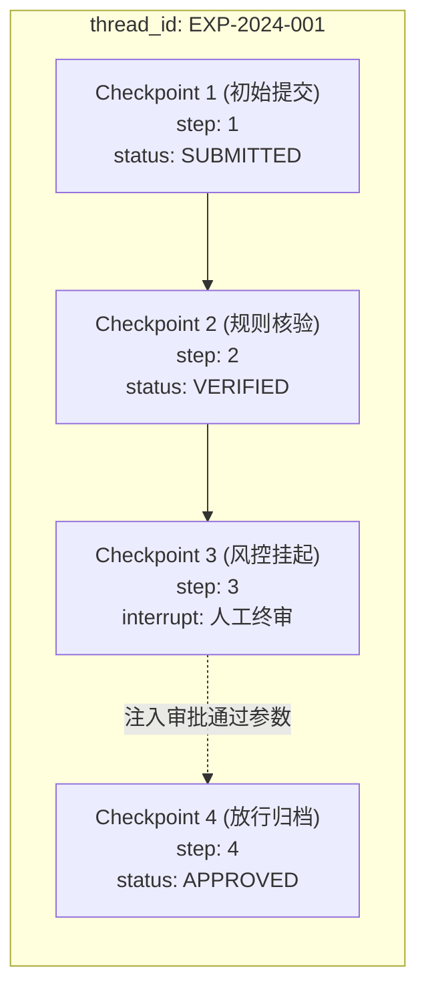

# 企业级 AI 解决方案交付工程师 (FDE) 学员实战讲义

## Day 26：LangGraph 生产双璧——Checkpointer 快照持久化与原生 HITL 审批

**所属模块**：第四阶段：MCP 协议扩展、企业级多智能体系统 (MAS) 与 AI 治理架构  
**学习周期**：第 6 周 / 第 26 天（8 学时 / LangGraph Checkpointer 持久化 + 原生中断 interrupt + 人机回环 HITL 审批 + 时间旅行 Time-Travel 调试）  
**面向学员**：初中级交付工程师 (Junior FDE) / 资深技术骨干 / 解决方案架构师  
**前置承接**：已完成 Day 25（LangGraph 核心架构与 StateGraph 编排）。学员已掌握图状态机基本拓扑（State/Node/Edge）。然而在企业真实生产环境中，单次进程内存运行极其脆弱——“服务器宕机重启状态丢失”、“涉及财务资金审批需要人工审核挂起数小时甚至数天”、“线上执行偏离需要回滚重试”。今天我们将全面攻坚让 LangGraph 真正具备“企业生产级韧性”的底层双璧——**Checkpointer 状态持久化快照与原生 Human-in-the-Loop (HITL) 动态挂起唤醒技术！**

---

## 🎯 学习目标与交付物约定

完成本模块课程与实操工作坊（Workshop）后，每位学员应达成以下关键能力指标：

1. **破除内存单点故障认知，掌握 Checkpointer 持久化架构**：
   - 深刻理解 `MemorySaver` 与生产级持久化（如 `SqliteSaver` / `PostgresSaver`）的机制差异；
   - 掌握 `thread_id` 会话隔离与多版本快照（Checkpoints）版本树设计。
2. **精通 LangGraph 原生 Human-in-the-Loop (HITL) 机制**：
   - 掌握现代 LangGraph 原生 `interrupt()` 函数调用机制，彻底淘汰老旧低效的硬编码断点；
   - 掌握外部输入动态注入（Resume Value）与人工裁决流转（通过/驳回/修改金额再提交）。
3. **精通时间旅行 (Time-Travel) 生产排错与状态分支重放**：
   - 能够通过 `app.get_state_history()` 检索任意历史快照点；
   - 能够使用 `app.update_state()` 实施状态热修补并实现“时光倒流重试”。
4. **组内交付核心工程资产**：
   - [ ] 产出物 1：《基于 Checkpointer 与原生中断的企业级 HITL 审批智能体 (`langgraph_hitl_agent.py`)》
   - [ ] 产出物 2：《快照持久化存储结构与状态流转审计日志 (`hitl_checkpoint_audit.md`)》

---

## 目录

- [第一篇 架构瓶颈：为什么企业级 Agent 必须拥有快照与人机回环？](#第一篇-架构瓶颈为什么企业级-agent-必须拥有快照与人机回环)
- [第二篇 核心解构：LangGraph Checkpointer 机制与版本树原理](#第二篇-核心解构langgraph-checkpointer-机制与版本树原理)
- [第三篇 核心解构：现代原生 interrupt() 中断与动态唤醒机制](#第三篇-核心解构现代原生-interrupt-中断与动态唤醒机制)
- [第四篇 生产进阶：Time-Travel（时间旅行）历史重放与状态热补丁](#第四篇-生产进阶time-travel时间旅行历史重放与状态热补丁)
- [第五篇 生产级代码实战：可持久化、可挂起审批的 LangGraph 完整工程](#第五篇-生产级代码实战可持久化可挂起审批的-langgraph-完整工程)
- [第六篇 课堂实战工作坊 (Workshop)：4 人协同开展断点恢复与异常回滚演练](#第六篇-课堂实战工作坊-workshop4-人协同开展断点恢复与异常回滚演练)

---

## 第一篇 架构瓶颈：为什么企业级 Agent 必须拥有快照与人机回环？

### 1.1 纯内存状态机的生产三大灾难

在很多演示级 Demo 中，智能体通常一气呵成跑完所有节点。但一旦部署至企业真实生产线，必定遭遇以下三大致命故障：

| 故障现象与灾难等级 | 生产级连环崩溃现场还原 |
| :--- | :--- |
| **生产灾难 1：容器重启即失联** | 审批流运行到第 4 步，K8s 容器因节点调度被触发重启，内存状态瞬间蒸发，客户几十万资金单据彻底变成死单。 |
| **生产灾难 2：异步长等待阻断线程** | 涉及超过 5 万元的大额特批必须等待部门副总裁签字，传统 `sleep` 或挂起进程会导致服务器线程池被死锁耗尽。 |
| **生产灾难 3：无法回滚热修补** | 大模型在中间某个环节提取金额出现幻觉（多写了个 0），无法回到错误节点修正，只能强制全流程重跑并浪费 Token。 |

### 1.2 工业级解法：快照外置化与确定性暂停

工业级高可用 AI 智能体必须满足两项硬性标准：
1. **每一个 Node 执行完毕后，全局 State 必须由底层的 Checkpointer 自动落盘**。任何时候发生网络断开或宕机，只要传入相同的 `thread_id`，系统就能从最近的一份 Checkpoint 原地满血复活！
2. **需要人工介入的节点，主动抛出中断信号并持久化当前快照，进程优雅退出**。直到数天后人工在前端页面点击“批准”并传入凭据，系统再次载入该快照并无缝恢复执行（Resume）。

---

## 第二篇 核心解构：LangGraph Checkpointer 机制与版本树原理

### 2.1 Checkpointer 的底层数据模型

LangGraph 的 Checkpointer 不仅保存单份最新状态，而是以 **版本链表 / 版本树** 形式记录全流程：



在持久化层，每个 Checkpoint 包含以下核心元数据（Metadata）：
- `thread_id`：全局业务会话唯一 ID（如单据编号 `EXP20240315-01`）；
- `checkpoint_ns`：命名空间，用于子图隔离；
- `checkpoint_id`：版本时间戳或自增序号（UUID/Timestamp）；
- `channel_values`：当时全局 State 的完整序列化快照（如各项表单值、消息列表）；
- `tasks`：挂起节点的执行堆栈与下一次待恢复目标节点。

---

## 第三篇 核心解构：现代原生 interrupt() 中断与动态唤醒机制

### 3.1 淘汰老版 `interrupt_before/after`，拥抱原生 `interrupt()`

在 LangGraph 较早版本中，需要在 compile 时硬编码指定 `interrupt_before=["approval_node"]`。这种做法缺乏灵活性，无法根据运行时的数据状态决定是否挂起。

**现代 LangGraph 原生机制**：在计算 Node 函数内部按需直接调用 `interrupt()`：

```python
from langgraph.types import interrupt

def financial_review_node(state: ApprovalState):
    amount = state["amount"]
    
    # 动态业务判定：小于 5000 元直接放行，超过 5000 元才触发中断
    if amount <= 5000:
        return {"review_status": "AUTO_PASSED", "reviewer": "SYSTEM_BOT"}
    
    # 触发原生挂起，向外部抛出审核工单 payload，并暂停执行！
    human_decision = interrupt({
        "task_name": "大额资金单据人工复核",
        "amount": amount,
        "applicant": state["applicant"],
        "reason": "单笔申报超过 5000 元企业合规红线，需终审人签字"
    })
    
    # 当外部唤醒该图并传入 resume 数据时，代码将从这里继续往下运行！
    # human_decision 接收到的就是外部传入的审批决议数据
    return {
        "review_status": human_decision.get("decision"),  # "PASSED" or "REJECTED"
        "reviewer": human_decision.get("approver_name"),
        "audit_comment": human_decision.get("comment", "")
    }
```

### 3.2 外部系统的交互闭环协议

| 阶段 | 交互主体与动作 | 状态图内部流转与数据行为 |
| :---: | :--- | :--- |
| **1** | **业务系统触发单据创建**<br>`app.invoke(input)` | 图从 `START` 开始运行至中断节点，自动将 Checkpoint 存入持久化存储。 |
| **2** | **节点执行 `interrupt()`**<br>状态图返回暂停状态 | 进程优雅返回，输出等待人工审核 payload；状态图进入挂起静止期，**0 CPU / 0 内存占用**。 |
| **3** | **人类领导在钉钉/企微点击**<br>“同意/驳回”并输入评语 | 前端将审批 payload 提交给后端服务，后端通过相同 `thread_id` 检索到断点。 |
| **4** | **系统调用 Resume 恢复**<br>`Command(resume=data)` | 状态机被唤醒，从中断处接收参数并继续执行，完成后续终审归档节点，直至到达 `END`。 |

---

## 第四篇 生产进阶：Time-Travel（时间旅行）历史重放与状态热补丁

在复杂的企业业务调试与线上纠错中，LangGraph 提供了业内独有的 **Time-Travel（时间旅行）** 机制：

1. **查阅全生命周期快照 (`get_state_history`)**：
   ```python
   for state_snapshot in app.get_state_history(config={"configurable": {"thread_id": "EXP-001"}}):
       print(state_snapshot.checkpoint_id, state_snapshot.values, state_snapshot.next)
   ```
2. **人工注入状态热修补 (`update_state`)**：
   如果前序节点由于大模型幻觉输出了错误参数（例如申报金额填错了），无需全流程推翻重来。交付工程师可直接定位到错误版本，注入修补补丁：
   ```python
   app.update_state(
       config={"configurable": {"thread_id": "EXP-001", "checkpoint_id": "target_ckpt_id"}},
       values={"amount": 800.0, "audit_flag": "MANUALLY_PATCHED"}
   )
   ```
3. **基于修补点重新派生流转（Forked Execution）**：
   修改后再次执行 `app.invoke(None, config=config)`，状态机将从被修补的时间节点重新分叉生长，实现安全纠错！

---

## 第五篇 生产级代码实战：可持久化、可挂起审批的 LangGraph 完整工程

以下提供一套**全自包含、基于 MemorySaver/SqliteSaver 且带有原生中断与人机审批**的生产级可运行套件。

```python
# langgraph_hitl_agent.py
# 生产级 LangGraph Checkpointer 持久化与原生 interrupt 审批智能体
import uuid
from typing import TypedDict, Annotated, Optional, Dict, Any, List
from langgraph.graph import StateGraph, START, END
from langgraph.checkpoint.memory import MemorySaver
from langgraph.types import interrupt, Command

# ==============================================================================
# 1. 业务状态模式定义 (TypedDict)
# ==============================================================================

class ApprovalState(TypedDict):
    ticket_id: str
    applicant: str
    department: str
    amount: float
    purpose: str
    policy_matched: str
    risk_level: str               # "LOW" (低风险自动放行) / "HIGH" (高风险需人工介入)
    approval_status: str          # "PENDING", "APPROVED", "REJECTED"
    approver: Optional[str]
    audit_comment: Optional[str]
    audit_logs: Annotated[List[str], lambda x, y: x + y]

# ==============================================================================
# 2. 核心图节点设计 (纯函数计算节点)
# ==============================================================================

def validate_and_rule_check_node(state: ApprovalState) -> Dict[str, Any]:
    """步骤 1：业务合规规则预审与风险定级"""
    amt = state["amount"]
    logs = [f"【合规初审】单据号 {state['ticket_id']} 进入核验，申报人：{state['applicant']}，金额：{amt} 元"]
    
    # 模拟企业制度规则前置匹配
    if amt <= 2000.0:
        logs.append("【合规初审】申报金额未超过常规 2000 元限额，风险等级评定为 LOW")
        return {
            "policy_matched": "《常规日常报销快速通道规约》",
            "risk_level": "LOW",
            "audit_logs": logs
        }
    else:
        logs.append(f"【合规初审】申报金额 {amt} 元超出 2000 元自动放行红线，触发合规风控，风险等级评定为 HIGH")
        return {
            "policy_matched": "《大额资金事前特批与连带责任条例》",
            "risk_level": "HIGH",
            "audit_logs": logs
        }

def route_decision(state: ApprovalState) -> str:
    """条件路由：低风险直接自动放行，高风险流转至人工终审中断节点"""
    if state["risk_level"] == "LOW":
        return "auto_approval_node"
    return "human_approval_node"

def auto_approval_node(state: ApprovalState) -> Dict[str, Any]:
    """步骤 2A：低风险自动审批节点"""
    logs = ["【系统自动放行】系统规则机审通过，已完成自动记账核销"]
    return {
        "approval_status": "APPROVED",
        "approver": "SYSTEM_AUTO_DISPATCH",
        "audit_comment": "常规额度系统机审合规，全自动放行通过",
        "audit_logs": logs
    }

def human_approval_node(state: ApprovalState) -> Dict[str, Any]:
    """步骤 2B：高风险人工中断节点（原生 interrupt 抛出挂起数据）"""
    # 组装展示给审批人（如钉钉/企业微信工作流卡片）的信息
    review_card = {
        "title": "⚠️ 发现大额资金申报，需要人工终审裁决",
        "ticket_id": state["ticket_id"],
        "applicant": state["applicant"],
        "department": state["department"],
        "amount": state["amount"],
        "reason": f"命中制度：{state['policy_matched']}，金额超标需人工介入"
    }

    # 🛑 核心技术：抛出中断并挂起！执行在此处暂停，等待外部人类操作
    human_response: Dict[str, Any] = interrupt(review_card)

    # 外部恢复 (Resume) 时从此处继续流转
    decision = human_response.get("action", "REJECTED")  # "APPROVED" or "REJECTED"
    approver_name = human_response.get("approver", "未知审批人")
    comment = human_response.get("comment", "无审批附言")

    status = "APPROVED" if decision == "APPROVED" else "REJECTED"
    logs = [f"【人工审批介入】终审人 [{approver_name}] 做出裁决：{status}，审批评语：{comment}"]

    return {
        "approval_status": status,
        "approver": approver_name,
        "audit_comment": comment,
        "audit_logs": logs
    }

def final_accounting_node(state: ApprovalState) -> Dict[str, Any]:
    """步骤 3：单据终审归档入库与财务通知"""
    if state["approval_status"] == "APPROVED":
        status_desc = "✅ 审批最终通过，款项进入银行出纳拨付队列"
    else:
        status_desc = "❌ 审批最终驳回，单据作废并已邮件通知申报人修改重提"

    logs = [f"【终审归档】单据 {state['ticket_id']} 状态终结：{status_desc}"]
    return {"audit_logs": logs}

# ==============================================================================
# 3. 构造状态图并挂载持久化 Checkpointer
# ==============================================================================

def build_production_approval_agent():
    builder = StateGraph(ApprovalState)

    # 添加各个业务节点
    builder.add_node("validate_node", validate_and_rule_check_node)
    builder.add_node("auto_approval_node", auto_approval_node)
    builder.add_node("human_approval_node", human_approval_node)
    builder.add_node("final_accounting_node", final_accounting_node)

    # 构建拓扑逻辑边
    builder.add_edge(START, "validate_node")
    builder.add_conditional_edges(
        "validate_node",
        route_decision,
        {
            "auto_approval_node": "auto_approval_node",
            "human_approval_node": "human_approval_node"
        }
    )
    builder.add_edge("auto_approval_node", "final_accounting_node")
    builder.add_edge("human_approval_node", "final_accounting_node")
    builder.add_edge("final_accounting_node", END)

    # 挂载 Checkpointer（生产环境可无缝替换为 SqliteSaver 或 PostgresSaver）
    checkpointer = MemorySaver()
    app = builder.compile(checkpointer=checkpointer)
    return app

# ==============================================================================
# 4. 模拟测试：验证自动放行与人工挂起唤醒全生命周期
# ==============================================================================

if __name__ == "__main__":
    print("=" * 80)
    print("🚀 Day 26 生产级 LangGraph：Checkpointer 持久化与原生中断审批实战")
    print("=" * 80)

    app = build_production_approval_agent()

    # --------------------------------------------------------------------------
    # 场景 1：低风险常规报销单（小额 1200 元，全自动流转）
    # --------------------------------------------------------------------------
    thread_config_1 = {"configurable": {"thread_id": "TICKET_AUTO_001"}}
    input_1: ApprovalState = {
        "ticket_id": "EXP-2024-001",
        "applicant": "张三",
        "department": "华东研发部",
        "amount": 1200.0,
        "purpose": "上海客户现场技术支持打车与差旅",
        "policy_matched": "",
        "risk_level": "",
        "approval_status": "PENDING",
        "approver": None,
        "audit_comment": None,
        "audit_logs": []
    }

    print("\n▶️ [测试 1] 提交低风险单据 (金额: 1200 元)...")
    res1 = app.invoke(input_1, config=thread_config_1)
    print(f"  ➔ 流程终态: {res1['approval_status']} (审批人: {res1['approver']})")
    for log in res1["audit_logs"]:
        print(f"     {log}")

    # --------------------------------------------------------------------------
    # 场景 2：高风险大额申报（金额: 30000 元，命中中断并暂停，模拟人工外部介入）
    # --------------------------------------------------------------------------
    thread_config_2 = {"configurable": {"thread_id": "TICKET_HIGH_002"}}
    input_2: ApprovalState = {
        "ticket_id": "EXP-2024-002",
        "applicant": "周建华",
        "department": "华东交付一部",
        "amount": 30000.0,
        "purpose": "华东重大项目现场紧急服务器设备采购与垫付",
        "policy_matched": "",
        "risk_level": "",
        "approval_status": "PENDING",
        "approver": None,
        "audit_comment": None,
        "audit_logs": []
    }

    print("\n▶️ [测试 2 - 阶段 A] 提交大额高风险单据 (金额: 30000 元)...")
    res2_phase1 = app.invoke(input_2, config=thread_config_2)

    # 检查状态图当前快照状态
    current_state = app.get_state(thread_config_2)
    print(f"  ➔ 状态机是否暂停挂起: {len(current_state.next) > 0 and 'human_approval_node' in current_state.next}")
    print(f"  ➔ 下一待执行节点: {current_state.next}")
    if current_state.tasks and current_state.tasks[0].interrupts:
        interrupt_info = current_state.tasks[0].interrupts[0].value
        print(f"  🛑 [系统捕获中断事件]: {interrupt_info['title']}")
        print(f"     单号: {interrupt_info['ticket_id']} | 申请人: {interrupt_info['applicant']} | 原因: {interrupt_info['reason']}")

    # --------------------------------------------------------------------------
    # 模拟外部经过数小时后，人类专家（监察委副主任赵小雪）在审批工作台点击“通过”
    # --------------------------------------------------------------------------
    print("\n▶️ [测试 2 - 阶段 B] 模拟外部终审人接入，执行 Resume 唤醒挂起流程...")
    human_approval_payload = {
        "action": "APPROVED",
        "approver": "监察委员会副主任赵小雪",
        "comment": "已核验合同及现场签收单，符合特殊采购绿色通道，准予特批放行。"
    }

    # 使用 Command(resume=...) 唤醒暂停的图，继续完成后续流转
    res2_phase2 = app.invoke(Command(resume=human_approval_payload), config=thread_config_2)
    print(f"  ➔ 唤醒后全流程状态: {res2_phase2['approval_status']}")
    print(f"  ➔ 最终经办审批人: {res2_phase2['approver']}")
    print("  📋 [完整审计跟踪链]：")
    for log in res2_phase2["audit_logs"]:
        print(f"     {log}")

    print("\n" + "=" * 80)
    print("✨ LangGraph Checkpointer 与原生 HITL 审批全生命周期闭环跑通！")
    print("=" * 80)
```

---

## 第六篇 课堂实战工作坊 (Workshop)：4 人协同开展断点恢复与异常回滚演练

在本次工作坊中，4 人学习小组将分工协同，对大额审批单据进行“中断注入、断点关机重连、人工修改金额 Time-Travel 重试”的生产级演练。

### 6.1 角色分工协同表

| 角色 | 主责学员 | 核心职责与任务 | 交付打卡项 |
| :--- | :--- | :--- | :--- |
| **方案负责人 (Spec Lead)** | 学员 A | 设计状态机数据契约 `ApprovalState`，明确必填字段与类型边界 | 签署《状态机契约 Spec》 |
| **架构负责人 (Architect Lead)** | 学员 B | 绘制带 `START`、`END` 与条件分支的状态拓扑图，规划 `interrupt()` 触发条件 | 产出 Mermaid 拓扑图 |
| **工程负责人 (Tech Lead)** | 学员 C | 编写可运行代码，配置 Checkpointer 与持久化后端 | 提供一键运行工程源码 |
| **质量负责人 (Quality Lead)** | 学员 D | 实施“中断后杀掉进程再次重启”的容灾测试，测试时光倒流回滚 | 签署《状态图容灾测试报告》 |

### 6.2 交付物验收 Checklist

- [ ] **断点有效性**：小额单据自动瞬时放行，大额单据能百分百在 `human_approval_node` 挂起；
- [ ] **数据无损性**：挂起期间进程退出，再次以相同的 `thread_id` 能够无缝读取到历史 State；
- [ ] **参数可注入性**：调用 `Command(resume=...)` 能够将审批人姓名与意见正确合并至最终 State 中；
- [ ] **审计完整性**：输出包含时间戳、责任人、操作意见的完整 `audit_logs` 追溯链条。
