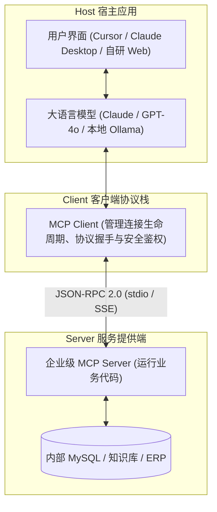

# 企业级 AI 解决方案交付工程师 (FDE) 学员实战讲义

## Day 27：工业互联新标准——Anthropic MCP 协议架构与企业 Server 资产化

**所属模块**：第四阶段：MCP 协议扩展、企业级多智能体系统 (MAS) 与 AI 治理架构  
**学习周期**：第 6 周 / 第 27 天（8 学时 / MCP 协议体系解构 + JSON-RPC 2.0 传输规范 + FastMCP 企业服务开发 + 工具资产化跨端挂载）  
**面向学员**：初中级交付工程师 (Junior FDE) / 资深技术骨干 / 解决方案架构师  
**前置承接**：已完成 Day 16（原生 Function Calling 协议与 Text2SQL）、Day 18（API 全链路协同）与 Day 26（LangGraph 生产级图状态机）。此前，我们将工具硬编码在特定应用框架中，导致“换一个前端/平台（如从自有 Web 换到 Claude Desktop 或 Cursor），全部工具必须推翻重写”。今天我们将迎来工具资产化的全球工业互联标准——**Anthropic 发布的 MCP (Model Context Protocol，模型上下文协议)，掌握企业级 MCP Server 开发与资产化打包标准！**

---

## 🎯 学习目标与交付物约定

完成本模块课程与实操工作坊（Workshop）后，每位学员应达成以下关键能力指标：

1. **破除私有胶水代码孤岛，精通 MCP 工业协议架构**：
   - 深刻理解 MCP 作为“AI 时代的 USB-C 接口”的核心价值；
   - 掌握 **Host（宿主客户端）- Client（连接适配器）- Server（能力提供方）** 三层拓扑架构；
   - 理解底层 **JSON-RPC 2.0** 通信报文格式（`tools/list`、`tools/call`、`resources/read`）。
2. **精通 MCP 三大核心原语（Primitives）设计规范**：
   - **Tools（操作类工具）**：具有副作用的动态计算函数（如提交报销、修改数据库状态）；
   - **Resources（只读资源通道）**：类似 RESTful GET / 文件 URI 协议的静态与动态上下文读取；
   - **Prompts（提示词模版）**：标准化的工作流交互指令组件。
3. **熟练使用 FastMCP 构建企业级生产 Server**：
   - 使用现代 Python `FastMCP` 框架，在 30 分钟内将前期的数据库查询、知识库检索与审批流接口封装为标准 MCP 服务；
   - 掌握 `stdio`（标准输入输出管道）与 `SSE`（Server-Sent Events 远程网络）两种传输模式。
4. **掌握企业工具资产化挂载与跨端复用**：
   - 掌握在 Cursor、Claude Desktop 及自有 Python 应用中配置 `mcp_config.json` 的标准流程，实现“编写一次，全端即插即用”。
5. **组内交付核心工程资产**：
   - [ ] 产出物 1：《华科智造企业统一财务与合规 MCP Server (`enterprise_finance_mcp.py`)》
   - [ ] 产出物 2：《MCP Server 协议调试日志与端到端集成测试报告 (`mcp_verification_report.md`)》

---

## 目录

- [第一篇 破除工具孤岛：为什么全球正在统一走向 MCP 标准？](#第一篇-破除工具孤岛为什么全球正在统一走向-mcp-标准)
- [第二篇 协议解构：Host、Client 与 Server 的三层架构及通信报文](#第二篇-协议解构hostclient-与-server-的三层架构及通信报文)
- [第三篇 核心原语：Tools、Resources 与 Prompts 的工业级设计](#第三篇-核心原语toolsresources-与-prompts-的工业级设计)
- [第四篇 传输通道：stdio 本地管道 vs SSE 远程微服务选型](#第四篇-传输通道stdio-本地管道-vs-sse-远程微服务选型)
- [第五篇 生产级代码实战：企业级 FastMCP Server 与客户端双向联调](#第五篇-生产级代码实战企业级-fastmcp-server-与客户端双向联调)
- [第六篇 课堂实战工作坊 (Workshop)：4 人协同开发与跨端资产挂载大实战](#第六篇-课堂实战工作坊-workshop4-人协同开发与跨端资产挂载大实战)

---

## 第一篇 破除工具孤岛：为什么全球正在统一走向 MCP 标准？

### 1.1 传统私有 Tool 绑定的交付噩梦

在 2024 年底之前，企业开发 AI 工具面临严重的“碎片化重复建设”：

| 痛点工具栈 / 框架 | 传统“烟囱式”工具开发方式 | 交付与复用瓶颈 |
| :--- | :--- | :--- |
| **LangChain 工具** | 编写一套专属 Python 装饰器函数 | 只能给本框架内部使用，跨框架无法直接迁移 |
| **Dify 自定义插件** | 编写一套专有 YAML / OpenAPI DSL | 平台框架绑定极其严重，与代码仓割裂 |
| **Claude / Cursor** | 桌面端与 IDE 宿主环境 | 完全无法直接调用上述私有工具，必须重新开发适配 |

**核心痛点**：
- 为 LangChain 写好的工具，无法直接导入 Dify 或 Claude Desktop；
- 每一个 Agent 平台都要编写专属的适配层与参数映射代码（Glue Code 泛滥）；
- 企业资产无法沉淀：交付给客户的工具散落在不同代码库中，无法形成企业级“工具资产超市”。

### 1.2 MCP：AI 时代的统一即插即用协议

Anthropic 于 2024 年底开源的 **MCP (Model Context Protocol)**，彻底改变了这一格局：
- **定义统一标准**：将工具（Tools）、只读数据（Resources）和提示模版（Prompts）抽象为通用接口；
- **解耦核心能力与宿主应用**：企业只需编写一个 `finance-mcp-server`，无论是 Claude Desktop、Cursor、VS Code 还是自研的 LangGraph 智能体，**只要支持 MCP 协议，就能零改造直接调用**！

---

## 第二篇 协议解构：Host、Client 与 Server 的三层架构及通信报文

### 2.1 三层拓扑架构



### 2.2 底层通信协议：标准 JSON-RPC 2.0

MCP 并非玄学黑盒，它底层运行在极度成熟的 **JSON-RPC 2.0** 协议之上：

#### 1. 协议握手与工具发现 (`tools/list`)
Client 向 Server 查询可用工具列表：
```json
// Client -> Server 请求
{
  "jsonrpc": "2.0",
  "id": 1,
  "method": "tools/list",
  "params": {}
}

// Server -> Client 响应
{
  "jsonrpc": "2.0",
  "id": 1,
  "result": {
    "tools": [
      {
        "name": "query_travel_policy",
        "description": "查询华科智造企业差旅住宿与交通报销标准限额",
        "inputSchema": {
          "type": "object",
          "properties": {
            "city_tier": {"type": "string", "description": "城市等级：一线城市/二线省会/三线及其他"},
            "level": {"type": "string", "description": "员工级别：普通员工/部门经理/总监级"}
          },
          "required": ["city_tier", "level"]
        }
      }
    ]
  }
}
```

#### 2. 工具执行与结果返回 (`tools/call`)
```json
// Client -> Server 执行指令
{
  "jsonrpc": "2.0",
  "id": 2,
  "method": "tools/call",
  "params": {
    "name": "query_travel_policy",
    "arguments": {
      "city_tier": "一线城市",
      "level": "普通员工"
    }
  }
}

// Server -> Client 执行结果
{
  "jsonrpc": "2.0",
  "id": 2,
  "result": {
    "content": [
      {
        "type": "text",
        "text": "【制度查询结果】一线城市普通员工（P4-P5）单晚住宿上限为 450 元/天，市内交通优先公共交通。"
      }
    ],
    "isError": false
  }
}
```

---

## 第三篇 核心原语：Tools、Resources 与 Prompts 的工业级设计

MCP 将企业上下文能力抽象为三大标准化原语：

| 原语类型 | 物理意义 | 典型业务场景 | 模型交互方式 |
| :--- | :--- | :--- | :--- |
| **`Tools`** (工具) | **动态可执行动作**，支持输入参数，通常带有计算逻辑或数据写入副作用 | 报销单提交、审批流挂起、Text2SQL 查询数据库、发送钉钉通知 | 大模型自主决策何时调用，传入结构化 JSON 参数 |
| **`Resources`** (资源) | **只读数据上下文**，具备类似 REST URI 的唯一寻址标识（如 `policy://travel/2024`） | 读取差旅制度全文、读取系统实时版本号、获取日志文件内容 | 通常由宿主客户端主动拉取作为背景知识注入，不可被随意篡改 |
| **`Prompts`** (提示词) | **预置的可复用指令模版**，帮助用户一键唤起复杂的专业工作流 | 《季度财务审计报告撰写提示词》、《合规风险自查提示词》 | 显示在聊天客户端快捷指令面板中，由人类按需点击触发 |

---

## 第四篇 传输通道：stdio 本地管道 vs SSE 远程微服务选型

MCP 官方定义了两种标准通信通道传输层（Transport Layer）：

| 比较维度 | `stdio` (标准输入输出管道) | `SSE` (Server-Sent Events) |
| :--- | :--- | :--- |
| **进程部署拓扑** | 本地子进程启动 | 独立远程微服务容器 (HTTP/TCP) |
| **通信介质** | `stdin` / `stdout` | HTTP POST + HTTP GET (SSE 流) |
| **认证与安全** | 依赖本地操作系统权限 | 依赖 Token / API-Key / OAuth2 |
| **适用场景** | Cursor / Claude 桌面端快速接入本地脚本 | 企业私有云集中部署、多租户集群服务化共享访问 |

---

## 第五篇 生产级代码实战：企业级 FastMCP Server 与客户端双向联调

为了让交付工程师摆脱繁琐的手写 JSON-RPC 编解码，Anthropic 官方推荐使用现代 Python 框架 **`mcp`（及其内置的高级封装 `FastMCP`）**。以下提供一套**全自包含、开箱即用的企业财务与合规 MCP Server**。

```python
# enterprise_finance_mcp.py
# 生产级企业财务与差旅合规 FastMCP Server
from mcp.server.fastmcp import FastMCP
from typing import Dict, Any, List
import json
import datetime

# ==============================================================================
# 1. 初始化 FastMCP 服务实例
# ==============================================================================
mcp = FastMCP("Huake-Enterprise-Finance-Server")

# 模拟底层真实企业制度库与员工数据库 (承接前期真实知识沉淀)
POLICY_DATABASE = {
    "一线城市": {
        "总监级": 800.0,
        "部门经理": 550.0,
        "普通员工": 450.0
    },
    "二线省会": {
        "总监级": 600.0,
        "部门经理": 420.0,
        "普通员工": 350.0
    },
    "三线及其他": {
        "总监级": 550.0,
        "部门经理": 370.0,
        "普通员工": 300.0
    }
}

EMPLOYEE_DATABASE = {
    "HK8012": {"name": "周建华", "department": "华东交付一部", "level": "普通员工"},
    "HK7991": {"name": "王大明", "department": "华东交付一部", "level": "部门经理"},
    "HK8110": {"name": "陈梓豪", "department": "监察委员会", "level": "总监级"},
    "HK8045": {"name": "赵小雪", "department": "监察委员会", "level": "部门经理"}
}

# ==============================================================================
# 2. 原语 1：发布标准 Tools (可执行工具)
# ==============================================================================

@mcp.tool()
def query_accommodation_limit(city_tier: str, employee_level: str) -> str:
    """
    根据城市等级和员工职级查询单晚住宿报销上限（元/天）。
    :param city_tier: 城市等级，必须为 '一线城市'、'二线省会' 或 '三线及其他'
    :param employee_level: 员工级别，必须为 '总监级'、'部门经理' 或 '普通员工'
    """
    tier_info = POLICY_DATABASE.get(city_tier)
    if not tier_info:
        return f"❌ 查询失败：未知城市级别 '{city_tier}'，有效选项为：{list(POLICY_DATABASE.keys())}"
    
    limit = tier_info.get(employee_level)
    if not limit:
        return f"❌ 查询失败：未知员工级别 '{employee_level}'，有效选项为：{list(tier_info.keys())}"
    
    return f"【合规标准核验】根据《2024版差旅规范》，{city_tier} - {employee_level} 的单晚住宿上限为 {limit} 元/天。"

@mcp.tool()
def audit_expense_claim(employee_id: str, city_tier: str, days: int, total_amount: float) -> str:
    """
    对员工提交的差旅住宿单据进行自动化合规审查与超标计算。
    :param employee_id: 员工工号，如 'HK8012'
    :param city_tier: 出差目的地城市等级
    :param days: 出差实际住宿天数（必须大于0）
    :param total_amount: 申报报销的总住宿费用（元）
    """
    emp = EMPLOYEE_DATABASE.get(employee_id)
    if not emp:
        return f"❌ 审计拦截：系统未检索到工号为 {employee_id} 的在职员工信息！"
    
    tier_info = POLICY_DATABASE.get(city_tier)
    if not tier_info:
        return f"❌ 审计拦截：未知城市级别 '{city_tier}'！"
    
    daily_limit = tier_info.get(emp["level"], 350.0)
    allowed_total = daily_limit * days
    
    if total_amount <= allowed_total:
        return (
            f"✅ 审计合规放行：员工 [{emp['name']}({emp['level']})] 在 {city_tier} 出差 {days} 天，"
            f"标准额度上限为 {allowed_total} 元，实际申报 {total_amount} 元，机审合规，予以通过。"
        )
    else:
        over_amount = total_amount - allowed_total
        return (
            f"🚨 审计违规预警：员工 [{emp['name']}({emp['level']})] 在 {city_tier} 出差 {days} 天，"
            f"标准总限额为 {allowed_total} 元（{daily_limit}元/天），实际申报 {total_amount} 元！"
            f"超出上限 {over_amount} 元。处理建议：超标金额强制剔除或由分管大区总监邮件特批！"
        )

# ==============================================================================
# 3. 原语 2：发布标准 Resources (只读资源通道)
# ==============================================================================

@mcp.resource("finance://policy/summary")
def get_finance_policy_summary() -> str:
    """提供企业 2024 最新差旅报销政策核心摘要只读文本"""
    summary = {
        "policy_id": "WIKI-FIN-TRAVEL-202403",
        "effective_date": "2024-03-01",
        "key_principles": [
            "一线城市标准调高，二三线城市维持勤俭原则",
            "夜间加班打车报销必须超过 21:00 且公共交通停运",
            "大额申报利益冲突时强制执行回避制度与监察委代签"
        ]
    }
    return json.dumps(summary, ensure_ascii=False, indent=2)

# ==============================================================================
# 4. 原语 3：发布标准 Prompts (专业指令模版)
# ==============================================================================

@mcp.prompt()
def audit_complaint_prompt(employee_id: str, disputed_amount: float) -> str:
    """为申诉复核专员生成针对违规超标单据的专业申诉沟通函模版"""
    return f"""你是一位资深企业财务合规审计专家。
请为工号为 {employee_id} 的员工起草一份《差旅超标复核沟通备忘录》。
涉及争议金额：{disputed_amount} 元。
要求：
1. 态度客观严谨，引用《2024差旅合规管理条例》生效节点；
2. 明确给出整改建议：补交特批证明，或自理超标差额；
3. 说明如果 3 个工作日内未反馈，财务系统将强制撤回单据。"""

# ==============================================================================
# 5. 服务入口与客户端直连测试
# ==============================================================================

if __name__ == "__main__":
    import sys
    print("=" * 80)
    print("🚀 Day 27 工业互联新标准：企业级 FastMCP Server 启动与就绪自测")
    print("=" * 80)
    
    # 支持两种模式：若带参数则启动标准 stdio 供 Cursor/Claude Desktop 调用
    # 否则直接执行内部全真契约自检
    if len(sys.argv) > 1 and sys.argv[1] == "run":
        # 正式以标准 stdio 运行，等待宿主 Client 连接
        mcp.run(transport="stdio")
    else:
        print("💡 [本地自检模式] 正在验证 MCP Tools 与 Resources 逻辑有效性...\n")
        
        # 1. 自检查询工具
        res_tool1 = query_accommodation_limit("一线城市", "普通员工")
        print("1. [Tool 测试: 查限额] ➔", res_tool1)
        
        # 2. 自检审查工具（合规单据）
        res_tool2 = audit_expense_claim("HK8012", "一线城市", 3, 1200.0)
        print("2. [Tool 测试: 合规审查] ➔", res_tool2)
        
        # 3. 自检审查工具（超标违规单据）
        res_tool3 = audit_expense_claim("HK7991", "二线省会", 2, 1800.0)
        print("3. [Tool 测试: 违规拦截] ➔", res_tool3)
        
        # 4. 自检只读资源
        res_resource = get_finance_policy_summary()
        print("4. [Resource 测试: 规约只读] ➔\n", res_resource)
        
        print("\n" + "=" * 80)
        print("✅ 企业级 FastMCP Server 自检 100% 通过！随时可挂载至 Cursor / Claude Desktop。")
        print("👉 启动标准 MCP 监听指令：python enterprise_finance_mcp.py run")
        print("=" * 80)
```

---

## 第六篇 课堂实战工作坊 (Workshop)：4 人协同开发与跨端资产挂载大实战

在本次工作坊中，4 人小组将分工协同，完成一个标准企业 MCP Server 的开发、自测，并将其挂载至本地开发工具（如 Cursor 或自研 Python 测试客户端）中。

### 6.1 角色分工协同表

| 角色 | 主责学员 | 核心职责与任务 | 交付打卡项 |
| :--- | :--- | :--- | :--- |
| **方案负责人 (Spec Lead)** | 学员 A | 设计工具 Schema（定义参数名称、类型约束与中英文语义描述） | 产出《MCP 工具定义规范表》 |
| **架构负责人 (Architect Lead)** | 学员 B | 规划三层架构拓扑，定义 Tools 与 Resources 边界，排查安全性 | 评审通过工具安全边界 |
| **工程负责人 (Tech Lead)** | 学员 C | 使用 `FastMCP` 编码实现业务逻辑，处理数据校验与异常分支 | 提交可执行 `enterprise_finance_mcp.py` |
| **质量负责人 (Quality Lead)** | 学员 D | 配置宿主配置（如 `claude_desktop_config.json`），实施跨端联调 | 录制或截屏跨端成功调用全过程 |

### 6.2 交付物验收 Checklist

- [ ] **语义自包含**：每一个 `@mcp.tool` 函数均有严谨的 Docstring，大模型无需人类提示即可准确理解入参含义；
- [ ] **协议合规性**：执行 `tools/list` 能够正确返回标准的 JSON Schema 规范定义；
- [ ] **健壮错误处理**：当传入非法工号或未知城市等级时，工具返回带有错误描述的业务友好字符串，绝不让底层抛出未捕获异常导致 Server 崩溃；
- [ ] **跨平台复用**：成功生成可在 Cursor 或 Claude Desktop 导入的 `mcp_config.json` 配置片段。
