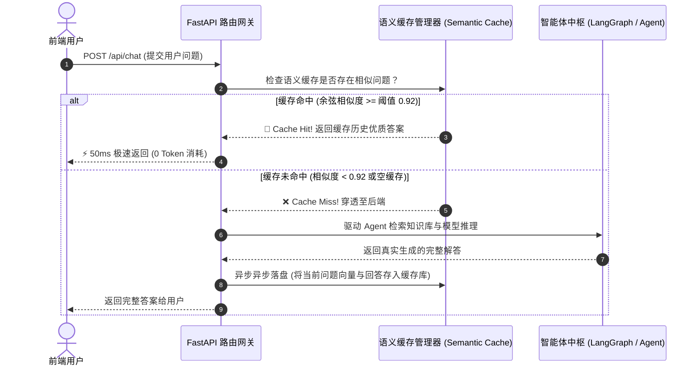
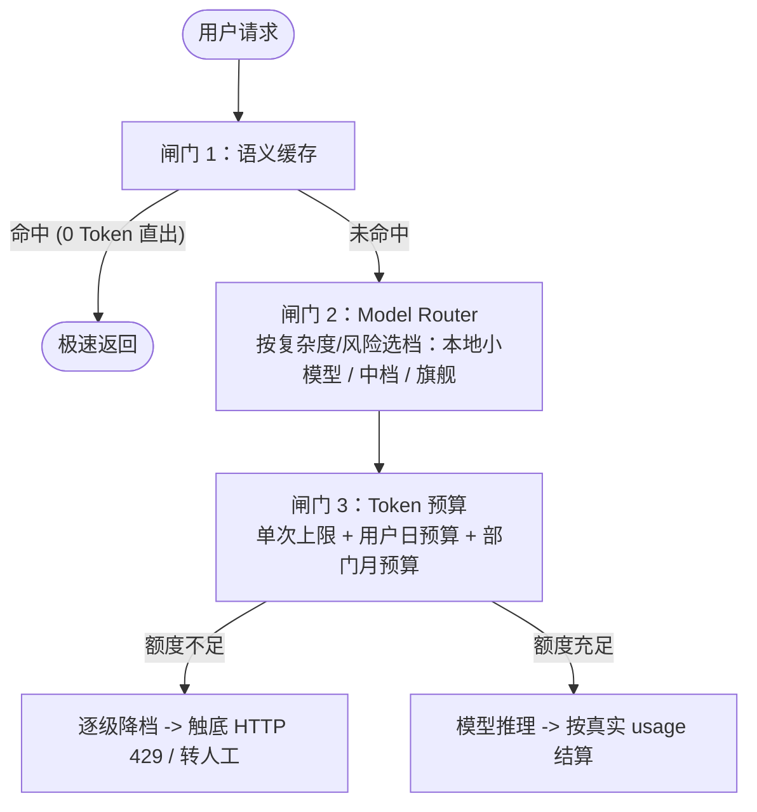
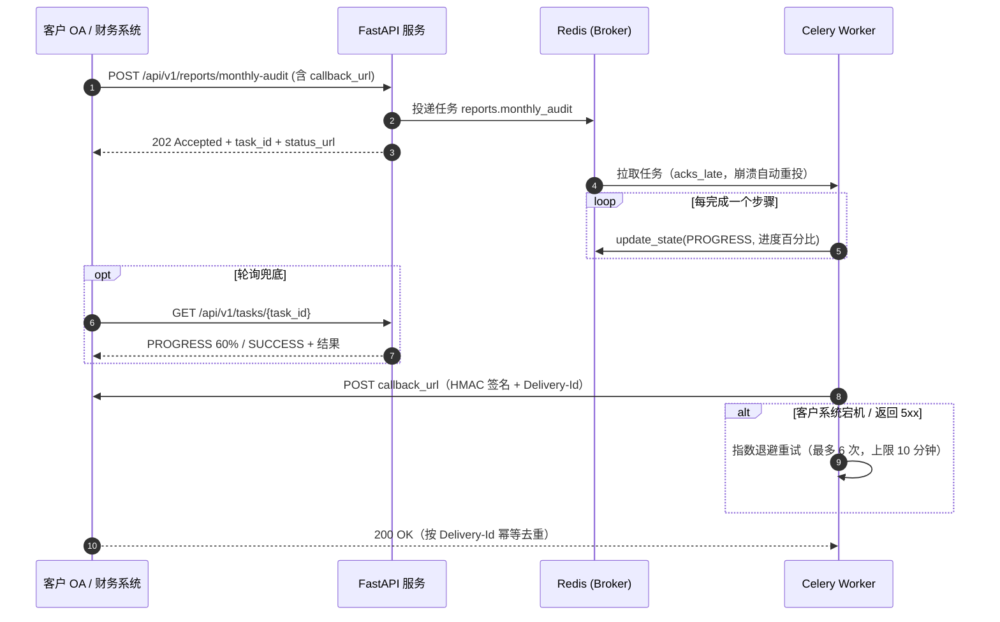

# 企业级 AI 解决方案交付工程师 (FDE) 学员实战讲义

## Day 29：降本增效与服务化——语义缓存优化与 FastAPI 高并发生产发布

**所属模块**：第四阶段：MCP 协议扩展、企业级多智能体系统 (MAS) 与 AI 治理架构  
**学习周期**：第 6 周 / 第 29 天（8 学时 / 语义缓存机制 + 向量阈值命中算法 + FastAPI 异步微服务化 + SSE 流式传输与 APM 监控 + Model Router 与 Token 预算 + Celery/Webhook 长任务异步化）  
**面向学员**：初中级交付工程师 (Junior FDE) / 资深技术骨干 / 解决方案架构师  
**前置承接**：已完成 Day 27（MCP 协议扩展）与 Day 28（Supervisor 多智能体与安全护栏）。学员已经构建出了功能完备的智能体系统。但在企业商业化交付最后一公里，客户 CIO 必然会提出最尖锐的两个生产级质问：“**高频重复问题每天被问上千次，每次都要调用大模型消耗数万 Token，账单怎么扛？**”以及“**单次响应耗时几秒甚至十几秒，怎么封装成支持高并发 Web 与移动端长连接的生产服务？**”。今天我们将攻坚这两大工业级终极底牌——**基于向量相似度的语义缓存 (Semantic Cache) 与 FastAPI 生产级微服务化架构！**

---

## 🎯 学习目标与交付物约定

完成本模块课程与实操工作坊（Workshop）后，每位学员应达成以下关键能力指标：

1. **破除传统精确缓存执念，精通语义缓存 (Semantic Cache) 原理**：
   - 深刻理解传统 Redis `key=string` 精确哈希在自然语言多样性表达下的彻底失效（缓存击穿率高达 95%）；
   - 精通基于 Embedding 向量距离的语义相似度缓存判决机制（实现相似问法语义命中，**0 Token 消耗，50ms 极速响应**）。
2. **精通动态缓存阈值调优与生命周期治理**：
   - 掌握余弦相似度阈值（$\tau \approx 0.90 \sim 0.95$）的精度与召回权衡；
   - 掌握带业务租户隔离、TTL 过期淘汰与主动失效机制的缓存存储设计。
3. **精通基于 FastAPI 的生产级智能体微服务化封装**：
   - 掌握 `Pydantic v2` 的严格请求响应数据契约与异常全局拦截器；
   - 掌握 **SSE (Server-Sent Events)** 异步流式输出协议，实现前端丝滑打字机体验。
4. **掌握端到端性能度量与 APM 全链路可观测性**：
   - 记录每次请求的“缓存命中状态、响应延迟 (Latency)、Token 节省量”，输出交付级吞吐性能指标。
5. **精通 Model Router 动态路由与 Token 三级预算控制**：
   - 掌握按问题复杂度与业务风险分级选模（本地小模型 / 中档 / 旗舰），以及高风险请求的降级下限；
   - 掌握“单次上限 + 用户日预算 + 部门月预算”三级额度与“预扣 → 结算 → 归还”两阶段记账，预算不足时逐级降档、触底返回 429。
6. **精通长任务异步化：FastAPI + Celery/Redis + Webhook 回调**：
   - 掌握 `202 Accepted + task_id` 受理模式、任务进度上报与轮询兜底；
   - 掌握 HMAC-SHA256 签名防伪造、时间戳防重放、指数退避重试与接收方幂等去重。
7. **组内交付核心工程资产**：
   - [ ] 产出物 1：《带语义缓存加速与 SSE 流式输出的高并发 FastAPI 智能体服务 (`semantic_cache_fastapi_server.py`)》
   - [ ] 产出物 2：《语义缓存命中率与并发延迟压测报告 (`cache_benchmark_report.md`)》
   - [ ] 产出物 3：《Model Router 与 Token 预算成本治理引擎 (`cost_governance.py`)》
   - [ ] 产出物 4：《Celery 长任务与签名 Webhook 回调套件 (`long_task_worker.py` & `production_routes.py`)》

---

## 目录

- [第一篇 成本悬崖：为什么企业生产系统必须引入语义缓存？](#第一篇-成本悬崖为什么企业生产系统必须引入语义缓存)
- [第二篇 底层解构：传统哈希缓存 vs 语义缓存 (Semantic Cache) 架构](#第二篇-底层解构传统哈希缓存-vs-语义缓存-semantic-cache-架构)
- [第三篇 调优艺术：余弦相似度阈值定位与缓存一致性治理](#第三篇-调优艺术余弦相似度阈值定位与缓存一致性治理)
- [第四篇 服务封装：FastAPI 异步架构与 SSE 流式打字机协议](#第四篇-服务封装fastapi-异步架构与-sse-流式打字机协议)
- [第五篇 生产级代码实战：带语义缓存的 FastAPI 完整服务工程](#第五篇-生产级代码实战带语义缓存的-fastapi-完整服务工程)
- [第六篇 成本治理与长任务异步化：Model Router、Token 预算与 Celery + Webhook 回调](#第六篇-成本治理与长任务异步化model-routertoken-预算与-celery--webhook-回调)
- [第七篇 课堂实战工作坊 (Workshop)：4 人协同开展缓存压测、成本治理与长任务联调实战](#第七篇-课堂实战工作坊-workshop4-人协同开展缓存压测成本治理与长任务联调实战)

---

## 第一篇 成本悬崖：为什么企业生产系统必须引入语义缓存？

### 1.1 大模型调用的“延迟地狱”与“Token 刺客”

在真实企业内部咨询、员工报销、IT 支持等高频场景中，**超过 70% 的用户提问其实在问同一件事**：

- “一线城市普通员工住宿报销上限是多少？”
- “去上海出差住宿最多报多少钱？”
- “普通员工在上海住一晚能够报销多少？”

如果系统每次都按部就班地：唤醒 Agent $\to$ 检索知识库 $\to$ 调用大模型多步推理：

1. **每次耗时 5~15 秒**：前端用户体验极其沉重；
2. **每次消耗 2000~5000 Token**：日活 1 万的企业，每月仅重复问答就会产生几万元甚至十几万元不必要的云端 API 账单！

### 1.2 为什么传统 Redis 精确缓存全面溃败？

传统软件工程习惯使用 `MD5(query)` 作为 Redis Key。但在自然语言面前：

- `MD5("上海出差能报多少") != MD5("去上海出差住宿限额是多少")`；
- 用户的标点符号、错别字、语序稍微改变，传统缓存就会 100% 击穿，变成形同虚设的摆设！

**唯一工业解法：语义缓存（Semantic Cache）**——以意图语义为 Key，以相似度度量为 Bridge！

---

## 第二篇 底层解构：传统哈希缓存 vs 语义缓存 (Semantic Cache) 架构

| 比较维度          | 传统精确缓存 (Redis)          | 语义缓存 (Semantic Cache)     |
|:------------- |:----------------------- |:------------------------- |
| **索引键 (Key)** | 原始文本的哈希值 (`MD5(query)`) | 语义嵌入向量 (Vector Embedding) |
| **匹配机制**      | 字符串完全绝对一致               | 向量空间余弦相似度计算               |
| **自然语言泛化能力**  | 极差（几乎为 0）               | 极高（同义句、倒装句直接命中）           |
| **命中响应耗时**    | 1 ~ 5 ms                | 20 ~ 50 ms (向量检索)         |
| **未命中大模型耗时**  | 5000 ~ 15000 ms         | 5000 ~ 15000 ms           |
| **Token 节省率** | < 5%                    | 60% ~ 85%                 |

### 2.1 语义缓存的底层工作流



---

## 第三篇 调优艺术：余弦相似度阈值定位与缓存一致性治理

### 3.1 相似度阈值（$\tau$）的工程平衡黄金法则

语义缓存的核心命脉在于 **阈值 $\tau$ 的设置**：

| 阈值设定方向                    | 典型风险与故障表现                                                     | 生产系统后果              |
|:------------------------- |:------------------------------------------------------------- |:------------------- |
| **阈值过低（如 $\tau = 0.80$）** | ⚠️ **致命危险：语义漂移 (Semantic Drift)**<br>把“一线城市住宿标准”误当成“二线省会标准”返回 | 造成严重业务与财务合规误导！      |
| **阈值过高（如 $\tau = 0.98$）** | ⚠️ **性能浪费：过于苛刻**<br>稍有同义改写或标点变化就无法命中                          | 缓存命中率暴跌，无法起到降本加速效果。 |

> 🎯 **工业界最佳实践定盘**：  
> 
> - 严肃合规、财务政策类场景：推荐设定 $\tau \in [0.91, 0.94]$；  
> - 当相似度在 $[0.85, 0.90)$ 区间时，可作为“建议候选参考”，但不直接短路拦截。

### 3.2 缓存的失效与更新机制 (Cache Invalidation)

知识库制度版本更新（如 2024 年 3 月 1 日出差新规发布）时，旧缓存必须能够精准失效：

1. **带版本命名空间 (Namespace Invalidation)**：Cache Key 中包含制度版本号 `v2.0`，版本升级直接切换 Namespace；
2. **TTL 时间窗口淘汰**：为热点问题设置合理 TTL（如 7 天自动过期）；
3. **人工主动驱逐接口**：提供 `POST /api/cache/flush` 专供管理员清空特定业务模块的缓存。

---

## 第四篇 服务封装：FastAPI 异步架构与 SSE 流式打字机协议

### 4.1 为什么必须采用 Server-Sent Events (SSE)？

大语言模型生成长篇报告通常需要数秒，如果等全部生成完毕再通过传统 JSON 一次性返回，用户会面对空白屏幕陷入“假死”焦虑。

- **WebSockets**：全双工，协议开销大，在多层反向代理（Nginx / K8s Ingress）中极易被超时掐断；
- **SSE (Server-Sent Events)**：基于标准 HTTP GET 长连接，单向服务端推流，原生自动重连，天然契合 LLM Token 逐字流式打字输出！

```http
HTTP/1.1 200 OK
Content-Type: text/event-stream
Cache-Control: no-cache
Connection: keep-alive

data: {"token": "根据"}

data: {"token": "《华科智造"}

data: {"token": "差旅合规条例》，"}

data: {"token": "一线城市限额为 800 元。"}

data: [DONE]
```

---

## 第五篇 生产级代码实战：带语义缓存的 FastAPI 完整服务工程

以下提供一套**全自包含、带内存语义缓存管理器、FastAPI 生产接口与 SSE 流式传输**的工业级套件。

```python
# semantic_cache_fastapi_server.py
# 生产级带语义缓存加速与 SSE 流式输出的高并发 FastAPI 智能体服务
import math
import time
import json
import asyncio
from typing import List, Dict, Any, Tuple, Optional
from pydantic import BaseModel, Field
import requests

# 引入 FastAPI 核心组件
from fastapi import FastAPI, HTTPException, Request
from fastapi.responses import StreamingResponse
from fastapi.middleware.cors import CORSMiddleware

# ==============================================================================
# 1. 语义缓存核心引擎 (基于 Embedding 余弦相似度)
# ==============================================================================

class CacheEntry(BaseModel):
    query_text: str
    query_vector: List[float]
    response_text: str
    created_at: float = Field(default_factory=time.time)
    hit_count: int = 0

class SemanticCacheManager:
    """
    轻量高性能语义缓存管理器
    （底层使用向量空间搜索，生产环境可平滑迁移至 Redis-VSS / Milvus）
    """
    def __init__(self, threshold: float = 0.92, embed_url: str = "http://localhost:11434/api/embeddings"):
        self.threshold = threshold
        self.embed_url = embed_url
        self.cache_pool: List[CacheEntry] = []
        self.stats = {"hits": 0, "misses": 0, "saved_tokens": 0}

    def _get_embedding(self, text: str) -> List[float]:
        """优先调用本地 Ollama 获取向量，若无外部环境则使用轻量自适应模拟"""
        try:
            resp = requests.post(
                self.embed_url,
                json={"model": "nomic-embed-text:latest", "prompt": text},
                timeout=2
            )
            if resp.status_code == 200:
                return resp.json().get("embedding", [])
        except Exception:
            pass

        # 兜底轻量级字符频次语义向量（确保无网络离线环境绝对可跑通）
        vec = [0.0] * 64
        for char in text:
            vec[ord(char) % 64] += 1.0
        norm = math.sqrt(sum(v * v for v in vec)) or 1.0
        return [v / norm for v in vec]

    @staticmethod
    def _cosine_similarity(v1: List[float], v2: List[float]) -> float:
        if not v1 or not v2 or len(v1) != len(v2):
            return 0.0
        dot = sum(a * b for a, b in zip(v1, v2))
        norm1 = math.sqrt(sum(a * a for a in v1))
        norm2 = math.sqrt(sum(b * b for b in v2))
        if norm1 == 0 or norm2 == 0:
            return 0.0
        return max(0.0, min(1.0, dot / (norm1 * norm2)))

    def search_cache(self, query: str) -> Tuple[Optional[str], float]:
        """查询语义缓存，若存在大于阈值的条目则命中"""
        q_vec = self._get_embedding(query)
        best_score = 0.0
        matched_entry: Optional[CacheEntry] = None

        for entry in self.cache_pool:
            sim = self._cosine_similarity(q_vec, entry.query_vector)
            if sim > best_score:
                best_score = sim
                matched_entry = entry

        if matched_entry and best_score >= self.threshold:
            self.stats["hits"] += 1
            matched_entry.hit_count += 1
            # 估算节省的 Token（按平均 1500 Token / 次）
            self.stats["saved_tokens"] += 1500
            return matched_entry.response_text, best_score

        self.stats["misses"] += 1
        return None, best_score

    def set_cache(self, query: str, response: str):
        """将新生成的回答异步写入语义缓存"""
        q_vec = self._get_embedding(query)
        entry = CacheEntry(
            query_text=query,
            query_vector=q_vec,
            response_text=response
        )
        self.cache_pool.append(entry)

# ==============================================================================
# 2. FastAPI 服务与 API 契约模型
# ==============================================================================

app = FastAPI(
    title="华科智造生产级企业 AI 智能体微服务",
    version="1.0.0",
    description="搭载语义缓存 (Semantic Cache) 与 SSE 流式打字输出的高并发服务"
)

# 允许跨域请求
app.add_middleware(
    CORSMiddleware,
    allow_origins=["*"],
    allow_credentials=True,
    allow_methods=["*"],
    allow_headers=["*"],
)

cache_manager = SemanticCacheManager(threshold=0.91)

class ChatRequest(BaseModel):
    query: str = Field(..., example="一线城市普通员工住宿报销上限是多少？")
    user_id: Optional[str] = "GUEST"
    stream: bool = Field(default=False, description="是否采用 SSE 流式打字机传输")

class ChatResponse(BaseModel):
    query: str
    answer: str
    latency_ms: float
    cache_hit: bool
    similarity_score: float

# ==============================================================================
# 3. 模拟后端重型智能体推理中枢
# ==============================================================================

async def mock_agent_reasoning(query: str) -> str:
    """模拟复杂的 RAG 知识图谱检索与大模型链式推理（耗时约 1.5 秒）"""
    await asyncio.sleep(1.5)
    return (
        f"【权威审计裁决】根据《华科智造2024差旅合规规范》：\n"
        f"针对您所咨询的有关事项，一线城市（北京/上海/深圳）普通员工住宿上限调整为 450 元/天；"
        f"二线省会城市为 350 元/天。单笔报销超额部分需大区总监邮件特批，否则财务系统强制拦截。"
    )

# ==============================================================================
# 4. 路由定义：常规接口、SSE 流式接口与运维监控大盘
# ==============================================================================

@app.post("/api/v1/chat", response_model=ChatResponse)
async def chat_endpoint(req: ChatRequest):
    """标准同步问答接口（自动透明启用语义缓存）"""
    t0 = time.time()

    # 1. 尝试检索语义缓存
    cached_ans, score = cache_manager.search_cache(req.query)
    if cached_ans:
        latency = round((time.time() - t0) * 1000, 2)
        return ChatResponse(
            query=req.query,
            answer=cached_ans,
            latency_ms=latency,
            cache_hit=True,
            similarity_score=round(score, 4)
        )

    # 2. 缓存击穿，穿透至重型智能体推理
    agent_answer = await mock_agent_reasoning(req.query)

    # 3. 异步落盘语义缓存
    cache_manager.set_cache(req.query, agent_answer)

    latency = round((time.time() - t0) * 1000, 2)
    return ChatResponse(
        query=req.query,
        answer=agent_answer,
        latency_ms=latency,
        cache_hit=False,
        similarity_score=round(score, 4)
    )

@app.post("/api/v1/chat/stream")
async def chat_stream_endpoint(req: ChatRequest):
    """SSE (Server-Sent Events) 流式打字机传输接口"""
    t0 = time.time()
    cached_ans, score = cache_manager.search_cache(req.query)

    async def sse_event_generator():
        # 如果命中缓存，极速流式打字输出
        if cached_ans:
            yield f"data: {json.dumps({'type': 'meta', 'cache_hit': True, 'score': round(score, 3)})}\n\n"
            for word in cached_ans:
                yield f"data: {json.dumps({'type': 'token', 'content': word})}\n\n"
                await asyncio.sleep(0.01)  # 模拟丝滑打字感
            yield "data: [DONE]\n\n"
            return

        # 若未命中缓存，等待推理并流式输出
        yield f"data: {json.dumps({'type': 'meta', 'cache_hit': False, 'score': round(score, 3)})}\n\n"
        full_text = await mock_agent_reasoning(req.query)
        cache_manager.set_cache(req.query, full_text)

        for word in full_text:
            yield f"data: {json.dumps({'type': 'token', 'content': word})}\n\n"
            await asyncio.sleep(0.02)
        yield "data: [DONE]\n\n"

    return StreamingResponse(sse_event_generator(), media_type="text/event-stream")

@app.get("/api/v1/cache/stats")
async def cache_stats_endpoint():
    """运维监控指标接口：获取当前语义缓存池运行大盘与降本指标"""
    total = cache_manager.stats["hits"] + cache_manager.stats["misses"]
    hit_rate = (cache_manager.stats["hits"] / total * 100) if total > 0 else 0.0
    return {
        "status": "UP",
        "cached_entries_count": len(cache_manager.cache_pool),
        "total_requests": total,
        "cache_hits": cache_manager.stats["hits"],
        "cache_misses": cache_manager.stats["misses"],
        "cache_hit_rate": f"{hit_rate:.1f}%",
        "estimated_tokens_saved": cache_manager.stats["saved_tokens"]
    }

# ==============================================================================
# 5. 本地自动化性能压测自检
# ==============================================================================

if __name__ == "__main__":
    print("=" * 80)
    print("🚀 Day 29 降本增效与服务化：FastAPI 与语义缓存 (Semantic Cache) 生产自测")
    print("=" * 80)

    # 模拟真实高频并发测试用例集
    test_queries = [
        "普通员工在一线城市出差单晚住宿上限是多少？",                  # 第 1 次问：必然 Cache Miss，穿透推理
        "请问一线城市普通员工出差单晚住宿报销上限是多少元？",          # 同义改写问：测试语义缓存命中
        "普通员工在上海出差住一晚最多报销多少？",                      # 泛化问法：测试语义向量相似度判定
        "员工加班打车超过晚上九点能否报销？"                           # 全新领域问题：应当未命中
    ]

    async def run_benchmark_simulation():
        print("▶️ [压测阶段 1] 预热与第 1 次冷启动请求...")
        ans1, score1 = cache_manager.search_cache(test_queries[0])
        print(f"  • 提问: \"{test_queries[0]}\"")
        print(f"    ➔ 缓存判定: {'🎯 命中' if ans1 else '❌ 未命中 (穿透推理)'} (相似度: {score1:.3f})")
        # 模拟生成并写入缓存
        real_ans = await mock_agent_reasoning(test_queries[0])
        cache_manager.set_cache(test_queries[0], real_ans)
        print("    ➔ 后端完成生成并成功写入语义缓存！\n")

        print("▶️ [压测阶段 2] 模拟同义改写提问，检验语义泛化命中率...")
        for q in test_queries[1:]:
            t_start = time.time()
            hit_ans, sim_score = cache_manager.search_cache(q)
            latency = (time.time() - t_start) * 1000
            status_text = "🎯 语义命中！(极速 0 Token)" if hit_ans else "❌ 穿透智能体"
            print(f"  • 提问: \"{q}\"")
            print(f"    ➔ 相似度评分: {sim_score:.4f} | 状态: {status_text} | 检索耗时: {latency:.2f}ms")
            if not hit_ans:
                new_ans = await mock_agent_reasoning(q)
                cache_manager.set_cache(q, new_ans)

        print("\n" + "-" * 60)
        print("📊 [生产降本效能审计大盘]")
        print("-" * 60)
        stats = await cache_stats_endpoint()
        for k, v in stats.items():
            print(f"  • {k:25}: {v}")
        print("-" * 60)

    asyncio.run(run_benchmark_simulation())
    print("\n💡 提示：如需对外暴露生产微服务，执行以下命令即可启动：")
    print("   uvicorn semantic_cache_fastapi_server:app --host 0.0.0.0 --port 8000 --workers 4")
    print("=" * 80)
```

---

## 第六篇 成本治理与长任务异步化：Model Router、Token 预算与 Celery + Webhook 回调

语义缓存只能拦截“重复问题”。剩下 30%~40% 的新问题仍会穿透到大模型，且其中相当一部分是“用旗舰模型回答 FAQ”式的浪费；另一类月度稽核、批量报表任务耗时数分钟，任何同步 HTTP 接口（包括 SSE）都会被网关超时掐断。本篇补齐生产服务的最后三道工程防线。

### 6.1 三道成本闸门的分工



| 闸门           | 解决的问题                         | 典型收益              | 失效风险               |
|:------------ |:----------------------------- |:----------------- |:------------------ |
| 语义缓存         | 高频重复问法                        | 命中部分 Token 降为 0   | 阈值过低导致语义漂移         |
| Model Router | 简单问题误用旗舰模型                    | 新问题平均单价下降 50%~80% | 复杂问题被路由到小模型，回答质量塌陷 |
| Token 预算     | 单用户 / 单部门失控刷量、Prompt 注入诱导超长输出 | 账单上限可预期、可写进合同     | 预算过紧误伤正常业务         |

### 6.2 Model Router：按复杂度与风险分级选模

路由器的输入是用户问题与会话上下文，输出是模型档位。生产初期推荐使用**可解释的规则打分**，积累足够标注数据后再替换为小模型意图分类器。

| 信号      | 判定方式                                 | 打分  |
|:------- |:------------------------------------ |:---:|
| 高风险财务语义 | 命中“审批 / 特批 / 驳回 / 违规 / 超标 / 稽核 / 审计” | +4  |
| 多跳推理    | 命中“对比 / 同时 / 分别 / 汇总 / 为什么 / 依据”     | +2  |
| 长输入     | 估算输入 > 120 Token                     | +2  |
| 长对话     | 历史轮次 ≥ 5                             | +1  |

| 总分  | 档位       | 示例模型                            | 适用请求            |
|:---:|:-------- |:------------------------------- |:--------------- |
| 0~1 | LITE     | 本地 Ollama `qwen2.5:7b-instruct` | 标准 FAQ、格式改写     |
| 2~3 | STANDARD | `qwen-plus`                     | 常规 RAG 问答、单条款解读 |
| ≥ 4 | PREMIUM  | `qwen-max`                      | 审批裁决、跨制度多跳推理    |

> 🛡️ **降级下限（min_tier）**：命中高风险财务语义的请求，预算不足时最多降到 STANDARD，**禁止降到本地小模型**，宁可返回 429 转人工，也不让小模型对“周建华 800 元特批”这类裁决给出结论。

### 6.3 Token 预算：三级额度与“预扣 → 结算”机制

| 层级     | 默认额度          | 作用                        |
|:------ |:------------- |:------------------------- |
| 单次请求上限 | 4,000 Token   | 防 Prompt 注入诱导超长输出、防异常长上下文 |
| 用户日预算  | 20,000 Token  | 防单个账号刷量或脚本滥用              |
| 部门月预算  | 500,000 Token | 与客户合同中的成本条款对齐，按部门分摊账单     |

模型调用前无法知道真实消耗，因此采用两阶段记账：

1. **预扣（reserve）**：按“输入估算 + 系统提示词预留 + 该档位 `max_output_tokens`”预占额度，任一层级不足则整体拒绝，不产生半扣；
2. **结算（settle）**：调用完成后释放预扣，按模型响应中的 `usage` 真实值记账；
3. **归还（release）**：调用异常时全额归还预扣额度。

预扣失败时按“路由档位 → 逐级降档 → 触底拒绝”处理，降档原因写入响应与 Langfuse Trace，供质量负责人复盘。

> 📌 本节代码使用进程内锁演示。多 Worker 部署时，额度账户必须迁移至 Redis，用 Lua 脚本保证“检查 + 预扣”的原子性，否则并发请求会同时通过检查导致超扣。

### 6.4 长任务异步化：为什么 SSE 不够

在做普通的 ChatGPT 式单轮聊天时，**SSE（Server-Sent Events）** 确实很好用：耗时 2～15 秒，一边生成一边吐字，前端体验很丝滑。

**但在企业生产级场景中，会出现大量的“重度长任务”**：

1. **多单批量审核**：比如“月度报销合规稽核，需要拿着大模型去对 128 张发票和单据逐一走多智能体推理”，可能需要 **3～10 分钟**；
2. **知识库全量更新**：重新构建树状索引（RAPTOR）或抽取知识图谱（GraphRAG），耗时 **30 分钟以上**。

如果依然使用普通的 HTTP 请求或 SSE 长连接，会引发两大灾难：

- **灾难 1：网关强制断连（超时 504）**：企业里的网关（Nginx、Kong、K8s Ingress）通常默认配置了 **60 秒超时**。任务还没跑完，HTTP 连接就被网关强行斩断了；业务人员一看断连，往往会疯狂刷新重试，导致服务器负载瞬间雪崩。
- **灾难 2：HTTP Worker 被耗尽（雪崩）**：FastAPI 的并发工作线程全被这些长达几分钟的请求占死，导致其他普通员工进来看一眼简单问题都排不上队（服务假死）。

| 任务                      | 典型耗时     | 同步接口的结局                                      |
|:----------------------- |:-------- |:-------------------------------------------- |
| 单轮问答                    | 2~15 s   | SSE 流式输出即可                                   |
| 部门月度报销合规稽核（128 张单据逐单推理） | 3~10 min | Nginx / K8s Ingress 默认 60 s 超时断开；用户刷新页面后重复提交 |
| 全量知识库重建索引               | 30 min+  | 占满 API Worker，拖垮在线问答                         |

#### 工业标准解法是 **“202 受理 + 后台执行 + 结果回调”**：



- **秒级响应（解耦连接）**：
  - 客户端发送请求后，FastAPI 只是将任务丢进队列（如 Redis / Celery），在 **50 毫秒内** 就给客户端返回一个 HTTP 状态码 **`202 Accepted`**，并带上一个任务 ID（`task_id`）；
  - 此时 HTTP 连接立即关闭，根本不怕网关 60s 超时，也不会占用任何 API 进程。
- **后台异步跑**：
  - 由独立的后端 Worker 节点去慢慢跑大模型推理、批量稽核。

#### 结果怎么送回？Webhook 安全与可靠性的四条硬性要求：

任务跑完后，Worker 会通过 **Webhook 回调** 调起客户系统的接口把结果送回去。讲义特别强调了企业级 Webhook 的 **4 条安全与可用性硬性规范**：

| 硬性要求         | 解决什么问题？                 | 工业级实现标准                                                                                                                         |
| ------------ | ----------------------- | ------------------------------------------------------------------------------------------------------------------------------- |
| **1. 防伪造**   | 防止伪造请求假冒 AI 服务给客户系统回调   | 请求头携带 `X-FDE-Signature`，采用 **HMAC-SHA256(密钥, 时间戳 + 请求体)** 对内容签名，接收方通过安全常量时间比较签名验证身份。                                            |
| **2. 防重放**   | 防止中间人截获报文后多次重发恶意攻击      | 请求头带时间戳 `X-FDE-Timestamp`，接收方检查只要时间与当前服务器**相差超过 300 秒（5分钟），直接拒绝**。                                                              |
| **3. 不丢结果**  | 万一客户的接收接口刚好在重启或网络抖动怎么办？ | **双保险机制**：<br>① Worker 遇到 5xx 故障时按**指数退避重试**（如 1s, 2s, 4s, 8s 重试最多 6 次）；<br>② 同时提供 `GET /api/v1/tasks/{task_id}` 接口供前端被动定时轮询兜底。 |
| **4. 不重复入账** | 网络超时后重试，万一客户系统收到了两次怎么办？ | **幂等去重（Idempotency）**：请求头必须携带全局唯一的 `X-FDE-Delivery-Id`（如 UUID），客户系统按该 ID 做去重校验，同一任务多次投递只处理一次。                                   |


### 6.5 生产级代码实战 A：Model Router 与 Token 预算总控器

纯标准库实现，离线可直接运行 `python cost_governance.py`。

```python
# cost_governance.py
# 生产级 Token 预算控制与 Model Router 动态路由引擎（纯标准库，离线可跑通）
import math
import time
import threading
from dataclasses import dataclass, field
from enum import Enum
from typing import Dict, List, Optional, Tuple

# ==============================================================================
# 1. 模型分级目录（单价为示例值，交付时以客户合同 / 云厂商报价为准）
# ==============================================================================

class ModelTier(str, Enum):
    LITE = "lite"          # 本地轻量模型：FAQ、闲聊、格式改写
    STANDARD = "standard"  # 云端中档模型：常规 RAG 问答
    PREMIUM = "premium"    # 云端旗舰模型：多跳推理、财务审批裁决


@dataclass(frozen=True)
class ModelProfile:
    tier: ModelTier
    model_name: str
    price_per_1k_input: float   # 元 / 1K 输入 Token
    price_per_1k_output: float  # 元 / 1K 输出 Token
    max_output_tokens: int


MODEL_CATALOG: Dict[ModelTier, ModelProfile] = {
    ModelTier.LITE: ModelProfile(ModelTier.LITE, "qwen2.5:7b-instruct (本地 Ollama)", 0.0, 0.0, 512),
    ModelTier.STANDARD: ModelProfile(ModelTier.STANDARD, "qwen-plus", 0.0008, 0.002, 1024),
    ModelTier.PREMIUM: ModelProfile(ModelTier.PREMIUM, "qwen-max", 0.0024, 0.0096, 2048),
}
TIER_ORDER: List[ModelTier] = [ModelTier.LITE, ModelTier.STANDARD, ModelTier.PREMIUM]

SYSTEM_PROMPT_RESERVE = 800  # 系统提示词 + 检索上下文的 Token 预留


def estimate_tokens(text: str) -> int:
    """粗估 Token：中文约 1 字 ≈ 1 Token，其他字符约 4 个 ≈ 1 Token"""
    cjk = sum(1 for ch in text if "\u4e00" <= ch <= "\u9fff")
    return cjk + math.ceil((len(text) - cjk) / 4)


def estimate_cost(model: ModelProfile, input_tokens: int, output_tokens: int) -> float:
    return round(
        input_tokens / 1000 * model.price_per_1k_input
        + output_tokens / 1000 * model.price_per_1k_output,
        6,
    )

# ==============================================================================
# 2. Model Router：基于规则打分的复杂度路由（可平滑替换为小模型意图分类器）
# ==============================================================================

@dataclass
class RouteDecision:
    tier: ModelTier
    min_tier: ModelTier          # 降级下限：高风险请求不允许降到本地小模型
    score: int
    reasons: List[str] = field(default_factory=list)


class ModelRouter:
    HIGH_RISK_KEYWORDS = ["审批", "特批", "驳回", "违规", "超标", "稽核", "审计"]
    MULTI_HOP_KEYWORDS = ["对比", "同时", "分别", "汇总", "为什么", "依据"]

    def route(self, query: str, history_turns: int = 0) -> RouteDecision:
        score, reasons = 0, []
        tokens = estimate_tokens(query)
        if tokens > 120:
            score += 2
            reasons.append(f"长输入({tokens} Token) +2")
        risk_hits = [k for k in self.HIGH_RISK_KEYWORDS if k in query]
        if risk_hits:
            score += 4
            reasons.append(f"高风险财务语义{risk_hits} +4")
        hop_hits = [k for k in self.MULTI_HOP_KEYWORDS if k in query]
        if hop_hits:
            score += 2
            reasons.append(f"多跳推理信号{hop_hits} +2")
        if history_turns >= 5:
            score += 1
            reasons.append(f"长对话上下文({history_turns} 轮) +1")
        if not reasons:
            reasons.append("标准 FAQ 问法，无升级信号")

        if score >= 4:
            tier = ModelTier.PREMIUM
        elif score >= 2:
            tier = ModelTier.STANDARD
        else:
            tier = ModelTier.LITE
        min_tier = ModelTier.STANDARD if risk_hits else ModelTier.LITE
        return RouteDecision(tier=tier, min_tier=min_tier, score=score, reasons=reasons)

# ==============================================================================
# 3. Token 预算管理器：单次上限 + 用户日预算 + 部门月预算，预扣 → 结算
# ==============================================================================

class BudgetExceeded(Exception):
    def __init__(self, scope: str, detail: str):
        super().__init__(f"[{scope}] {detail}")
        self.scope = scope
        self.detail = detail


@dataclass
class BudgetAccount:
    limit: int
    used: int = 0
    reserved: int = 0

    @property
    def available(self) -> int:
        return self.limit - self.used - self.reserved


class TokenBudgetManager:
    """生产环境将 _accounts 迁移至 Redis（INCRBY + Lua 原子脚本），此处用进程内锁演示"""

    def __init__(self, per_request_cap: int = 4000,
                 user_daily_limit: int = 20000,
                 dept_monthly_limit: int = 500000):
        self.per_request_cap = per_request_cap
        self.user_daily_limit = user_daily_limit
        self.dept_monthly_limit = dept_monthly_limit
        self._accounts: Dict[str, BudgetAccount] = {}
        self._reservations: Dict[str, Tuple[List[str], int]] = {}
        self._lock = threading.Lock()

    def _scopes(self, user_id: str, dept_id: str) -> List[Tuple[str, int]]:
        day, month = time.strftime("%Y%m%d"), time.strftime("%Y%m")
        return [
            (f"user:{user_id}:{day}", self.user_daily_limit),
            (f"dept:{dept_id}:{month}", self.dept_monthly_limit),
        ]

    def reserve(self, request_id: str, user_id: str, dept_id: str, estimated: int) -> None:
        """预扣：所有层级额度都充足才放行，任一层级不足则整体拒绝（不产生半扣）"""
        if estimated > self.per_request_cap:
            raise BudgetExceeded("request", f"单次预估 {estimated} Token 超过上限 {self.per_request_cap}")
        with self._lock:
            accounts = [(k, self._accounts.setdefault(k, BudgetAccount(limit)))
                        for k, limit in self._scopes(user_id, dept_id)]
            for key, acc in accounts:
                if acc.available < estimated:
                    raise BudgetExceeded(key, f"剩余 {acc.available} Token，不足以覆盖预估 {estimated}")
            for _, acc in accounts:
                acc.reserved += estimated
            self._reservations[request_id] = ([k for k, _ in accounts], estimated)

    def settle(self, request_id: str, actual_tokens: int) -> None:
        """结算：释放预扣额度，按模型返回的真实 usage 记账"""
        with self._lock:
            keys, estimated = self._reservations.pop(request_id)
            for key in keys:
                acc = self._accounts[key]
                acc.reserved -= estimated
                acc.used += actual_tokens

    def release(self, request_id: str) -> None:
        """调用失败时归还预扣额度"""
        with self._lock:
            keys, estimated = self._reservations.pop(request_id, ([], 0))
            for key in keys:
                self._accounts[key].reserved -= estimated

    def snapshot(self, user_id: str, dept_id: str) -> Dict[str, Dict[str, int]]:
        with self._lock:
            return {
                key: {"limit": limit,
                      "used": self._accounts.get(key, BudgetAccount(limit)).used,
                      "available": self._accounts.get(key, BudgetAccount(limit)).available}
                for key, limit in self._scopes(user_id, dept_id)
            }

# ==============================================================================
# 4. 成本总控器：路由 → 预扣 → 逐级降档 → 触底拒绝
# ==============================================================================

@dataclass
class CostPlan:
    request_id: str
    model: ModelProfile
    routed_tier: ModelTier
    estimated_tokens: int
    degraded: bool
    reasons: List[str]


class CostGovernor:
    def __init__(self, router: ModelRouter, budget: TokenBudgetManager):
        self.router = router
        self.budget = budget

    def plan(self, request_id: str, query: str, user_id: str, dept_id: str,
             history_turns: int = 0) -> CostPlan:
        decision = self.router.route(query, history_turns)
        input_tokens = estimate_tokens(query) + SYSTEM_PROMPT_RESERVE
        hi = TIER_ORDER.index(decision.tier)
        lo = TIER_ORDER.index(decision.min_tier)
        last_error: Optional[BudgetExceeded] = None

        for idx in range(hi, lo - 1, -1):  # 从路由档位逐级向下尝试，不低于 min_tier
            model = MODEL_CATALOG[TIER_ORDER[idx]]
            estimated = input_tokens + model.max_output_tokens
            try:
                self.budget.reserve(request_id, user_id, dept_id, estimated)
                reasons = list(decision.reasons)
                if idx != hi:
                    reasons.append(f"预算不足：{decision.tier.value} → {model.tier.value} 降档")
                return CostPlan(request_id, model, decision.tier, estimated, idx != hi, reasons)
            except BudgetExceeded as exc:
                last_error = exc

        if decision.min_tier != ModelTier.LITE:
            raise BudgetExceeded(last_error.scope,
                                 f"{last_error.detail}；高风险请求禁止降级到本地小模型，转人工处理")
        raise last_error

# ==============================================================================
# 5. 本地自检：路由分级、降档与预算熔断全流程
# ==============================================================================

if __name__ == "__main__":
    print("=" * 80)
    print("💰 Day 29 成本治理：Model Router 动态路由 + Token 三级预算自检")
    print("=" * 80)

    # 为演示熔断效果，将用户日预算压低到 6000 Token
    governor = CostGovernor(ModelRouter(), TokenBudgetManager(user_daily_limit=6000))
    cases = [
        ("一线城市普通员工住宿报销上限是多少？", 0),
        ("对比上海和成都的住宿标准，并说明依据条款", 0),
        ("周建华 800 元住宿超标，是否符合特批审批条件？", 0),
        ("周建华 800 元住宿超标，是否符合特批审批条件？", 0),
        ("王大明 2 月的报销为什么被驳回？请汇总违规依据", 6),
    ]

    for i, (query, turns) in enumerate(cases, 1):
        rid = f"req-{i:03d}"
        try:
            plan = governor.plan(rid, query, user_id="E1024", dept_id="D-FIN", history_turns=turns)
            # 模拟模型返回的真实 usage：输出通常低于 max_output_tokens
            actual_in = estimate_tokens(query) + 600
            actual_out = plan.model.max_output_tokens // 2
            governor.budget.settle(rid, actual_in + actual_out)
            cost = estimate_cost(plan.model, actual_in, actual_out)
            flag = "⬇️ 降档" if plan.degraded else "✅ 原档"
            print(f"[{rid}] {query}")
            print(f"    ➔ 路由: {plan.routed_tier.value:8} | 实际模型: {plan.model.model_name} | {flag}")
            print(f"    ➔ 依据: {'; '.join(plan.reasons)}")
            print(f"    ➔ 预扣 {plan.estimated_tokens} / 实耗 {actual_in + actual_out} Token | 费用 ¥{cost}")
        except BudgetExceeded as exc:
            print(f"[{rid}] {query}")
            print(f"    ➔ ⛔ HTTP 429 预算熔断: {exc}")

    print("-" * 60)
    for scope, info in governor.budget.snapshot("E1024", "D-FIN").items():
        print(f"  • {scope:22}: 已用 {info['used']:>6} / 上限 {info['limit']:>6} | 剩余 {info['available']}")
    print("=" * 80)
```

自检输出（用户日预算压低至 6,000 Token 以演示降档与熔断）：

```text
[req-001] 一线城市普通员工住宿报销上限是多少？
    ➔ 路由: lite     | 实际模型: qwen2.5:7b-instruct (本地 Ollama) | ✅ 原档
[req-003] 周建华 800 元住宿超标，是否符合特批审批条件？
    ➔ 路由: premium  | 实际模型: qwen-max | ✅ 原档
[req-004] 周建华 800 元住宿超标，是否符合特批审批条件？
    ➔ 路由: premium  | 实际模型: qwen-plus | ⬇️ 降档
    ➔ 依据: 高风险财务语义['审批', '特批', '超标'] +4; 预算不足：premium → standard 降档
[req-005] 王大明 2 月的报销为什么被驳回？请汇总违规依据
    ➔ ⛔ HTTP 429 预算熔断: [user:E1024:...] 剩余 1218 Token，不足以覆盖预估 1845；高风险请求禁止降级到本地小模型，转人工处理
```

### 6.6 生产级代码实战 B：Celery 长任务与 HMAC 签名 Webhook

依赖：`pip install celery redis requests`。无 Redis 环境可用 `CELERY_EAGER=1 python long_task_worker.py` 在当前进程内同步自检。

```python
# long_task_worker.py
# Celery + Redis 长任务异步执行与 HMAC 签名 Webhook 回调
#
# 生产启动：
#   docker run -d -p 6379:6379 redis:7
#   celery -A long_task_worker worker --loglevel=info --concurrency=4
# 无 Redis 的本地自检（任务在当前进程同步执行）：
#   CELERY_EAGER=1 python long_task_worker.py
import hashlib
import hmac
import json
import os
import time
from typing import Optional

import requests
from celery import Celery

# ==============================================================================
# 1. Celery 应用与长任务专用配置
# ==============================================================================

EAGER = os.getenv("CELERY_EAGER") == "1"
BROKER_URL = "memory://" if EAGER else os.getenv("CELERY_BROKER_URL", "redis://localhost:6379/0")
RESULT_BACKEND = "cache+memory://" if EAGER else os.getenv("CELERY_RESULT_BACKEND", "redis://localhost:6379/1")
WEBHOOK_SECRET = os.getenv("WEBHOOK_SECRET", "change-me-in-prod").encode()

celery_app = Celery("fde_long_tasks", broker=BROKER_URL, backend=RESULT_BACKEND)
celery_app.conf.update(
    task_serializer="json",
    result_serializer="json",
    accept_content=["json"],
    task_track_started=True,
    task_acks_late=True,            # 执行完才 ACK：Worker 崩溃后任务自动重新投递
    worker_prefetch_multiplier=1,   # 长任务不预取，避免单个 Worker 囤积任务
    task_soft_time_limit=840,       # 软超时：抛 SoftTimeLimitExceeded，可做清理
    task_time_limit=900,            # 硬超时：强制终止进程
    result_expires=86400,           # 结果保留 24 小时供轮询查询
    task_always_eager=EAGER,
    task_eager_propagates=EAGER,
    task_store_eager_result=EAGER,  # 本地自检时也写入结果后端，便于轮询接口查询
)

# ==============================================================================
# 2. Webhook 签名：HMAC-SHA256(timestamp + "." + body)，防伪造 + 防重放
# ==============================================================================

def sign_payload(body: bytes, timestamp: str) -> str:
    return hmac.new(WEBHOOK_SECRET, timestamp.encode() + b"." + body, hashlib.sha256).hexdigest()


def verify_signature(body: bytes, timestamp: str, signature: str, tolerance_s: int = 300) -> bool:
    """接收方校验：时间戳超出容忍窗口视为重放攻击；使用常量时间比较防时序攻击"""
    try:
        if abs(time.time() - int(timestamp)) > tolerance_s:
            return False
    except ValueError:
        return False
    return hmac.compare_digest(sign_payload(body, timestamp), signature)

# ==============================================================================
# 3. 业务长任务：部门月度报销合规稽核报告（真实耗时 3~10 分钟）
# ==============================================================================

AUDIT_STEPS = ["拉取当月报销单据", "逐单差旅合规校验", "违规归因与人际回避核查", "生成稽核报告"]


@celery_app.task(bind=True, name="reports.monthly_audit")
def generate_monthly_audit_report(self, dept_id: str, month: str,
                                  callback_url: Optional[str] = None,
                                  step_seconds: float = 1.0) -> dict:
    for idx, step in enumerate(AUDIT_STEPS, 1):
        self.update_state(state="PROGRESS", meta={
            "step": step, "progress": int(idx / len(AUDIT_STEPS) * 100)})
        time.sleep(step_seconds)  # 模拟检索 + LLM 逐单推理耗时

    result = {
        "dept_id": dept_id,
        "month": month,
        "total_claims": 128,
        "violations": [
            {"employee": "王大明", "rule": "一线城市住宿超标", "amount": 620, "action": "驳回"},
            {"employee": "周建华", "rule": "住宿 800 元超标", "amount": 800, "action": "特批待审"},
        ],
        "report_url": f"/reports/{dept_id}/{month}/audit.pdf",
    }
    if callback_url:
        deliver_webhook.delay(callback_url, {
            "event": "report.completed", "task_id": self.request.id, "result": result})
    return result

# ==============================================================================
# 4. Webhook 投递任务：指数退避重试，客户系统宕机也不丢结果
# ==============================================================================

@celery_app.task(bind=True, name="webhooks.deliver",
                 autoretry_for=(requests.RequestException,),
                 retry_backoff=True, retry_backoff_max=600, retry_jitter=True,
                 max_retries=6)
def deliver_webhook(self, url: str, payload: dict) -> int:
    body = json.dumps(payload, ensure_ascii=False, sort_keys=True).encode()
    ts = str(int(time.time()))
    headers = {
        "Content-Type": "application/json",
        "X-FDE-Event": payload.get("event", "unknown"),
        "X-FDE-Delivery-Id": payload["task_id"],  # 接收方按此字段做幂等去重
        "X-FDE-Timestamp": ts,
        "X-FDE-Signature": sign_payload(body, ts),
    }
    resp = requests.post(url, data=body, headers=headers, timeout=10)
    resp.raise_for_status()  # 4xx/5xx 抛 HTTPError（RequestException 子类）触发重试
    return resp.status_code

# ==============================================================================
# 5. 本地自检：任务进度、结果回传与签名校验
# ==============================================================================

if __name__ == "__main__":
    print("=" * 80)
    print("⏳ Day 29 长任务异步化：Celery + Webhook 签名回调自检")
    print("=" * 80)
    if not EAGER:
        print("⚠️ 未设置 CELERY_EAGER=1，将投递到 Redis，请确认 Worker 已启动。")

    async_result = generate_monthly_audit_report.delay("D-FIN", "2024-02", None, 0.2)
    print(f"▶️ 已提交任务 task_id = {async_result.id}")
    report = async_result.get(timeout=60)
    print(f"✅ 任务状态: {async_result.state} | 违规条数: {len(report['violations'])}")
    for v in report["violations"]:
        print(f"   • {v['employee']}: {v['rule']} ({v['amount']} 元) → {v['action']}")

    body = json.dumps({"task_id": async_result.id}, sort_keys=True).encode()
    ts = str(int(time.time()))
    sig = sign_payload(body, ts)
    print("-" * 60)
    print(f"🔐 合法签名校验:   {verify_signature(body, ts, sig)}")
    print(f"🔐 篡改报文校验:   {verify_signature(body + b' ', ts, sig)}")
    print(f"🔐 重放(10 分钟前): {verify_signature(body, str(int(ts) - 600), sign_payload(body, str(int(ts) - 600)))}")
    print("=" * 80)
```

### 6.7 生产级代码实战 C：将三道闸门与长任务挂载到 FastAPI 服务

`production_routes.py` 复用第五篇的 `app` 与 `cache_manager`，新增 `/api/v2/chat`（成本治理问答）、`/api/v2/budget`（额度查询）、`/api/v1/reports/monthly-audit`（202 异步提交）、`/api/v1/tasks/{task_id}`（轮询）与 Webhook 接收方示例。

```python
# production_routes.py
# 在 Day 29 FastAPI 服务上挂载：成本治理问答接口 + 长任务异步提交 / 查询 / Webhook 接收
# 启动：uvicorn production_routes:app --host 0.0.0.0 --port 8000
import json
import uuid

from celery.result import AsyncResult
from fastapi import HTTPException, Request
from pydantic import BaseModel, Field, HttpUrl
from typing import Optional

from semantic_cache_fastapi_server import app, cache_manager, mock_agent_reasoning
from cost_governance import (BudgetExceeded, CostGovernor, ModelRouter,
                             TokenBudgetManager, estimate_cost, estimate_tokens)
from long_task_worker import celery_app, generate_monthly_audit_report, verify_signature

governor = CostGovernor(ModelRouter(), TokenBudgetManager())

# ==============================================================================
# 1. 成本治理问答接口：缓存 → 路由 → 预扣 → 推理 → 结算
# ==============================================================================

class GovernedChatRequest(BaseModel):
    query: str
    user_id: str = Field(..., examples=["E1024"])
    dept_id: str = Field(..., examples=["D-FIN"])
    history_turns: int = 0


@app.post("/api/v2/chat")
async def governed_chat(req: GovernedChatRequest):
    cached, score = cache_manager.search_cache(req.query)
    if cached:  # 第一道闸门：语义缓存命中，0 Token
        return {"answer": cached, "cache_hit": True, "model": None, "tokens": 0, "cost_cny": 0.0}

    request_id = uuid.uuid4().hex
    try:  # 第二、三道闸门：模型路由 + 预算预扣
        plan = governor.plan(request_id, req.query, req.user_id, req.dept_id, req.history_turns)
    except BudgetExceeded as exc:
        raise HTTPException(status_code=429, detail={"scope": exc.scope, "message": exc.detail})

    try:
        answer = await mock_agent_reasoning(req.query)  # 生产中按 plan.model.model_name 调用对应模型
    except Exception:
        governor.budget.release(request_id)  # 调用失败归还额度
        raise

    # 生产中取模型响应里的 usage.prompt_tokens / usage.completion_tokens
    in_tok = estimate_tokens(req.query) + 600
    out_tok = estimate_tokens(answer)
    governor.budget.settle(request_id, in_tok + out_tok)
    cache_manager.set_cache(req.query, answer)
    return {
        "answer": answer, "cache_hit": False,
        "model": plan.model.model_name, "routed_tier": plan.routed_tier.value,
        "degraded": plan.degraded, "route_reasons": plan.reasons,
        "tokens": in_tok + out_tok, "cost_cny": estimate_cost(plan.model, in_tok, out_tok),
    }


@app.get("/api/v2/budget/{dept_id}/{user_id}")
async def budget_snapshot(dept_id: str, user_id: str):
    return governor.budget.snapshot(user_id, dept_id)

# ==============================================================================
# 2. 长任务异步接口：202 Accepted + task_id，结果走轮询或 Webhook
# ==============================================================================

class AuditReportRequest(BaseModel):
    dept_id: str = Field(..., examples=["D-FIN"])
    month: str = Field(..., pattern=r"^\d{4}-\d{2}$", examples=["2024-02"])
    callback_url: Optional[HttpUrl] = None


@app.post("/api/v1/reports/monthly-audit", status_code=202)
async def submit_monthly_audit(req: AuditReportRequest):
    task = generate_monthly_audit_report.delay(
        req.dept_id, req.month, str(req.callback_url) if req.callback_url else None)
    return {"task_id": task.id, "status": "PENDING", "status_url": f"/api/v1/tasks/{task.id}"}


@app.get("/api/v1/tasks/{task_id}")
async def get_task_status(task_id: str):
    result = AsyncResult(task_id, app=celery_app)
    body = {"task_id": task_id, "status": result.state}
    if result.state == "PROGRESS":
        body["meta"] = result.info
    elif result.state == "SUCCESS":
        body["result"] = result.result
    elif result.state == "FAILURE":
        body["error"] = str(result.result)
    return body

# ==============================================================================
# 3. Webhook 接收方示例（部署在客户 OA / 财务系统侧）
# ==============================================================================

_processed_deliveries: set = set()  # 生产环境使用 Redis SETNX 或数据库唯一索引


@app.post("/demo/webhook-receiver")
async def webhook_receiver(request: Request):
    body = await request.body()
    ts = request.headers.get("X-FDE-Timestamp", "0")
    signature = request.headers.get("X-FDE-Signature", "")
    if not verify_signature(body, ts, signature):
        raise HTTPException(status_code=401, detail="Webhook 签名校验失败或已过期")

    delivery_id = request.headers.get("X-FDE-Delivery-Id", "")
    if delivery_id in _processed_deliveries:  # 重试导致的重复投递：直接确认，不重复入账
        return {"status": "duplicate_ignored"}
    _processed_deliveries.add(delivery_id)

    payload = json.loads(body)
    return {"status": "accepted", "task_id": payload["task_id"]}
```

联调验证结果：

| 用例                                      | 预期                         | 实测                                       |
|:--------------------------------------- |:-------------------------- |:---------------------------------------- |
| 首次提问“周建华 800 元特批审批”                     | 路由至 PREMIUM，返回模型、Token 与费用 | `200`，`qwen-max`，635 Token               |
| 同一问题再次提问                                | 语义缓存命中，0 Token             | `cache_hit: true`                        |
| 提交月度稽核                                  | 立即返回 `202` 与 `task_id`     | `202 PENDING`                            |
| 轮询任务状态                                  | 完成后返回结果                    | `SUCCESS`                                |
| 月份格式 `2024/02`                          | Pydantic 校验拒绝              | `422`                                    |
| 合法签名 Webhook / 同一 Delivery-Id 重投 / 伪造签名 | 接受 / 幂等忽略 / 拒绝             | `accepted` / `duplicate_ignored` / `401` |

---

## 第七篇 课堂实战工作坊 (Workshop)：4 人协同开展缓存压测、成本治理与长任务联调实战

在本次工作坊中，4 人学习小组将协作部署一套带语义缓存、成本治理与长任务异步通道的 FastAPI 服务，使用真实多样化提问集进行并发击穿与命中率压力测试，并完成预算熔断与 Webhook 回调联调。

### 7.1 角色分工协同表

| 角色                         | 主责学员 | 核心职责与任务                                                                                              | 交付打卡项                |
|:-------------------------- |:---- |:---------------------------------------------------------------------------------------------------- |:-------------------- |
| **方案负责人 (Spec Lead)**      | 学员 A | 设计 OpenAPI 契约（定义 `/chat`、`/stream`、`/reports/monthly-audit` 的 JSON Schema、429/422 错误码与 Webhook 报文格式） | 导出并评审 Swagger API 契约 |
| **架构负责人 (Architect Lead)** | 学员 B | 制定语义缓存阈值 $\tau$ 校验矩阵、Model Router 分级规则与三级预算额度，规划降本核算公式                                               | 提交《语义缓存阈值与成本治理定盘方案》  |
| **工程负责人 (Tech Lead)**      | 学员 C | 主笔编写 FastAPI 服务、SSE 流式打字生成器、语义缓存管理器、成本总控器与 Celery 长任务                                                | 启动成功并提供 API 接口       |
| **质量负责人 (Quality Lead)**   | 学员 D | 编写压力测试脚本，录入 20 组同义改写问题，统计命中率与 P99 延迟提升；构造预算耗尽与 Webhook 伪造 / 重投用例                                     | 出具《微服务压测与降本分析报告》     |

### 7.2 交付物验收 Checklist

- [ ] **语义命中有效性**：同一问题的不同倒装句或同义表达，语义相似度 $\ge 0.91$ 并实现毫秒级缓存直接返回；
- [ ] **不误伤不漂移**：面对完全不同的业务问题（如从差旅跳到加班），缓存不产生误命中；
- [ ] **SSE 流式合规性**：调用 `/stream` 能够观察到带有 `data: {"token": "..."}\n\n` 的标准事件流逐字打印；
- [ ] **降本可度量**：`/cache/stats` 接口能够精准返回累计拦截调用次数与预估节省的 Token 总数。
- [ ] **路由分级正确**：标准 FAQ 路由到 LITE，含“审批 / 特批 / 驳回”的请求路由到 PREMIUM，响应中返回 `route_reasons`；
- [ ] **预算熔断生效**：用户日预算耗尽时先降档；高风险请求不降到 LITE，触底返回 `429` 并提示转人工；
- [ ] **长任务不阻塞**：提交月度稽核立即返回 `202 + task_id`，轮询可见 `PROGRESS` 进度与最终 `SUCCESS` 结果；
- [ ] **Webhook 安全可靠**：合法签名被接受，篡改报文与超时时间戳返回 `401`，同一 `Delivery-Id` 重投被幂等忽略。
