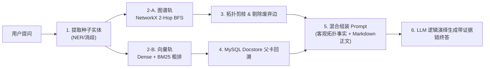

# 企业级 RAG 架构演进与轻量 GraphRAG 攻坚核心问答讲解手册

> **编写背景**：本手册汇总了在真实工业级交付场景下，针对 **Parent-Child 大小块存储解耦（MySQL Docstore）** 以及 **轻量级 GraphRAG 网状多跳推理** 的核心提问、架构决策与原理解析，专供技术分享、方案评审与课堂讲解使用。

---

## 目录
- [第一模块：切块与存储解耦架构（Parent-Child & Docstore）](#第一模块切块与存储解耦架构parent-child--docstore)
  - [Q1. 原先的父块存在哪里？为什么在向量库元数据中存父块不符合企业级标准？](#q1-原先的父块存在哪里为什么在向量库元数据中存父块不符合企业级标准)
  - [Q2. 为什么要引入 Docstore？采用 MySQL 代替向量元数据的优势是什么？](#q2-为什么要引入-docstore采用-mysql-代替向量元数据的优势是什么)
  - [Q3. 现在的存储分工是怎样的？元数据和正文分别由谁保管？](#q3-现在的存储分工是怎样的元数据和正文分别由谁保管)
  - [Q4. 检索阶段是如何通过 `parent_id` 触发高效回溯的？](#q4-检索阶段是如何通过-parent_id-触发高效回溯的)
- [第二模块：GraphRAG 引入动机与本质突破](#第二模块graphrag-引入动机与本质突破)
  - [Q5. 既然已经做了 Parent-Child，为什么我们还要引入 Graph（知识图谱）？](#q5-既然已经做了-parent-child为什么我们还要引入-graph知识图谱)
  - [Q6. 针对我们当前这个 IT 工单与智能客服系统，纯向量的致命盲区具体是什么？](#q6-针对我们当前这个-it-工单与智能客服系统纯向量的致命盲区具体是什么)
- [第三模块：三元组本质、槽位角色与建立时机](#第三模块三元组本质槽位角色与建立时机)
  - [Q7. 什么是三元组？我们系统里具体需要抽取哪四大维度的状态与关系？](#q7-什么是三元组我们系统里具体需要抽取哪四大维度的状态与关系)
  - [Q8. 三元组的 3 个槽位（Head $\to$ Relation $\to$ Tail）在咱们系统里分别代表什么？](#q8-三元组的-3-个槽位head-to-relation-to-tail在咱们系统里分别代表什么)
  - [Q9. 图谱中的因果关系是在什么时候建立的？离线还是在线？](#q9-图谱中的因果关系是在什么时候建立的离线还是在线)
- [第四模块：检索执行流与大模型抽取约束工程](#第四模块检索执行流与大模型抽取约束工程)
  - [Q10. 引入 Graph 后的完整检索流程是怎样的？从开始到结束经历了什么？](#q10-引入-graph-后的完整检索流程是怎样的从开始到结束经历了什么)
  - [Q11. 大模型抽取三元组不准、胡乱捏造关系怎么办？咱们如何做工程约束？](#q11-大模型抽取三元组不准胡乱捏造关系怎么办咱们如何做工程约束)
- [第五模块：讲解总结与答辩金句提炼](#第五模块讲解总结与答辩金句提炼)

---

## 第一模块：切块与存储解耦架构（Parent-Child & Docstore）

### Q1. 原先的父块存在哪里？为什么在向量库元数据中存父块不符合企业级标准？
- **原先存储位置**：在传统初级实现中，切分出来的每个子块 metadata 里硬塞了一个庞大的 `parent_content` 字符串字段。
- **为什么不合规（痛点锐评）**：
  1. **巨量数据冗余**：一张父卡切出 4 个子块，意味着同一篇几千字的 Markdown 正文在向量库的 SQLite/元数据区被**无脑重复存了 4 次**。
  2. **内存雪崩与索引抖动**：向量数据库（如 Chroma、FAISS、Milvus）依赖内存常驻的 HNSW 图索引。把几十 KB 的文本大字段塞进元数据，会导致向量库内存暴增、频繁缺页换页，大幅拉高检索延迟。
  3. **破坏职责单一性**：向量数据库的核心使命是“高维浮点数近似最近邻搜索（ANN）”，把它当分布式文档数据库使，是典型架构反模式。

---

### Q2. 为什么要引入 Docstore？采用 MySQL 代替向量元数据的优势是什么？
- **Docstore 核心定义**：`Docstore（文档存储）` 是专业负责文本大字段持久化存储的专用组件。
- **采用 MySQL 的工业级优势**：
  1. **存储检索分离**：Chroma 专心处理 1024 维向量的高速 ANN 检索；MySQL（`rag_parent_docstore` 表）专职保管 Markdown 父卡正文。
  2. **主键聚簇索引极速读取**：MySQL 基于 `parent_id` 主键检索，10 条父卡全文读取耗时通常在 1~2 毫秒内。
  3. **无缝复用企业既有基础设施**：与 IT 系统的业务库同源，具备天然的高可用、数据备份、行锁并发与持久化保障，不需要额外运维冷门的分布式 KV 存储。

---

### Q3. 现在的存储分工是怎样的？元数据和正文分别由谁保管？

| 存储组件 | 承担职责 | 保存的具体字段 | 是否包含大字段正文 |
| :--- | :--- | :--- | :---: |
| **Chroma 向量数据库** | 向量距离计算、属性过滤 | `chunk_id`、`parent_id`（外键关联）、`title`、`category_id`、`article_id`、`version_id`、`char_len` | ❌ **彻底剥离**（`parent_content` 为 0） |
| **MySQL `rag_parent_docstore`** | Enterprise Docstore（持久化存储） | `parent_id`（主键）、`title`、`content`（**完整的 Markdown 父卡长正文**）、`metadata`、`updated_at` | ✅ **专职存储** 完整的父卡 Markdown 正文 |

---

### Q4. 检索阶段是如何通过 `parent_id` 触发高效回溯的？
1. **子块粗排召回**：Dense 向量检索与 BM25 稀疏检索召回 Top-15 候选子切片。
2. **提取外键去重**：从候选切片提取 `parent_id`，去重后通常收敛为 3~5 个唯一的父卡 ID（如 `['ITKB-VPN-001', 'ITKB-ACC-001']`）。
3. **批量主键查询（`mget`）**：
   ```sql
   SELECT parent_id, content FROM rag_parent_docstore WHERE parent_id IN ('ITKB-VPN-001', 'ITKB-ACC-001');
   ```
4. **父块级重排与上下文组装**：直接拿完整的父卡正文输入 Cross-Encoder 重排并返回给大模型。

---

## 第二模块：GraphRAG 引入动机与本质突破

### Q5. 既然已经做了 Parent-Child，为什么我们还要引入 Graph（知识图谱）？
- **Parent-Child 解决的是**：单篇文档内的“放大镜”问题（小块定位，大块读全文，消灭段落撕裂）。
- **GraphRAG 解决的是**：跨越多篇孤立制度之间的“导航图”问题（**多跳因果推理 Multi-hop Reasoning**）。
- **本质区别**：
  - 向量空间衡量的是**“一维语义相似度”**（字面意思像不像）；
  - 企业真实制度是**“多维网状拓扑”**（A 触发回避 $\to$ B 转派给 C $\to$ C 出差授权 D 代签）。
  - 没有单个切片会包含整条因果链，纯向量检索面对多跳链路存在必然的**召回断层**。

---

### Q6. 针对我们当前这个 IT 工单与智能客服系统，纯向量的致命盲区具体是什么？

#### 盲区 1：跨卡片连环故障排查链（以 VPN 与 AD 账号为例）
- **真实场景**：用户提问 *“在家连不上 VPN 报 691 认证失败，刚才手机邮箱也提示过期，怎么排查？”*
- **向量检索翻车**：死死命中 `ITKB-VPN-001`，给出重启路由器、换协议等常规网络废话。
- **图谱能力**：
  沿着 `(VPN错误691) ──[诱发根因]──> (AD域账号锁定) ──[高频诱因]──> (移动端邮件轮询旧密码)` 2 跳路径，精准诊断出用户是手机后台旧密码撞库锁定了域账号，给出解锁指导。

#### 盲区 2：制度版本替代与废止治理（以锁定次数为例）
- **历史旧卡片（ITKB-LEG-ACC-001）**：输错 3 次永久锁定，不自动解锁。
- **现行新卡片（ITKB-ACC-001）**：输错 5 次，锁定 15~30 分钟自动解锁。
- **向量检索翻车**：新旧切片字面高度相似，向量会把新旧两段同时捞出，大模型回答“精神分裂”。
- **图谱能力**：
  图谱中有显式边 `(ITKB-ACC-001) ──[废止并替代]──> (ITKB-LEG-ACC-001)`，检索时直接对废弃节点进行**物理拓扑剪枝**，杜绝过期规则输出。

#### 盲区 3：IT 基础设施依赖与工单派单（CMDB 资产链）
- 用户问 *“财务 ERP 打不开报 502”*。
- 知识库没有专门卡片，图谱通过 `(财务ERP) ──[依赖通道]──> (SSL-VPN) ──[主责组]──> (业务系统二组)`，准确告知前置网络条件并将工单直派精准责任组。

---

## 第三模块：三元组本质、槽位角色与建立时机

### Q7. 什么是三元组？我们系统里具体需要抽取哪四大维度的状态与关系？
三元组即 **`(Head 头实体, Relation 关系谓词, Tail 尾实体)`**。在我们的 IT 系统中，预设了 4 大核心维度：
1. **故障因果链路**：`诱发根因`、`衍生次生故障`、`前置排查动作`、`处置动作`；
2. **资产拓扑依赖**：`依赖网络通道`、`依赖身份源`、`依赖系统组件`；
3. **工单与审批流转**：`主责运维组`、`SLA升级流转`、`出差代签人`、`利益回避转派`；
4. **知识治理与生命周期**：`废止并替代`、`生效状态为`。

---

### Q8. 三元组的 3 个槽位（Head $\to$ Relation $\to$ Tail）在咱们系统里分别代表什么？

```text
  [ 1. 头实体 Head ]   ────( 2. 关系 Relation )────>   [ 3. 尾实体 Tail ]
    “起因 / 角色 / 资产”          “规则 / 因果 / 动作”             “根因 / 归宿 / 责任人”
```

- **① 头实体 (Head)**：提问触发点（报错代码 `VPN-691`、报障人、业务系统名 `财务ERP`、卡片ID `ITKB-VPN-001`）；
- **② 关系谓词 (Relation)**：刚性业务规则与联系（`诱发根因`、`出差代签人`、`依赖网络通道`、`废止并替代`）；
- **③ 尾实体 (Tail)**：最终归宿与方案（深层根因 `AD账号锁定`、终审代签人 `副主任赵小雪`、处置手段、状态值）。

---

### Q9. 图谱中的因果关系是在什么时候建立的？离线还是在线？
- **结论**：**在离线建索引期（Offline Indexing Time）一次性建立完成**。
- **核心逻辑**：
  - 在离线构建向量库时，驱动大模型提取 38 篇卡片的三元组，载入 Python **NetworkX 内存图**；
  - 在线检索用户提问时，绝对不去现抽三元组（避免消耗数十秒及高额 Token），而是直接在现成的内存图上做 **广度优先（BFS）遍历**，耗时 `< 1ms`。

---

## 第四模块：检索执行流与大模型抽取约束工程

### Q10. 引入 Graph 后的完整检索流程是怎样的？从开始到结束经历了什么？



1. **第一步：抓取种子实体**：从提问中精准提取名词并做别名归一化（如“陈主任” $\to$ “陈梓豪”）；
2. **第二步：双轨并行检索**：图谱轨查“因果逻辑事实”，向量轨查“详细排查正文”；
3. **第三步：图拓扑剪枝**：硬屏蔽所有指向 `DEPRECATED` 已废止卡片的边；
4. **第四步：Docstore 反哺回溯**：根据图谱涉及的关联卡片，从 MySQL 批量拉取父卡全文；
5. **第五步：Prompt 上下文组装**：将【不可违背的刚性事实】与【详细参考正文】拼合喂给模型；
6. **第六步：大模型演绎推理**：输出带有清晰因果推导链条的终答。

---

### Q11. 大模型抽取三元组不准、胡乱捏造关系怎么办？咱们如何做工程约束？

工业级实践中绝不让大模型自由发挥，而是建立 **5 道工程约束防线**：

1. **防线一：Pydantic 枚举物理强约束**  
   使用 `ITRelationEnum` 将允许的关系定死，输出枚举之外的关系直接报错打回，杜绝模型乱发明关系。
2. **防线二：实体原子化与字数长度拦截**  
   通过 `max_length=25` 与标点拦截器，禁止把长句子塞进实体槽位。
3. **防线三：卡片 Frontmatter 实体库反哺（做连线题代替填空题）**  
   利用知识库自带的 `entities: [...]` 候选池直接作为 Prompt 选项，限制大模型只能在候选池里挑选实体建立关系。
4. **防线四：原文佐证逐字比对（Quote Grounding）**  
   强制要求模型输出引用的原文句子 `evidence_quote`，在 Python 后端做 `if quote not in card_text` 检验，搜不到直接剔除，彻底消灭虚假幻觉。
5. **防线五：标准化字典消歧（Canonicalization）**  
   入图前通过同义词字典将别名归一化（如 `{"AD域": "AD域控制器", "域控": "AD域控制器"}`），消除孤岛节点。

---

## 第五模块：讲解总结与答辩金句提炼

> 💡 **现场答辩与技术分享金句**：
> 
> 1. **关于存储架构**：  
>    *“向量库只负责找坐标，文档库专职管内容。让 MySQL 承担 Docstore，既保护了向量索引的毫秒级纯粹性，又享受了企业级关系型数据库的持久化与事务红利。”*
> 
> 2. **关于引入 Graph**：  
>    *“Parent-Child 给了大模型看清单张卡片的‘放大镜’，而 Graph 给了大模型穿透复杂制度与资产网络的‘导航图’。没有 Graph，面对多跳问答，所有向量 RAG 都是在拼运气。”*
> 
> 3. **关于轻量工程选型**：  
>    *“告别高成本、重运维的 Neo4j 和天价 Token 的全量 GraphRAG；通过 Pydantic 严格 Schema 抽取 + NetworkX 内存图 + 2-Hop BFS，我们在 0 额外组件负担下，实现了 100% 确定性的企业级多跳因果推理。”*
