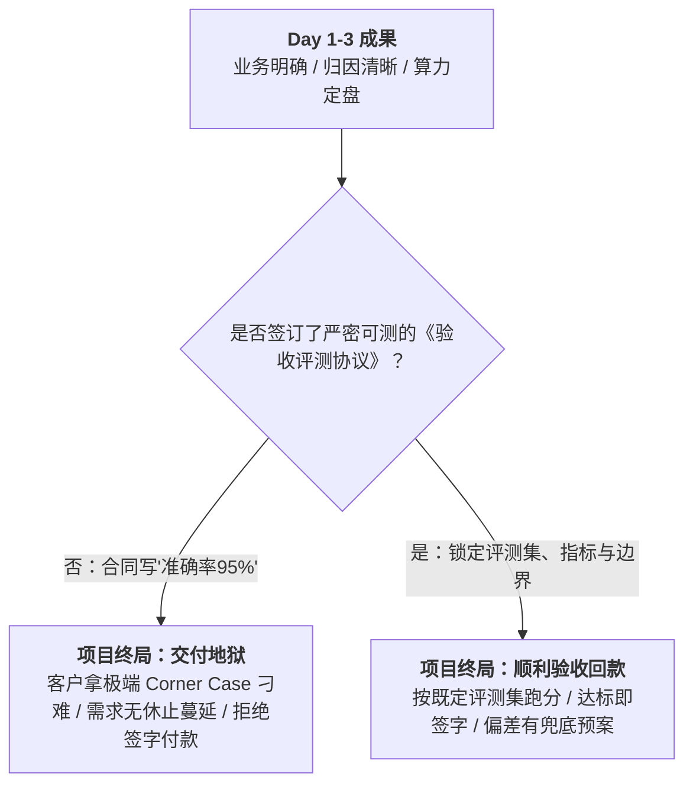
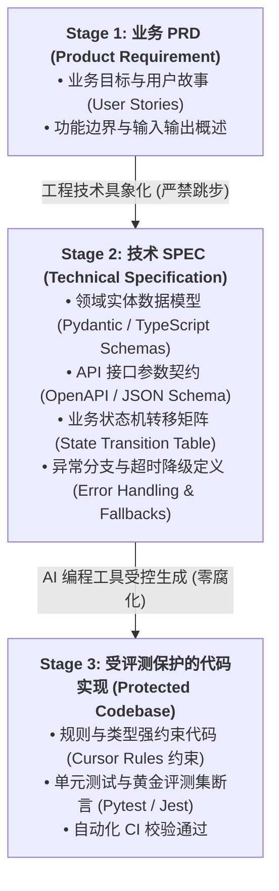
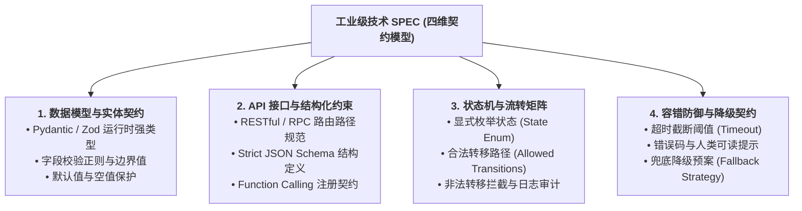
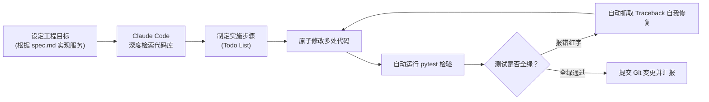

# 企业级 AI 解决方案交付工程师 (FDE) 学员实战讲义

## Day 4：验收评测协议、Spec 规范驱动开发与 AI 编程工具链实战

**所属模块**：第一阶段：FDE 需求翻译、推理底座与 Spec 规范驱动开发  
**学习周期**：第 1 周 / 第 4 天（8 学时 / 理论剖析 + 工具链实操 + 工作坊沉浸编码）  
**面向学员**：初中级交付工程师 (Junior FDE) / 资深技术骨干 / 解决方案架构师  
**前置承接**：已完成 Day 1《业务场景萃取与 BRD 规划》及 Day 2-3《需求工程归因、风险防线与算力定盘》，手握明确的 P0 功能清单、技术归因结论、风险防线策略与算力定盘卡数。

---

## 🎯 学习目标与交付物约定

完成本模块课程与实操工作坊后，每位学员应达成以下关键能力指标：

1. **破除验收死穴**：学会将客户合同中模糊的“准确率 95%”翻译为具备法律与技术效力的《可测验收评测协议》，掌握“小样本黄金评测集”的初筛构建方法与验收打分口径。
2. **掌握 Spec-Driven 范式**：深刻理解“先规格后编码（Spec First, Code Later）”的工业核心思想，掌握从模糊 PRD 向严格技术 SPEC（数据模型、JSON Schema 接口契约、业务规则、状态转移矩阵）的转化推演。
3. **消除代码生成腐化**：掌握 AI 辅助编程防“幻觉与腐化”工程防线，拒绝在 Cursor/Claude Code 中随意自然语言聊天生成，建立规则约束体系（`.cursorrules` / 系统级 Prompt）。
4. **掌控工业级工具链**：熟练掌控 Cursor（Agent / Composer 模式）与 Claude Code 的命令行 Agentic Loop、代码库自动化索引与自动化单测生成。
5. **组内产出三大核心工程资产**：
   - [ ] 产出物 1：《项目交付与验收评测协议书 (Acceptance & Evaluation Protocol)》
   - [ ] 产出物 2：《项目技术 SPEC 规格说明书 (含 Pydantic / TypeScript 契约与状态机)》
   - [ ] 产出物 3：《受 Spec 保护的端到端单体业务模块代码与自动化测试套件 (Zero-Corruption Codebase)》

---

## 目录

- [第一篇 承上启下与验收防线：把“准确率 95%”翻译成可签字的验收协议](#第一篇-承上启下与验收防线把准确率-95翻译成可签字的验收协议)
- [第二篇 软件工程范式重塑：Spec-Driven Development (规范驱动开发) 核心方法论](#第二篇-软件工程范式重塑spec-driven-development-规范驱动开发-核心方法论)
- [第三篇 工业级技术 SPEC 架构规范：四维契约模型](#第三篇-工业级技术-spec-架构规范四维契约模型)
- [第四篇 现代 AI 编程工具链实战：Cursor 与 Claude Code 的工程化约束](#第四篇-现代-ai-编程工具链实战cursor-与-claude-code-的工程化约束)
- [第五篇 实战推演：从 SPEC 到受评测保护的高质量工程代码](#第五篇-实战推演从-spec-到受评测保护的高质量工程代码)
- [第六篇 课堂实战工作坊：3 人小组协同与“受评测保护的微服务”代码交付](#第六篇-课堂实战工作坊3-人小组协同与受评测保护的微服务代码交付)

---

# 第一篇 承上启下与验收防线：把“准确率 95%”翻译成可签字的验收协议

### 1.1 为什么有了 BRD、归因和算力，项目依然会在最后一步被拒付？

在前三天，我们打通了一条严密的工程链条：

* **Day 1**：业务痛点 $\to$ BRD 4 栏矩阵 $\to$ 初步功能清单；
* **Day 2-3**：功能清单 $\to$ 需求归因三棱镜 $\to$ Scoping 漏斗（P0/P1/P2） $\to$ 技术风险登记册 $\to$ 显存与算力定盘（买几张卡）。

此时很多工程师会认为：“太好了，万事俱备，今天可以打开 IDE 疯狂敲代码了！”

**慢着！在敲下第一行代码之前，还有一个致命的商业与法律隐患没有排除：验收协议。**



> **📢 【引导】**：
> “在软件外包与交付领域，最让项目经理和工程师想跳楼的一句话是什么？
> 就是商务在合同里给客户写了一句：**‘系统识别准确率达到 95% 以上’**！
> 各位，大模型是一个基于概率生成的系统，什么是‘准确率’？
> 客户拿一张被水泡过、折叠了八次的褶皱增值税发票，或者问一个涉及三年跨度多表聚合的隐晦问题，系统回答不出来，客户就说：‘你看，你没达到 95%，我不签字！’
> **FDE 的核心素养之一，就是在开发前，把商务和客户嘴里的‘模糊准确率’，翻译成工程上可以运行、数学上可以量化、法务上可以签字的《验收评测协议》！**”

---

### 1.2 模糊验收条款 vs 工业级验收协议深度对照

| 维度                  | 传统业余做法（埋下交付地狱）     | 工业级 FDE 规范做法（受保护交付）                                                                                                                                                                         |
|:------------------- |:------------------ |:------------------------------------------------------------------------------------------------------------------------------------------------------------------------------------------- |
| **测试集来源**           | 验收当天由客户领导“随机抽题测试”  | **双方共同封版认定的《黄金测试集 (Golden Dataset v1)》**（如 100 条典型真实业务样本），测试集之外的提问属于“扩展边界”，不作为卡脖子依据。                                                                                                        |
| **指标定义**            | 笼统的“准确率 95%”       | **分层量化指标拆解**：<br>1. **字段提取准确率 (Field Precision)**：关键字段（如金额、税号）精确匹配率 $\ge 98\%$；<br>2. **语义相关性 (Semantic Recall)**：基于 Embedding 余弦相似度 $\ge 0.85$；<br>3. **意图路由准确率**：P0 核心流程路由正确率 $\ge 95\%$。 |
| **前置运行工况 (SLA 边界)** | 任何环境下随意测试          | **明确前置约束**：<br>1. 必须部署在 Day 2-3 定盘的指定硬件环境（如双卡 A800 80G）；<br>2. 并发不超过 16 QPS；<br>3. 输入文档图像分辨率 $\ge 300\text{ DPI}$，倾斜角 $< 15^\circ$。                                                         |
| **边界失败免责与降级**       | 只要失败一次客户就判定系统“不可用” | **在协议中明确【合规降级路径】**：当模型置信度（Confidence Score）$< 0.7$ 时，系统自动流转至人工复核工作台（HITL），该行为在协议中定义为 **“成功处理”** 而非系统故障！                                                                                     |

---

### 1.3 《企业 AI 项目交付验收协议》核心条款模板

```markdown
# 《项目功能模块交付与验收评测协议书 (标准条款)》

## 一、 评测基准与黄金数据集定义
1. 验收测试必须且仅在双方于 [日期] 联合签署封版的《Golden_Dataset_v1.0 (共 100 例)》上运行。
2. 数据集构成比例严格锁定为：标准业务样本 70 例，常见边界样本 20 例，生僻/复杂长文本样本 10 例。

## 二、 量化验收考核指标 (KPI)
| 功能域 | 测试指标 | 合格阈值 | 计算口径说明 |
| :--- | :--- | :---: | :--- |
| 信息结构化提取 | 核心字段精确匹配率 | >= 95% | (正确提取字段数 / 样本总字段数) * 100% |
| 业务逻辑判定 | 规则拦截与召回率 | >= 90% | 风险发票/违规合同样本中被成功识别并标记拦截的比率 |
| 性能与响应时延 | TTFT (首字延迟) | <= 1.5s | 在并发 QPS=10、GPU A800 环境下测试 |
| 端到端吞吐时延 | P95 端到端响应时间 | <= 8.0s | 包含 OCR、模型推理与数据库写入全链路 |

## 三、 兜底预案与免责边界
1. 当图像严重模糊、关键要素缺失导致模型输出置信度低于 0.70 时，系统触发 Fallback 机制流转至人工待办队列。此处理流程视为系统功能正常履行，计入有效流转。
2. 未包含在封版知识库或超出业务约定范围的开放域提问，模型触发标准安全拒答（“该问题超出知识库范围”），判定为正常合规响应。
```

---

# 第二篇 软件工程范式重塑：Spec-Driven Development (规范驱动开发) 核心方法论

### 2.1 AI 辅助编程的最大陷阱：为什么“自由聊天式写代码”必死？

今天很多开发者用上了 Cursor、ChatGPT 或 Claude，体验往往经历这样一个过山车周期：

1. **第 1 小时（惊叹）**：输入一段话，啪的一下生成了一个小页面，感觉开发效率提升了 10 倍！
2. **第 3 天（混乱）**：随着业务逻辑变复杂，新增一个字段，AI 把之前写的鉴权逻辑改丢了；再让它修一个 Bug，它把另一个模块的数据库 Schema 偷偷重命名了。
3. **第 1 周（灾难与推倒重来）**：代码库出现巨大的**架构腐化（Architecture Rot）**，到处是未引用的冗余函数、循环依赖、无类型保护的 `any` 变量。改一个小功能要修 20 个 Bug，最后工程师只能愤怒地“删库重写”。

```
【反模式】：自然语言直接生代码 (Chat-Driven)
用户口述 (充满歧义) ──> AI 自行脑补细节 ──> 代码生成 ──> 接口不匹配、隐藏Bug、架构腐化 ──> 交付暴死

【生产级最佳实践】：规范驱动开发 (Spec-Driven Development, SDD)
用户口述 ──> 标准 PRD ──> 严谨技术 SPEC (契约/状态机/约束) ──> AI 受控编译实现 ──> 零腐化工业级代码
```

> **🔥 FDE 第一铁律**：  
> **代码是给计算机执行的，自然语言是给人交流的，中间必须有一座桥梁——那就是严格结构化的技术规格说明书（Technical SPEC）。**  
> 在 AI 时代，**工程师最重要的产出物不再是逐行敲出的代码，而是定义系统边界、数据实体与交互契约的 SPEC！**

---

### 2.2 SDD 规范驱动开发的三阶漏斗动线

规范驱动开发（Spec-Driven Development）将研发过程标准化为不可逆的三级递进：



1. **Stage 1 (PRD)**：回答“**做给谁看、解决什么业务流程**”；
2. **Stage 2 (SPEC)**：回答“**字段是什么类型、接口入参出参是什么 JSON、状态怎么流转、出错返回什么 HTTP 状态码**”。**这一步是写给 AI 工具看的核心上下文（Context）！**
3. **Stage 3 (Code)**：让 Cursor 或 Claude Code 读取 SPEC，作为唯一的真理源（Single Source of Truth），进行“填空式”高保真编译与单元测试生成。

---

# 第三篇 工业级技术 SPEC 架构规范：四维契约模型

一份合格的、能够直接指导 AI 生成企业级工业代码的技术 SPEC，必须包含以下**四大核心维度**：



### 3.1 维度一：数据模型与强类型实体契约（Pydantic 示例）

在 Python / TypeScript 后端工程中，严禁使用无类型的裸字典（`dict` / `any`）。所有业务实体必须使用具备运行时校验能力的结构（如 Pydantic 或 Zod）：

```python
# 示例：财务智能报账助手的 SPEC 实体定义 (spec_models.py)
from enum import Enum
from typing import List, Optional
from pydantic import BaseModel, Field, field_validator
import re

class InvoiceCategory(str, Enum):
    """发票类型严格枚举"""
    MEAL = "餐饮"
    TRANSPORT = "交通"
    ACCOMMODATION = "住宿"
    OFFICE_SUPPLIES = "办公用品"
    OTHER = "其他"

class InvoiceItemSpec(BaseModel):
    """单张发票解析结果规范"""
    invoice_id: str = Field(..., description="系统内部生成唯一流水号，UUID格式")
    invoice_code: Optional[str] = Field(None, max_length=12, description="发票代码，必须为10-12位数字")
    invoice_number: str = Field(..., min_length=8, max_length=8, description="发票号码，必须为8位数字")
    amount_in_cents: int = Field(..., gt=0, description="发票金额，以'分'为单位存储，严禁使用浮点数防止精度失真")
    category: InvoiceCategory = Field(..., description="业务报销品类枚举值")
    confidence_score: float = Field(..., ge=0.0, le=1.0, description="模型解析置信度打分")

    @field_validator("invoice_number")
    @classmethod
    def validate_invoice_number(cls, v: str) -> str:
        if not re.match(r"^\d{8}$", v):
            raise ValueError("发票号码必须严格为 8 位纯数字")
        return v
```

---

### 3.2 维度二：AI 接口与 JSON Schema 约束契约

在 Day 1 和 Day 2-3 中我们学过，让大模型输出非结构化自然语言是灾难的根源。在 SPEC 中，必须严格定义 Model 的输入输出 JSON Schema：

```json
{
  "$schema": "http://json-schema.org/draft-07/schema#",
  "title": "ExpenseAuditDecisionResponse",
  "description": "财务合规审批 Agent 返回的终极决策结构",
  "type": "object",
  "properties": {
    "decision": {
      "type": "string",
      "enum": ["PASS", "REJECT", "REQUIRE_HUMAN_REVIEW"],
      "description": "审批结论：自动通过、直接驳回、或必须转入人工复核"
    },
    "risk_tags": {
      "type": "array",
      "items": { "type": "string" },
      "description": "命中风控标签清单（如：超额报销、品类冲突、抬头不符）"
    },
    "audit_reason": {
      "type": "string",
      "description": "面向员工的人类可读审批理由（Markdown 格式）"
    },
    "compliance_details": {
      "type": "object",
      "properties": {
        "is_within_limit": { "type": "boolean" },
        "invoice_duplicate_detected": { "type": "boolean" }
      },
      "required": ["is_within_limit", "invoice_duplicate_detected"]
    }
  },
  "required": ["decision", "risk_tags", "audit_reason", "compliance_details"],
  "additionalProperties": false
}
```

---

### 3.3 维度三：业务状态机流转矩阵（State Transition Matrix）

任何严肃的业务系统，状态变迁绝对不能靠 AI 意淫，必须以**确定性状态机表**锁死：

| 当前状态 (From State)  | 触发事件 (Event) | 转移条件 / 校验守卫 (Guard)      | 目标状态 (To State)            | 异常分支 / 拦截动作                 |
|:------------------ |:------------ |:------------------------ |:-------------------------- |:--------------------------- |
| **DRAFT (草稿)**     | 用户提交报销       | 发票提取置信度 $\ge 0.70$ 且金额合法 | **UNDER_AI_AUDIT (AI审批中)** | 置信度 $< 0.7$ 提示用户补录，留在 DRAFT |
| **UNDER_AI_AUDIT** | AI 完成合规推演    | 模型判定为 PASS 且未命中风控标签      | **AUTO_APPROVED (自动通过)**   | 触发向财务凭证系统写入接口               |
| **UNDER_AI_AUDIT** | AI 发现合规疑点    | 命中可疑风险标签或金额超标            | **PENDING_HUMAN (转人工复核)**  | 触发审批流待办，挂起等待（HITL）          |
| **PENDING_HUMAN**  | 财务专员点击“同意”   | 专员具备对应金额审批权限             | **MANUAL_APPROVED (人工核准)** | 记录专员审批意见与操作时间戳              |
| **PENDING_HUMAN**  | 财务专员点击“驳回”   | 专员填写驳回理由                 | **REJECTED (已驳回)**         | 发送通知提醒员工修改发票                |

---

### 3.4 维度四：容错防御与降级契约 (Fallback Specification)

在 SPEC 中必须列出每一处可能发生外部故障的节点，并明确定义降级代码行为：

```markdown
### 模块降级契约 (Fallback Spec)
1. **OCR / 多模态模型解析超时降级**：
   - 熔断阈值：HTTP 请求耗时超过 5.0 秒或重试 2 次均返回 5xx。
   - 降级行为：中断模型调用，单据状态置为 `NEEDS_MANUAL_ENTRY`，前端弹出轻提示：“图像智能识别繁忙，已自动转入人工极速审核”，绝不允许界面卡死在 Loading 状态。
2. **大模型生成 JSON 解析失败降级**：
   - 熔断条件：模型输出无法通过 `ExpenseAuditDecisionResponse` 的 Schema 校验。
   - 降级行为：执行二次语法修复（Pydantic OutputFixingParser）；若依旧失败，强制打标 `REQUIRE_HUMAN_REVIEW` 并记录系统级报警日志。
```

---

# 第四篇 现代 AI 编程工具链实战：Cursor 与 Claude Code 的工程化约束

有了高精度的 SPEC，现在我们要把代码生成的控制权交给现代 AI 编程工具链。

### 4.1 认识两大生产级工具生态

```
┌─────────────────────────────────────────────────────────────┐
│                    现代 AI 辅助研发双子星                    │
├──────────────────────────────┬──────────────────────────────┤
│ 1. Cursor (IDE 交互型工具)   │ 2. Claude Code (CLI Agent型) │
│ • 深度嵌入 VS Code 生态      │ • 纯终端、目标驱动 (Goal-Driven)│
│ • 擅长：多文件联动、可视化 Diff│ • 擅长：跨目录全局重构、命令行执行│
│ • 核心利器：Composer / Agent │ • 核心利器：Agentic Loop、自测闭环│
└──────────────────────────────┴──────────────────────────────┘
```

---

### 4.2 工业级控制武器：构建项目专属 `.cursorrules`

为什么初学者用 Cursor 老是生成烂代码？因为没有配置 `.cursorrules`！  
`.cursorrules` 是存放在工程根目录下的隐藏配置文件，**它会在每一次代码生成前，隐式注入到 AI 的 System Prompt 中**，形成绝对的技术纪律。

#### 生产级 `.cursorrules` 工业模板实战：

```markdown
# ==========================================
# FDE Enterprise Project Rules (.cursorrules)
# ==========================================

## 1. 角色定位与代码哲学
你是一名严格遵循 Spec-Driven 研发规范的资深架构师。
原则：严禁未经 SPEC 确认自行编造接口参数；严禁破坏现有单测契约；保持极简、类型安全与高内聚。

## 2. 技术栈与编码规范
- 后端语言：Python 3.11+ / FastAPI
- 数据实体：所有入参和出参必须使用 Pydantic v2 BaseModel，严禁使用原生 Dict 裸传数据！
- 金额计算：严禁使用 float 浮点数，涉及金额必须以整型分 (cents) 存储。
- 异常处理：所有外部网络与模型调用必须显式包裹 try...except，并严格遵循 SPEC 中的降级返回值定义。

## 3. 架构分层铁律
代码严格执行四层架构，严禁越级跨层调用：
1. `api/`: 只负责路由绑定、入参 Schema 校验与 HTTP 状态码返回，不包含业务逻辑。
2. `services/`: 核心业务逻辑实现层，操作状态机，协调 Agent 与外部工具。
3. `agent/`: LLM 提示词组装、Function Calling 注册与输出修复解析。
4. `models/`: 纯数据模型与 SPEC 契约定义。

## 4. 交付与生成要求
- 任何生成的业务函数，必须同步在 `tests/` 目录下生成对应的 `pytest` 自动化单元测试代码！
- 测试用例必须覆盖至少 1 个正常分支与 2 个 SPEC 中约定的异常降级分支。
```

---

### 4.3 Claude Code：命令行 Agentic Loop 的工业威慑力

不同于传统的聊天框，Anthropic 推出的 **Claude Code** 具备自主感知文件系统、执行测试、定位 Bug 并自我修复的闭环能力（LLM Loop）：



* **FDE 核心操作流**：
  1. 在项目目录执行 `claude` 启动终端 Agent；
  2. 投喂指令：`"请阅读 docs/spec_v1.md，严格按照其中定义的数据实体与降级策略，实现 services/audit_service.py，并运行 pytest 确保所有测试用例通过后汇报给我。"`
  3. 观察 Agent 自动阅读上下文、创建文件、执行命令行测试、修复语法警告，直至任务达成。

---

# 第五篇 实战推演：从 SPEC 到受评测保护的高质量工程代码

现在，手把手带大家走一遍：**如何拿着一份发票合规审核的 SPEC，驱动 AI 编写出兼具业务逻辑、状态流转与单测保护的工业级代码**。

### 5.1 第一步：确立测试契约（Test-Driven & Spec Alignment）

先写测试，或者让 AI 先根据 SPEC 生成测试，这就是著名的 **红绿灯开发循环（Red-Green Refactor）**：

```python
# tests/test_audit_service.py
import pytest
from models.spec_models import InvoiceCategory, InvoiceItemSpec
from services.audit_service import AuditService, AuditState

def test_invoice_audit_auto_pass_when_compliant():
    """验证：合规餐饮发票在额度内应当自动通过"""
    invoice = InvoiceItemSpec(
        invoice_id="inv-001",
        invoice_number="12345678",
        amount_in_cents=18000, # 180.00 元
        category=InvoiceCategory.MEAL,
        confidence_score=0.95
    )
    service = AuditService()
    decision = service.evaluate_invoice(invoice)

    assert decision.state == AuditState.AUTO_APPROVED
    assert "金额合规" in decision.reason
    assert len(decision.risk_tags) == 0

def test_invoice_audit_fallback_to_human_when_low_confidence():
    """验证降级策略：模型置信度低于 0.70 时，必须转入人工复核，绝不盲目通过"""
    invoice = InvoiceItemSpec(
        invoice_id="inv-002",
        invoice_number="87654321",
        amount_in_cents=18000,
        category=InvoiceCategory.MEAL,
        confidence_score=0.62 # 低置信度触发降级
    )
    service = AuditService()
    decision = service.evaluate_invoice(invoice)

    assert decision.state == AuditState.PENDING_HUMAN
    assert "LOW_CONFIDENCE" in decision.risk_tags
    assert "需要人工核实" in decision.reason
```

---

### 5.2 第二步：受约束的业务服务层实现

通过 Cursor Composer 或 Claude Code 生成业务实现类，严格遵守状态机和降级约定：

```python
# services/audit_service.py
from enum import Enum
from typing import List
from pydantic import BaseModel
from models.spec_models import InvoiceItemSpec, InvoiceCategory

class AuditState(str, Enum):
    DRAFT = "DRAFT"
    AUTO_APPROVED = "AUTO_APPROVED"
    PENDING_HUMAN = "PENDING_HUMAN"
    REJECTED = "REJECTED"

class AuditResult(BaseModel):
    invoice_id: str
    state: AuditState
    risk_tags: List[str]
    reason: str

class AuditService:
    # 业务规则限额常量：餐饮报销单笔上限 300 元 (30000 分)
    MEAL_LIMIT_CENTS = 30000 

    def evaluate_invoice(self, invoice: InvoiceItemSpec) -> AuditResult:
        """严格按照 Day 4 技术 SPEC 实施的合规判定逻辑"""
        risk_tags = []

        # 1. 契约守卫：低置信度降级至人工复核 (Fallback 策略)
        if invoice.confidence_score < 0.70:
            risk_tags.append("LOW_CONFIDENCE")
            return AuditResult(
                invoice_id=invoice.invoice_id,
                state=AuditState.PENDING_HUMAN,
                risk_tags=risk_tags,
                reason=f"模型识别置信度仅为 {invoice.confidence_score:.2f}，低于系统阈值 0.70，自动转入人工核验。"
            )

        # 2. 状态机守卫与业务限额校验
        if invoice.category == InvoiceCategory.MEAL:
            if invoice.amount_in_cents > self.MEAL_LIMIT_CENTS:
                risk_tags.append("OVER_BUDGET")
                return AuditResult(
                    invoice_id=invoice.invoice_id,
                    state=AuditState.PENDING_HUMAN,
                    risk_tags=risk_tags,
                    reason=f"餐饮发票金额 (¥{invoice.amount_in_cents/100:.2f}) 超出个人单笔限额 ¥300.00，需主管人工加批。"
                )

        # 3. 正常合规准入
        return AuditResult(
            invoice_id=invoice.invoice_id,
            state=AuditState.AUTO_APPROVED,
            risk_tags=[],
            reason="发票要素完整，金额合规，系统自动核准。"
        )
```

---

# 第六篇 课堂实战工作坊：4人小组协同与“受评测保护的微服务”代码交付

> **实战挑战背景**：  
> 各小组沿用 Day 1 萃取出的业务场景（如：智能运维告警分派、客户工单智能路由、发票财务初审、HR 简历初筛等）。  
> 今天，小组必须停止宏观空谈，**将 Day 2-3 定盘的 P0 核心功能彻底落地为一套受评测保护、通过全部单元测试的微服务工程代码包！**

### 6.1 混合班级三角色协同作战表 (Day 4 任务分工)

```
┌────────────────────────────────────────────────────────────────────────┐
│                        3 人小组协同作战流水线                          │
├───────────────────┬──────────────────────┬─────────────────────────────┤
│ 角色 A: 质量与验收负责人 │ 角色 B: 方案与规范负责人  │ 角色 C: 工程与代码负责人    │
│ (Quality Lead)    │ (Spec Architect)     │ (Tech Lead)                 │
├───────────────────┼──────────────────────┼─────────────────────────────┤
│ 1. 编写《验收评测协议》│ 1. 编写技术 SPEC 规格书 │ 1. 配置项目 `.cursorrules`  │
│ 2. 构造 10 条小样本   │ 2. 给出 Pydantic 实体模型│ 2. 在 Cursor/Claude 中调度  │
│    黄金数据集 (JSON)  │ 3. 制定 4 状态流转矩阵   │ 3. 实现 Service 并跑通测试   │
│ 3. 负责最终评测跑分签字│ 4. 审查 API 接口契约规范│ 4. 提交可执行单体微服务工程包 │
└───────────────────┴──────────────────────┴─────────────────────────────┘
```

---

### 6.2 课堂实战工作坊任务指引清单

#### 步骤 1：出具《验收评测协议书》（质量负责人主笔，限时 25 分钟）

- 明确本小组 P0 功能的核心指标（如：分类精确度、提取准确率、响应延迟）。
- 手写构造 10 条真实测试样本（包含 7 条典型案例、2 条边界案例、1 条故意恶搞的注入案例）。

#### 步骤 2：出具《技术 SPEC 规格书》（方案负责人主笔，限时 35 分钟）

- 定义核心实体数据结构（字段名称、类型、正则、值域约束）。
- 画出状态转移表格（至少 3 个状态，明确触发事件与 Guard 守卫条件）。
- 明确超时与降级（Fallback）响应逻辑。

#### 步骤 3：工具链受控代码生成与跑测（工程负责人主笔，限时 60 分钟）

- 初始化工程目录，配置 `.cursorrules` 文件。
- 将质量负责人出的测试集写成 `tests/test_service.py`。
- 将方案负责人的 SPEC 喂给 Cursor Composer / Claude Code，生成核心实现。
- 运行 `pytest`，向全班大屏展示：**全部测试用例绿色通过（100% Passed）**！

---

### 6.3 小组交付物验收标准（结课打分表）

| 序号    | 交付成果物                 | 判定达标标准 (Checklist)                       | 得分 (1-5分) |
|:-----:|:--------------------- |:---------------------------------------- |:---------:|
| **1** | 《验收评测协议与黄金样本集》        | 包含明确量化阈值，杜绝“模糊准确率”字眼；10 条样本具有代表性。        | [ ]       |
| **2** | 《技术 SPEC 架构说明书》       | 数据实体包含强类型约束；具备严密的状态转移矩阵与 Fallback 降级定义。  | [ ]       |
| **3** | `.cursorrules` 约束配置文件 | 明确技术栈规则、目录四层架构、强类型约束与禁止反模式清单。            | [ ]       |
| **4** | 工程代码与测试运行报告           | 代码结构清晰，无裸传字典；`pytest` 运行测试全部通过，成功拦截异常分支。 | [ ]       |

---

> **🏆 结语**：
> “很多程序员以为有了 AI，自己就能偷懒了，其实大错特错！
> 在以前，你写烂代码，顶多影响你负责的一个接口；
> 在 AI 时代，如果你没有 **Spec 架构定义能力**，AI 生成烂代码的速度是你以前敲键盘速度的 100 倍！它能在 10 秒钟内用屎山代码把你彻底淹没！
> 
> 今天我们交给大家的这套组合拳：
> **用《验收协议》堵住客户扯皮的嘴；**
> **用《技术 SPEC》约束 AI 自由发挥的野心；**
> **用 `.cursorrules` 和单测门禁护住系统的工程底线。**
> 
> 走出今天的课堂，你们就不再是只会对着对话框瞎聊天的初级码农，而是能够带领 AI 军团在企业严苛战场上攻城拔寨的 **交付架构师（FDE）**！”
