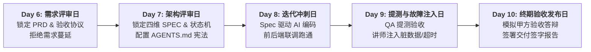

## FDE实训第一阶段Web项目产出方案

---

### 一、 战略方向

**战略价值**

1. **彻底摆脱“学生气 / 码农思维”，直击 FDE 岗位灵魂**：
   * 普通培训班教的是“写代码”；但企业采购、甲方总监要的是 **“受评测保护的生产级交付”**。
   * FDE（前线部署工程师）的核心素养不是敲键盘有多快，而是**如何在混乱的现场掌控节奏**——从需求对齐、架构卡位、带规矩编码、到提测验收。走完这套全生命周期，学员下周走进客户现场就具备了“交付老手”的职业底色。
2. **完美盘活了第 1 周（Day 1~5）沉淀的全部理论资产**：
   * Day 1 的 BRD $\to$ 用在**需求评审**；
   * Day 2-3 的归因/风险/算力 $\to$ 用在**技术架构评审**；
   * Day 4 的四维 SPEC 与验收协议 $\to$ 用在**编码驱动与提测**；
   * Day 5 的 `AGENTS.md` 与 Hooks 门禁 $\to$ 贯穿在**迭代过程防代码腐化**。
   * 这不是孤立做新项目，而是把前 5 天的散珠串成了一条价值连城的项链！
3. **让“4 人角色协同”有了真正的用武之地**：
   * 方案负责人主导需求评审，架构负责人主导技术架构评审，工程负责人主导 Sprint 编码，质量负责人主导提测与验收——每个人都有清晰的“主责主场”，绝不会出现有人摸鱼、有人累死的情况。

---

### 二、 可行性评估

**在时间上（5 天 / 40 学时），做完一个受控的单体全栈业务系统是完全足够的**。传统开发 5 天做全栈不可能，但在 **Spec 驱动 + Cursor / Claude Code 高保真生成** 的加持下，代码生成只需 20% 时间，剩下的 80% 时间恰恰是留给评审、测试和联调的。

**风险识别：三大致命翻车陷阱**：

| 致命陷阱                  | 翻车表象                                           | 预防与破解底线                                                                                               |
|:--------------------- |:---------------------------------------------- |:----------------------------------------------------------------------------------------------------- |
| **陷阱 1：需求发散死循环**      | 需求评审变成了“产品脑洞大会”，各组想做天猫商城或大型协同 SaaS，范围无限膨胀。     | **必须收敛在垂直单点场景**（如前几天演练的报销初审、智能工单路由、HR 简历初筛），严格执行 P0 范围切分，坚决划除 P1/P2。                                  |
| **陷阱 2：环境泥潭与 CSS 纠缠** | 学员把 2 天时间花在配 Node.js/Python 环境，或者死磕前端按钮颜色好不好看。 | **必须提供标准化脚手架（Boilerplate）**：极简前后端骨架（如 FastAPI + SQLite + 原生 React/Vue/Tailwind），前端能点通交互即可，重点是业务状态与降级。 |
| **陷阱 3：评审与提测流于形式**    | 评审变成走过场，提测就是鼠标乱点两下说“我测过了”。                     | **必须由真实契约物卡死**：提测必须跑通 Day 4 编写的自动化测试套件；验收必须由讲师或跨组同学扮演“挑剔甲方”当场签字。                                      |

---

### 三、 5 天全生命周期排期

 **五天五大里程碑动线**：

#### 🗓️ Day 6（周一）：需求评审与验收协议签署日（Kickoff & PRD Review）

* **核心动作**：方案负责人出具标准 PRD 与 P0 边界清单；全组召开需求评审会。
* **交付铁律**：质量负责人必须同步出具《项目交付验收评测协议书》（明确多少条测试用例、什么指标算及格）。
* **里程碑产出**：全组签字封版的《PRD 规格书》+《验收评测协议书 v1.0》。

#### 🗓️ Day 7（周二）：技术架构与 SPEC 契约评审日（Architecture Review）

* **核心动作**：架构负责人出具四维 SPEC（数据实体、OpenAPI/JSON Schema 契约、状态转移矩阵、超时降级方案）；工程负责人搭建好 Day 5 的项目脚手架与 `AGENTS.md`。
* **交付铁律**：**严禁写业务实现代码！** 只能定义出 `models.py` 与 `tests/test_api.py` 测试断言（也就是学过的 5.1 “测试考卷”）。
* **里程碑产出**：通过评审的《技术 SPEC 架构书》+ 基础单测套件（红灯状态）。

#### 🗓️ Day 8（周三）：迭代冲刺与高保真代码生成日（Sprint Coding & Integration）

* **核心动作**：工程负责人挂载 `AGENTS.md`，驱动 Cursor Composer / Trae / Claude Code 进行填空式业务代码生成。
* **交付铁律**：后端 API、ORM 数据库写入与前端界面联动；必须跑通 Day 7 编写的单测套件（全员见证绿灯）。
* **里程碑产出**：受单测保护的端到端单体 Web 系统（本地可运行演示）。

#### 🗓️ Day 9（周四）：提测、故障注入与缺陷迭代日（QA & Fault Injection）

* **核心动作（重头戏）**：工程负责人向质量负责人正式“提测”。质量负责人拿着 Day 6 的验收测试集进行饱和测试。
* **🔥 讲师高潮设计（Chaos Monkey 故障注入）**：
  * **讲师亲自扮演“恶意/突发环境”**：往各组数据库注入脏数据、故意断网模拟模型超时、输入极端模糊的 OCR 图片；
  * 检验各组系统是否会崩溃报错，还是能按 SPEC 优雅地触发 Fallback 降级（转人工复核）；
  * 发现缺陷后，驱动 AI 在 30 分钟内完成代码自我修复与回归测试。
* **里程碑产出**：《QA 提测缺陷报告》+《故障注入防御测试报告》。

#### 🗓️ Day 10（周五）：模拟客户终期验收答辩与上线（Final Sign-off & Demo Day）

* **核心动作**：各小组在本地打好 Docker 镜像或一键启动全栈服务。
* **答辩演练**：
  * 4 人组上台，方案讲价值与场景，架构讲 SPEC 与状态机，工程演示系统与 AI 协同，质量演示测试覆盖率与验收打分；
  * **讲师现场扮演“挑剔的甲方总监”**：抽查 corner case、询问卡数算力定盘、并在最终的《客户验收报告》上正式签字回款！
* **里程碑产出**：完整的 GitHub 仓库 + 甲方签字的《项目结项验收报告包》（第一阶段完美结业！）。

---

### 💡 核心建议小结：

> **“抓两头，控中间”**：  
> **抓两头**：把 Day 6 的《需求与验收协议》和 Day 10 的《现场验收签字》做扎实，让学员体会到商业契约的严肃性；  
> **控中间**：用 Day 7 的《技术 SPEC》约束 Day 8 的 AI 编码速度，用 Day 9 的《讲师故障注入》检验系统硬核防线。  
> **这样5 天的实操，是学员职业生涯中最具实战含金量的一周！**
