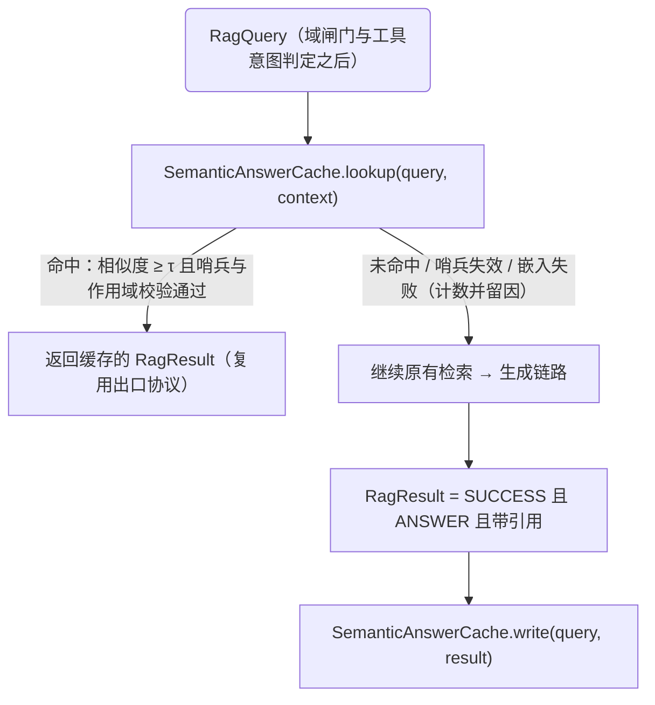

# 语义答案缓存设计：带知识版本哨兵的向量相似度缓存

## 授权与范围

教学输入：Day 29 "语义缓存 + FastAPI" 讲义（2026-11）。本设计只移植其语义缓存思想，
不引入 FastAPI/Celery/Model Router——服务化外壳、超时预算、拒答与引用治理已由现有
组合方案（见 `2026-09-30-rag-consultation-composition-design.md`）建立。

范围：在 consultation-service 内为 AI 咨询问答增加一层"以查询向量余弦相似度命中、
以知识当前发布版本为有效性哨兵"的答案缓存。默认关闭，配置启用。

非目标：SSE 流式（单独立项）、按请求选模、用户/部门 Token 预算、跨实例缓存共享、
Redis 接入、outbox 消费者实现、消息持久化与幂等语义的任何改变。

## 现状事实（实施前提）

链路（`it-ticket-cloud/consultation/`，下同）：

- `service/AiConsultationService.java:71` `chat(...)` → `idempotencyService.execute(...)` 包裹
  `doChat`；`doChat`（:83）顺序：载入会话鉴权 → `loadAiHistory` → `appendEmployeeMessage`
  （:93，模型调用前持久化提问）→ `ragClient.answer(query, requestId)`（:103）→ 二次
  `requireAiActive`（:108）→ `AiAnswerGuard.evaluate`（:110）→ `persistInteraction`（:114）/
  `persistAiMessage`（:115）→ 组装 `AiChatResponse`。
- `adapter/ComposedRagAdapter.answer(RagQuery, RagCallContext)`（:49）唯一编排：
  分类（:53）→ 域闸门 `restrict(verdict.domain())`（:55）→ 工具意图旁路判定（:72）→
  检索（:57）→ 检索侧 HIGH_RISK 收紧（:65）→ `RetrievalPolicy.material`（:74）→
  生成（:75，生成前预算放开为无限）→ 引用重建（:94）→ `RagResult`（:102）。
- `adapter/GuardedRagClient.answer`（:113）四层防护 + `validate`（:259）严格六键协议；
  失败一律折叠为 `RagStatus`，永不抛出。
- 版本哨兵可本地执行：`service/KnowledgeQueryService.java:124`
  `isPublishedCurrentVersion(String articleId, String versionId)`，本地 MyBatis 锁定读
  （`mapper/KnowledgeQueryMapper.java:190`，`FOR SHARE NOWAIT`，不使用会话缓存的当前读）。
- `AiAnswerGuard.evaluate`（`service/AiAnswerGuard.java:72`）纯函数，逐条引用调用
  `citationValidator`，且在回答落库事务内执行——缓存命中若沿用该出口，版本复核自动保留。
- Java 侧无任何 embedding 代码；向量计算仅存在于 Python 检索内核。
- consult-service pom 无 cache/caching 依赖；无 Caffeine/Guava/Redis 客户端。
- 审计表 `ai_interaction`（`db/it_ticket_system_init_v2.sql:442`）与 AI 消息
  `consultation_message` 已有 latency、retrieved_versions、消息 metadata JSON。

## 组件与数据流

新增两个组件，接线在装配期完成（`config/AiCompositionConfig.java`），业务代码不出现
provider 分支：



### 1. EmbeddingClient（新接口 + 单实现）

```
adapter/embedding/EmbeddingClient.java
  public interface EmbeddingClient {
      float[] embed(String text);            // 归一化向量；失败抛 EmbeddingUnavailable
  }
adapter/embedding/OpenAiCompatibleEmbeddingClient.java
  // POST {embedding-base-url}/embeddings，OpenAI 兼容协议，apiKey 鉴权
```

- 配置挂 `itticket.consultation.ai.cache.*`，新增嵌套类 `ConsultationProperties.Ai.Cache`：
  `enabled=false`，`threshold=0.93`，`maxEntries=500`，`ttlSeconds=604800`，
  `embeddingModel`，`embeddingBaseUrl`（为空回退 `ai.base-url`），`embeddingTimeoutMs=1000`，
  `minWriteIntervalSeconds=0`（同条目限频刷新）。
- 向量模型名进入条目命名空间：不同 embedding 模型的向量不可比，模型名或维度不一致即视为
  不同命名空间，禁止跨命名空间比较。
- **嵌入调用计入 `RagCallContext` 统一超时预算**：查缓存发生在预算尚受检索/生成总限约束的
  阶段；嵌入超时或预算耗尽 → 跳过缓存（按未命中处理，见失败语义）。

### 2. SemanticAnswerCache（纯本地、有界、可独立测试）

```
adapter/cache/SemanticAnswerCache.java
  public Optional<CachedAnswer> lookup(RagQuery query, RagCallContext context)
  public void write(RagQuery query, RagResult result)
```

**条目结构** `CachedAnswer`（不可变 record）：

- `questionText`（规范化：trim + 折叠连续空白，不做分词/去停用词）、`questionVector`
- `RagResult` 全量字段原样承载：`answerText`、`citations`（含 score/snippet）、`confidence`、
  `modelVersion`、`replyType`、`retrievedVersionIds`
- 作用域判别字段：`category`、`assetId`（来自 RagQuery；空视为通配）
- `embeddingModel`、`createdAt`、`lastAccessedAt`、`hitCount`

**lookup 规则（全部通过才命中，任一失败都是真实未命中，不留半吊子状态）：**

1. `enabled` 且 `query.history()` 为空（独立提问；多轮追问不参与缓存，理由见"正确性"）
2. 工具判定不为旁路（`RequestVerdict.tool() == NO_TOOL`；旁路请求走原有 agent 链路）
3. 同一 namespace：`embeddingModel` 一致
4. 作用域匹配：条目 `category`/`assetId` 与本次查询一致（null 通配）
5. 与每一条目算余弦相似度，取最高分 ≥ `threshold`（默认 0.93）
6. **版本哨兵前置复核**：对候选条目全部 `citations` 的 `versionId` 逐条调
   `isPublishedCurrentVersion`（本地 SQL，廉价的当前读）。任一不再是当前发布版本 →
   驱逐该条目并按未命中继续（**不允许把过期缓存当成实时拒答**；也不允许跳过复核直接放出）。
   哨兵复核抛出数据库异常时，按未命中降级穿透并记录原因，不吞错。

命中后组装的 `RagResult` 与实时链路结构完全相同（`RagStatus.SUCCESS`、原 `modelVersion`、
原 citations），并记录 `retrievedVersionIds = 条目原值`，供审计沿用。**不在 RagResult 上
新增对外字段，`AiChatResponse` 外部契约不变。**

**write 规则（仅在完整成功路径调用）：**

1. `RagResult.status == SUCCESS` 且 `replyType == ANSWER` 且 `refusalReason == null`
   且 `citations` 非空（**generalAnswer/CLARIFY/拒答/降级永不缓存**）
2. 作用域、history 为空、非工具旁路，与 lookup 相同
3. 去重替换：若已有条目与本次问题相似度 ≥ threshold，替换该条目（刷新时间与内容），
   否则在容量上限内追加；超限时按 LRU 淘汰
4. 写缓存失败（嵌入失败、容量异常）只降级为不缓存并计数留因，**绝不影响实时回答**

**存储**：进程内有界结构（数组 + 访问序），本期不做持久化、不做跨实例共享。理由：FAQ 语义
簇数量在百级，上限 500 条 × 4096 维 float ≈ 8MB；进程重启冷缓存可接受。Redis 化留待缓存被
证明需要多实例共享时再立。

## 编排接线（ComposedRagAdapter 修改点）

`ComposedRagAdapter` 构造器增加 `SemanticAnswerCache cache`（装配期由
`AiCompositionConfig` 注入；`enabled=false` 时装配一个空实现以外的选择是**不装配旁路**，
仍保持唯一 RagAdapter）。步骤插接：

- **lookup 插入点**：分类（:53）与域闸门（:55）之后、工具旁路判定之后、检索（:57）之前。
  域闸门每个请求实时执行，OFF_TOPIC/HIGH_RISK 在缓存之前就被拒——缓存永不短路安全裁决。
- 命中直接跳到引用已满足的出口组装（跳过检索、检索侧 HIGH_RISK 收紧、生成）。
  已知取舍：检索侧 HIGH_RISK 收紧（:65）在命中路径不执行——该条目当初通过了该收紧，
  且版本哨兵保证其引用的知识内容与当初一致，语义不同的知识批次走实时链路，不会被缓存污染。
  此取舍写入部署说明。
- **write 插入点**：`RagResult` 成功组装（:102）之后、return 之前。

同步迁移：`ComposedRagAdapter` 构造器签名变更时同步修改 `AiCompositionConfig.java:57-64`
与所有直接构造该类的测试（`RagCompositionHttpTest`、`AiConsultationPolicyTest` 等），
不留旧构造器。

## 失败与降级语义（对齐既有裁决）

- 三种结果严格区分并分别计数：**命中**（`hit`）、**真实未命中**（含哨兵驱逐）、
  **缓存依赖失败**（embedding 调用失败/超时、哨兵 SQL 异常）。失败绝不静默：WARN 日志 +
  失败计数器，且失败原因独立于未命中，审计可辨。
- 缓存任何阶段失败都不阻断实时链路——缓存是加速器不是依赖链；但"跳过缓存"这一事实是
  显式降级决策，必须留痕，不允许伪装成普通未命中对外输出。
- 命中结果的 `confidence` 语义不变：它仍是当初真实生成时的模型置信度；缓存相似度是独立的
  匹配度量，只进审计与统计，不进 `AiChatResponse.confidence`（两种置信度不混用）。

## 审计与监控（对齐讲义产出物 2，不动 DB 结构）

- `persistAiMessage` metadata JSON 增加 `cacheHit`、`cacheSimilarity`、`cacheScope` 字段
  （readable 默认缺省，schemaVersion 保持 1 并在文档注明追加字段）。
- `persistInteraction` 不改表结构：命中时 `modelVersion` 原样（真实来源），latencyMs 自然
  反映加速效果，`retrieved_versions` 沿用条目原值。
- 新增进程内计数器与只读端点 `GET /api/v1/consultations/ai/cache/export`（管理员鉴权，
  路由与权限沿用现有 controller 惯例）：hits、realMisses、depFailures、evictions（TTL/LRU/
  哨兵各计）、entries、hitRate、topSimilarity 分布。产出物 2 的压测报告以此端点为数据源。
- 压测基线：记录启用前后同题集的 P95 延迟、命中率、Token 消耗估算（模型调用次数 ×
  平均输出 Token），写入 `docs/` 报告，格式对齐讲义 `cache_benchmark_report.md` 交付定义。

## 正确性论证

1. **版本安全**：双重防线——命中前哨兵逐条当前读复核 + 原有 `AiAnswerGuard` 落库前复核
   （不变）。缓存不引入任何绕过这两道复核的路径。
2. **多轮追问不缓存**：追问（"那上海呢？"）语义依赖历史，向量只匹配末句会产生张冠李戴。
   v1 硬性限定 `history` 为空的独立提问；内部 IT 咨询高频问法绝大多数为独立提问，
   该限制先保正确再谈覆盖。
3. **同义改写命中即语义命中**：讲义核心收益（同义问法 → 0 Token 直出）完整保留。
4. **阈值语义漂移**：τ 默认 0.93（合规语境取高值），配置下界校验 ≥ 0.90；上线后按审计回调。
5. **知识可见性假设**：缓存条目仅含 PUBLISHED 知识的引用，对所有员工可见性一致。若未来
   引入按角色裁剪的检索，必须在缓存 key 增加 scope 维度——写入部署说明。
6. **幂等不变**：缓存仍在 `idempotencyService.execute` 包裹之内；幂等重放走既有机制，
   缓存不参与、不干扰。

## 配置

`application.yml` 追加（kebab-case，env 占位符，沿用 `itticket.consultation.ai.*` 惯例）：

```yaml
itticket.consultation.ai.cache:
  enabled: ${AI_SEMANTIC_CACHE_ENABLED:false}
  threshold: ${AI_SEMANTIC_CACHE_THRESHOLD:0.93}
  max-entries: 500
  ttl-seconds: 604800
  embedding-model: ${AI_CACHE_EMBEDDING_MODEL:}        # 必填方可启用
  embedding-base-url: ${AI_CACHE_EMBEDDING_BASE_URL:}  # 空 → 回退 ai.base-url
  embedding-timeout-ms: 1000
```

前提待实施期验证：所选 OpenAI 兼容供应商在 `ai.base-url` 上同时提供 `/embeddings` 端点
（与 Python 侧 `KspEmbeddingProvider` 同一服务族）。

## 验收

1. 单元（纯函数级）：`SemanticAnswerCacheTest`——余弦计算与阈值边界、LRU/TTL 淘汰、
   命名空间隔离（不同 embedding 模型不比较）、去重替换写入、history 非空不查找不写入。
2. 集成（`RagCompositionHttpTest` 风格，JDK HttpServer stub `/embeddings` + 模型端点）：
   未命中→生成→写入→同义改写命中（模型端点零调用）→哨兵失效（versionId 下线）后未命中
   并驱逐→拒答/CLARIFY/generalAnswer 不写缓存→工具旁路不查缓存→嵌入故障计数为依赖失败
   而非未命中→命中路径 `AiAnswerGuard` 仍执行且能拦截伪造引用。
3. Spring 上下文：`enabled=false`（默认）行为与现状完全一致；`enabled=true` 且缺
   `embedding-model` 时启动失败（fail-fast，不做半启用）。
4. 基线：修改前后 consultation-service 全量 Maven 测试通过（当前基线 206 项，
   含事务/预算/断路器既有用例不回归）。
5. 指标验收：stub 压测下同义改写题集命中率 ≥ 90%、命中延迟 < 300ms（含嵌入）、
   模型调用次数按命中数线性下降。

## 待裁决

1. 哨兵复核用现有 `KnowledgeQueryService.isPublishedCurrentVersion` 逐条调用（N = citations
   数，topK=3，通常 ≤3 次索引点查）；若压测显示热点问题下成本仍显著，再议批量接口。
2. 缓存命中是否也跳过检索侧 HIGH_RISK 收紧（上面已声明取舍）——确认接受。
3. 引用版本运行 YAML 阈值为 0.65/0.70 的既有事实不变，缓存不重复该策略，仅消费通过策略
   的结果。
