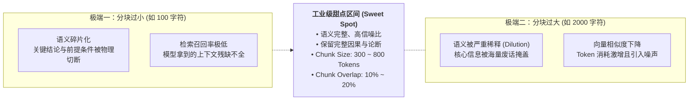
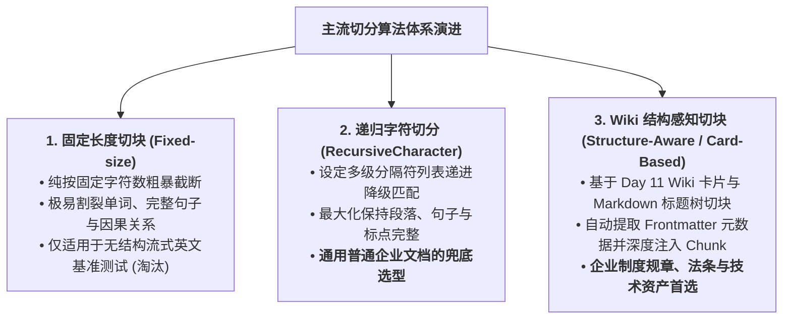
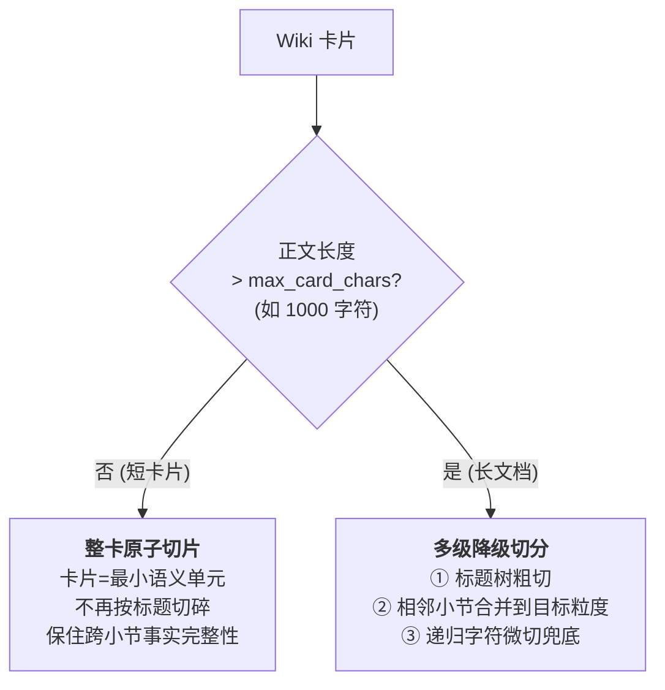

# 企业级 AI 解决方案交付工程师 (FDE) 学员实战讲义

## Day 12：Chunking 结构感知切块工程与 Embedding 向量化调优

**所属模块**：第二阶段：RAG 数据工程、黄金问题集与单 Agent 工具交付  
**学习周期**：第 3 周 / 第 12 天（8 学时 / 理论剖析 + Wiki 结构化切块实验 + 向量库批量索引实操）  
**面向学员**：初中级交付工程师 (Junior FDE) / 资深技术骨干 / 解决方案架构师  
**前置承接**：已完成 Day 11《企业非结构化文档解析、清洗与 LLM Wiki 知识重构工程》，手握带 YAML Frontmatter 元数据的高纯度、无冲突企业 Wiki 知识卡片。今天将深入 RAG 数据工程最关键的“结构感知切割与高维向量表征”阶段！

---

## 🎯 学习目标与交付物约定

完成本模块课程与实操工作坊后，每位学员应达成以下关键能力指标：

1. **破除“一刀切”盲目分块**：深刻理解固定字符切块（Fixed-size Chunking）对上下文语义的腰斩危害，掌握分块大小（Chunk Size）与重叠窗口（Chunk Overlap）的黄金经验参数调优法则。
2. **精通基于 Wiki 卡片的结构感知切块 (Structure-Aware Chunking)**：熟练掌握递归字符切块（`RecursiveCharacterTextSplitter`）与层级结构切块（`MarkdownHeaderTextSplitter`），并掌握直接基于 Day 11 企业 Wiki 卡片边界切分的最佳实践。
3. **精通元数据深度注入 (Metadata Enrichment)**：掌握自动化解析 Wiki YAML Frontmatter，将制度版本、生效日期、所属部门、业务实体作为 Payload 注入向量库，为后续条件过滤检索建立基座。
4. **精通 Embedding 工业选型与评测**：掌握 BAAI BGE 系列（`bge-m3`、`bge-large-zh`）、OpenAI 及开源模型的维度、最大序列长度与检索效果平衡，理解 MRL（俄罗斯套娃表示学习）降维降成本技术。
5. **掌握向量数据库架构与 HNSW 索引调优**：理解向量相似度计算（余弦相似度、内积、欧氏距离），掌握主流向量库（Chroma 本地轻量级 vs Milvus 分布式生产级）选型与 HNSW 图索引的核心参数配置。
6. **组内产出两大核心工程资产**：
   - [ ] 产出物 1：《Chunking 分块策略评估报告 (含朴素暴力切块 vs 基于 Wiki 结构切块对照实验)》
   - [ ] 产出物 2：《端到端批量向量化与索引入库脚本代码 (`ingest_vector_store.py`，支持 Frontmatter 自动注入与断点续入)》

---

## 目录

- [第一篇 切割的艺术：为什么 Chunking 决定了检索命中率的生死？](#第一篇-切割的艺术为什么-chunking-决定了检索命中率的生死)
- [第二篇 三大切块算法深度拆解：从暴力截断到 Wiki 结构感知切块](#第二篇-三大切块算法深度拆解从暴力截断到-wiki-结构感知切块)
- [第三篇 语义罗盘：Embedding 模型全景选型与评测](#第三篇-语义罗盘embedding-模型全景选型与评测)
- [第四篇 存储与检索基座：向量数据库与 HNSW 索引调优](#第四篇-存储与检索基座向量数据库与-hnsw-索引调优)
- [第五篇 生产级代码实战：基于 Wiki 结构与元数据注入的向量库入库工程](#第五篇-生产级代码实战基于-wiki-结构与元数据注入的向量库入库工程)
- [第六篇 课堂实战工作坊：4 人小组分块调优与入库大比武](#第六篇-课堂实战工作坊4-人小组分块调优与入库大比武)

---

# 第一篇 切割的艺术：为什么 Chunking 决定了检索命中率的生死？

### 1.1 分块太小 vs 分块太大的“两难死锁”

在 RAG 系统的向量检索中，很多工程师最容易走向两个极端：



#### 真实企业级翻车案例：

某医疗知识库对《用药说明书》进行分块，由于采用了朴素的 200 字固定切分：

* **切块 A**：“本药品适用于治疗急性支气管炎、肺炎，每日口服三次，每次一片……”
* **切块 B（被硬生生切断在下一块）**：“……但在患者处于重度肝肾功能不全或妊娠早期时，**绝对禁用！违者可致严重肝衰竭！**”
* **灾难后果**：用户提问“孕妇有轻微支气管炎能吃这个药吗？”，向量库只召回了切块 A，模型回答“可以服用”——直接引发危及生命的医疗责任事故！

> 📌 **工程根因剖析与架构解法**：  
> **问题根因**：物理字数截断完全忽视句法结构与语义边界，导致条件状语、反转连词与主谓宾结构被强制割裂。  
> **架构解法**：一个合格的 Chunk 必须是一个自包含、语义完整、有始有终的“原子事实单元”。必须升级为**结构感知分块（Structure-Aware Chunking）**，优先依据 Markdown 章节标题与知识卡片边界进行切分，杜绝边界截断。

---

# 第二篇 三大切块算法深度拆解：从暴力截断到 Wiki 结构感知切块

### 2.1 三大核心切分算法原理与对照



| 算法类型                                   | 核心驱动逻辑                                                           | 优势                           | 劣势                     | 推荐工业场景                          |
|:-------------------------------------- |:---------------------------------------------------------------- |:---------------------------- |:---------------------- |:------------------------------- |
| **固定长度切块**<br>*(Fixed-size)*           | 纯按字符下标推进，如 `0~500, 450~950`                                      | 速度极快，计算极其简单                  | 极易在句子中间断裂，割裂标点与单词      | 纯英文无格式流式文本预处理（工业级已废弃）           |
| **递归字符切分**<br>*(RecursiveCharacter)*   | 设定分隔符优先级列表：`["\n\n", "\n", "。", "！", " ", ""]`，从大段落到标点逐级降级尝试     | 尽可能保留段落和完整句子，语义连贯度高          | 对复杂表格与层级标题无感知          | **通用业务正文段落二次切分的标准兜底**           |
| **Wiki 结构感知切块**<br>*(Structure-Aware)* | 基于 Wiki 卡片边界与 Markdown `#`, `##`, `###` 标题树切分，注入 Frontmatter 元数据 | 完整保留层级拓扑，带版本/部门/实体标签，支持元数据过滤 | 需前置依赖 Day 11 的知识重构治理工作 | **企业制度规章、操作手册、商业合同、高规格 RAG 基座** |

---

### 2.2 黄金经验参数：Chunk Size 与 Overlap 计算公式

在工程落地中，**Chunk Size（分块大小）** 与 **Chunk Overlap（重叠窗口大小）** 该如何设定？

$\text{推荐 Overlap} = \text{Chunk Size} \times (10\% \sim 20\%)$

* **为什么需要重叠窗口（Overlap）？**  
  两个切块之间必须有交叉过渡区（类似千层饼的搭接处），防止恰好落在边界处的关键因果关系或专有名词丢失！
* **主流场景参数推荐表**：
  * **企业规章制度 / 法律合规条文**：`Chunk Size = 500 ~ 600 Tokens, Overlap = 80 ~ 100 Tokens`（保证法条完整，因果完整）。
  * **客户服务 FAQ / 短知识卡片**：`Chunk Size = 200 ~ 300 Tokens, Overlap = 30 ~ 50 Tokens`（短小精悍，提高单点命中率）。
  * **技术文档 / 跨段长论文**：`Chunk Size = 800 ~ 1000 Tokens, Overlap = 150 Tokens`（保持技术论证与代码块完整）。

---

### 2.3 实战反面教材：过度切分陷阱（结构感知≠万能，粒度必须匹配原子性）

> 📌 **本节是 Day 12 真实踩坑记录**：很多学员以为"上了结构感知切块就一定比朴素强"。错！**如果卡片本身已经是一个原子单元，再按标题切碎反而是负优化。**

#### 翻车现场：结构感知切块 2/4，竟输给朴素切块 4/4

在对《IT 常见问题知识库》做向量化评测时，我们设计了一道对抗题：

* **业务提问**：“电脑频繁蓝屏显示 `MEMORY_MANAGEMENT`，如何检查内存？IT 用什么工具分析 dump 文件？”
* **黄金考点（4 个）**：`mdsched`、`sfc /scannow`（员工自助）、`MemTest86`、`BlueScreenView`（IT 进阶）

**反直觉结果**：

| 切块策略 | Top-3 命中率 | 现象 |
| :--- | :---: | :--- |
| 朴素固定切分 (500 字符) | **4/4** ✅ | 恰好把两个小节切进了同一块 |
| Wiki 结构感知切块 (H2 逐节切) | **2/4** ❌ | 4 个考点被切散到 2 个切片，Top-3 只召回了其中 1 个 |

#### 工程根因剖析

出问题的卡片《SYS-001 蓝屏死机故障处置》**整篇正文仅 ~900 字符**（约 500 Tokens，正落在 300~800 Tokens 的甜点区），但 4 个黄金考点天然分散在两个小节：

```
# 【SYS-001】Windows蓝屏死机故障处置
## 员工自助排查        ← mdsched、sfc /scannow（考点 1、2）
## IT工程师进阶处理    ← MemTest86、BlueScreenView（考点 3、4）
```

* **结构感知切块**按 H2 标题“逢节必切”，把这两个小节切成了**两个独立切片**。检索时 Top-3 往往只命中其中一节，另一节的考点就丢了 → 2/4。
* **朴素切块**按 500 字符硬切，歪打正着把两节切进了同一块，反而 4/4。

**根因一句话**：*过度切分破坏了短卡片的原子性（Atomicity）。* 对一张已经自包含、语义完整的短卡片再做"标题切碎"，等于人为制造了"事实分裂"。

#### 架构解法：自适应粒度切块（Adaptive Granularity）

**核心思想：切块粒度必须匹配内容的原子边界，而不是无脑套用最细粒度。**



| 策略 | 适用 | 切法 | 效果 |
| :--- | :--- | :--- | :--- |
| **整卡原子化** (Card-Atomic) | 短卡片 (≤1000 字符) | 1 张卡片 = 1 个切片 | 命中即携带完整排查链路，跨小节事实不分裂 |
| **多级降级切分** (Hierarchical) | 长文档 / 长法条 | 标题树 + 小节合并 + 递归兜底 | 控制单块大小，同时尊重语义边界 |

> 💡 **配套工程细节**：同时要**把 `_index.md` 这类"目录导航页"从入库语料中排除**——它罗列所有卡片标题，会污染向量检索的 Top-1（表面相关但无实际知识正文，且不带 frontmatter 元数据）。

#### 修复后验证数据

| 评测 | 修复前 | 修复后 |
| :--- | :---: | :---: |
| Day12 · TC-03 结构组命中率 | 2/4 | **4/4** ✅ |
| Day12 · 结构组 5 题总命中 | 16/20 | **20/20 (100%)** ✅ |
| Day13 · 四轨总命中率 | Dense/BM25/RRF 100%，全链路 81% | **四轨全部 21/21 (100%)** ✅ |

**切片规模对比**：从 142 个碎块收敛到 35 个原子卡片切片，数量更少但每个切片语义完整，检索质量不降反升。

#### FDE 避坑清单（切分策略选型自检）

1. **先看内容原子性，再定切分粒度**：FAQ / 知识卡片这类"一卡一答"的短内容，默认**整卡不切**；法条 / 手册 / 长文档才进标题切分。
2. **警惕"逢节必切"**：结构感知切块≠把每个标题都切成独立切片。要评估单块语义是否完整，跨小节的事实是否需要合并。
3. **用对抗评测题验证，而非凭感觉**：设计几个"考点横跨多个小节"的查询（如本例"员工命令 + IT 工具"），实测命中率，立刻暴露过度切分。
4. **排除导航/索引类页面**：目录页、汇总页不含实际知识正文，入库会污染检索 Top-K。

---


# 第三篇 语义罗盘：Embedding 模型全景选型与评测

从文本到高维向量空间，Embedding 模型是 RAG 的**“语义罗盘”**。

### 3.1 主流中英文 Embedding 模型天梯榜

| 模型名称                       | 开源/商业  | 向量维度 (Dimensions) | 最大上下文长度 (Max Seq Len) | 中文语义与检索能力 (MTEB)         | 推荐部署模式                    |
|:-------------------------- |:------:|:-----------------:|:---------------------:|:------------------------:|:------------------------- |
| **bge-m3 (智源)**            | **开源** | **1024**          | **8192 Tokens**       | **S 级（多语言、支持密集/稀疏/多向量）** | 私有化 GPU/CPU 本地部署（企业首选）    |
| **bge-large-zh-v1.5**      | 开源     | 1024              | 512 Tokens            | A+ 级（中文极强，针对短文本优化）       | 本地部署，显存占用极低               |
| **text-embedding-3-small** | 商业 API | 1536 / 512 (可降维)  | 8192 Tokens           | A 级（性价比极高，全球多语言）         | 公有云调用 ($0.02 / 1M Tokens) |
| **text-embedding-3-large** | 商业 API | 3072 / 1024 (可降维) | 8192 Tokens           | S 级（极高召回率与推理维度）          | 公有云高精度要求场景                |

---

### 3.2 俄罗斯套娃降维技术 (MRL - Matryoshka Representation Learning)

现代开源模型与商业模型普遍支持 **MRL 技术**：

* 传统向量模型是 1536 维，每个向量占 $1536 \times 4\text{ Bytes} \approx 6\text{ KB}$。若有 1000 万个切块，显存与内存开销巨大；
* **MRL 机制**：模型在训练阶段就保证前 $D$ 维（如 512 维）蕴含绝大部分语义能量，允许直接截取前 512 维使用；
* **工程收益**：**存储与检索计算开销暴降 66%**，而检索精度损失通常小于 1%~2%，在大规模工业检索中性价比极高。

---

# 第四篇 存储与检索基座：向量数据库与 HNSW 索引调优

### 4.1 Chroma vs Milvus：双雄选型定位

* **Chroma (轻量级嵌入式首选)**：
  * 无需启动复杂的 Docker 或集群，作为 Python 进程内置运行，存储直接落到本地 SQLite/Parquet 文件中；
  * **定位**：个人开发、PoC 验证、数据量在 50 万条以内的单机企业系统。
* **Milvus (分布式生产级首选)**：
  * 基于分布式架构，计算与存储分离（支持 S3/MinIO），支持数十亿级向量高并发毫秒级检索；
  * **定位**：集团级大规模数据、高可用集群与高并发生产交付。

---

### 4.2 HNSW 图索引的核心参数调优

向量库生产环境 90% 采用 **HNSW（Hierarchical Navigable Small World，分层导航小世界图）**：

```
Layer 2 (高速跳跃层):   (A) -----------------------> (G)
                         │                            │
Layer 1 (次级过渡层):   (A) --------> (D) ---------> (G)
                         │             │              │
Layer 0 (底层密集数据): (A)-(B)-(C)---(D)-(E)-(F)----(G)-(H)
```

#### FDE 必调两大核心参数：

1. **`M`（每个节点的最大邻居连边数）**：典型取值 $16 \sim 64$。
   * $M$ 越大，图连接越紧密，召回率越高，但建图时间和显存开销线性增加。
2. **`efConstruction`（建图时的探索深度队列大小）**：典型取值 $100 \sim 200$。
   * 决定了索引构建时的精度，通常设为所需最高召回率的对应值。

---

# 第五篇 生产级代码实战：基于 Wiki 结构与元数据注入的向量库入库工程

本工程代码读取 Day 11 产出的带 YAML Frontmatter 的企业 Wiki 知识卡片，完成**元数据提取 $\to$ 标题树切分 $\to$ 递归微切 $\to$ Chroma 向量库批量持久化**。

```python
# pipeline/ingest_vector_store.py
import os
import re
import uuid
import yaml
from typing import List, Dict, Tuple
from langchain_text_splitters import MarkdownHeaderTextSplitter, RecursiveCharacterTextSplitter
from langchain_community.embeddings import HuggingFaceBgeEmbeddings
from langchain_community.vectorstores import Chroma
from langchain_core.documents import Document

class WikiKnowledgeIngestionPipeline:
    def __init__(self, persist_directory: str = "./chroma_db"):
        self.persist_directory = persist_directory

        # 1. 初始化 Embedding 模型 (中文推荐 bge-large-zh-v1.5)
        print("⚡ 正在加载 Embedding 模型...")
        self.embeddings = HuggingFaceBgeEmbeddings(
            model_name="BAAI/bge-large-zh-v1.5",
            model_kwargs={'device': 'cpu'},  # 生产环境若有 GPU 改为 'cuda'
            encode_kwargs={'normalize_embeddings': True}  # 必须归一化以支持余弦相似度
        )

        # 2. Markdown 标题层级切分器
        self.headers_to_split_on = [
            ("#", "Header_1"),
            ("##", "Header_2"),
            ("###", "Header_3"),
        ]
        self.header_splitter = MarkdownHeaderTextSplitter(
            headers_to_split_on=self.headers_to_split_on,
            strip_headers=False
        )

        # 3. 兜底递归字符切分器
        self.text_splitter = RecursiveCharacterTextSplitter(
            chunk_size=550,
            chunk_overlap=80,
            separators=["\n\n", "\n", "。", "！", "；", " ", ""]
        )

    def parse_wiki_frontmatter(self, file_content: str) -> Tuple[Dict, str]:
        """解析 Markdown 顶部的 YAML Frontmatter 元数据"""
        frontmatter_pattern = r"^---\s*\n(.*?)\n---\s*\n"
        match = re.search(frontmatter_pattern, file_content, re.DOTALL)
        if match:
            yaml_text = match.group(1)
            try:
                metadata = yaml.safe_load(yaml_text) or {}
            except Exception:
                metadata = {}
            body_content = file_content[match.end():]
            return metadata, body_content
        return {}, file_content

    def process_and_ingest_wiki(self, file_path: str):
        """读取 Wiki 卡片并注入带有丰富元数据的向量数据库"""
        print(f"📖 正在解析企业 Wiki 卡片：{file_path} ...")
        with open(file_path, "r", encoding="utf-8") as f:
            raw_content = f.read()

        # Step 1: 解析 Frontmatter 元数据
        frontmatter_meta, body = self.parse_wiki_frontmatter(raw_content)

        # Step 2: 结构化层级切分
        header_splits = self.header_splitter.split_text(body)

        # Step 3: 二次微切并注入元数据
        final_docs: List[Document] = []
        for doc in header_splits:
            sub_chunks = self.text_splitter.split_documents([doc])
            for idx, chunk in enumerate(sub_chunks):
                # 合并 Frontmatter 元数据与切块元数据
                for key, val in frontmatter_meta.items():
                    # 向量库 Metadata 通常要求值为 str, int, float, bool
                    chunk.metadata[f"wiki_{key}"] = str(val) if isinstance(val, (list, dict)) else val

                chunk.metadata["source_file"] = os.path.basename(file_path)
                chunk.metadata["chunk_id"] = str(uuid.uuid4())[:8]
                chunk.metadata["sub_idx"] = idx
                final_docs.append(chunk)

        print(f"✅ 成功拆解为 {len(final_docs)} 个高纯度结构化 Chunks (含完整 Wiki 元数据)")

        # Step 4: 批量灌入 Chroma 向量数据库
        vector_db = Chroma.from_documents(
            documents=final_docs,
            embedding=self.embeddings,
            persist_directory=self.persist_directory
        )
        print(f"🎉 入库圆满完成！数据已落盘至：{self.persist_directory}")
        return vector_db

if __name__ == "__main__":
    # 测试运行
    sample_wiki = "test_wiki_card.md"
    content = """---
id: "WIKI-HR-TRAVEL-202401"
title: "集团员工差旅报销管理规约 (2024年版)"
category: "财务制度"
department: "财务共享中心"
version: "v2.1"
effective_date: "2024-01-01"
entities: ["差旅补贴", "总监级", "住宿上限"]
---

# 差旅住宿执行规范

## 1. 住宿标准明细
总监级员工一线城市每晚限额 800 元，普通员工每晚限额 400 元。

## 2. 报销凭证要求
住宿费必须开具增值税专用发票，明细必须注明住宿天数与单价。
"""
    with open(sample_wiki, "w", encoding="utf-8") as f:
        f.write(content)

    pipeline = WikiKnowledgeIngestionPipeline()
    db = pipeline.process_and_ingest_wiki(sample_wiki)

    # 验证元数据检索
    query = "总监在北上广深出差住宿每晚报销上限是多少？"
    results = db.similarity_search(query, k=1)
    print(f"\n🔍 测试提问：{query}")
    print(f"🎯 命中片段：\n{results[0].page_content}")
    print(f"🏷️ 附带元数据：\n{results[0].metadata}")
```

---

# 第六篇 课堂实战工作坊：4 人小组分块调优与入库大比武

> 📌 **实战对抗任务**：  
> 各小组使用 Day 11 产出的标准化企业 Wiki 知识卡片库 (`wiki_kb_v1.0/`)。  
> 小组必须设计 **2 组对照实验**（朴素固定字符切块 vs Wiki 结构感知切块），用 5 个典型复杂业务问题（含涉及版本与适用部门的提问）发起检索对比，量化说明命中率差异，并将高质量切片全量落盘入库！

### 6.1 4 人角色分工协同表

```
┌────────────────────────────────────────────────────────────────────────┐
│                        4 人小组分块与向量化作战表                       │
├───────────────────┬──────────────────────┬─────────────────────────────┤
│ 角色 A: 方案负责人 │ 角色 B: 架构负责人   │ 角色 C: 数据工程师          │ 角色 D: 质量负责人           │
│ (Spec Lead)       │ (Architect Lead)     │ (Data Lead)                 │ (Quality Lead)              │
├───────────────────┼──────────────────────┼─────────────────────────────┤
│ 1. 审定 Chunk 参数│ 1. 选定 Embedding 模型│ 1. 编写 Frontmatter 提取    │ 1. 出具 5 个业务检索评测题  │
│    Size/Overlap   │    与本地硬件加速    │    与结构感知分块脚本       │ 2. 统计两套库的 Top-3 召回率│
│ 2. 审定 Metadata  │ 2. 配置 Chroma 路径  │ 2. 执行向量化批量落盘入库   │ 3. 验证切片是否丢失前提条件 │
│    过滤字段规范   │    与 HNSW 参数      │ 3. 优化分批写入防内存溢出   │    或因果转折词             │
└───────────────────┴──────────────────────┴─────────────────────────────┘
```

---

### 6.2 课堂任务指引清单（Step-by-Step）

1. **步骤 1：确立分块策略与 Metadata 规约（方案与架构负责人，限时 25 分钟）**
   * 审定针对本组业务文档的最佳 Chunk 范围（推荐 500~600 Tokens）；
   * 明确从 Wiki Frontmatter 中继承的核心字段（`wiki_version`, `wiki_category`, `wiki_department`）。
2. **步骤 2：执行对比切块与入库实操（数据工程师主笔，限时 40 分钟）**
   * 运行实验脚本，分别生成两套向量数据库（`chroma_naive/` 与 `chroma_wiki_structured/`）；
   * 检查向量入库耗时、最终 Chunk 个数与元数据完备度。
3. **步骤 3：检索效果对照大打分（质量负责人主笔，限时 25 分钟）**
   * 用 5 个业务问题向两个库分别发起检索（Top-3）；
   * 记录对比：有几道题在朴素切分库中前言不搭后语？有几道题在 Wiki 结构库中命中完整且带有效版本元数据？

---

### 6.3 小组交付成果验收标准

| 序号    | 交付成果物                                  | 判定达标标准 (Checklist)                         | 得分 (1-5分) |
|:-----:|:-------------------------------------- |:------------------------------------------ |:---------:|
| **1** | 《Chunking 参数与对比评估报告》                   | 包含朴素暴力切块 vs Wiki 结构感知切块的详实对照数据。            | [ ]       |
| **2** | 自动化向量化管道代码包 (`ingest_vector_store.py`) | 具备 Frontmatter 提取、分级切块、元数据自动注入及持久化存储功能。    | [ ]       |
| **3** | 切块语义自包含性                               | 抽查 5 个切块，无断头句或孤立数字，因果关系完整。                 | [ ]       |
| **4** | 元数据完整度                                 | 检查 Chroma 存储，每个 Chunk 均携带源 Wiki 的版本与分类元数据。 | [ ]       |
| **5** | 检索召回有效性                                | 面对复杂提问，Top-1 检索结果能精准命中答案所在章节且语意完整。         | [ ]       |

---

> 📌 **阶段技术承接说明**：  
> 本日构建的高质量向量数据库已注入了丰富的 Wiki 元数据。  
> • **Day 13**：将在此基础上引入 **BM25 关键词检索**，利用 Wiki 归一化术语与 **BGE-Reranker** 打造工业级混合检索双引擎；  
> • **Day 14**：黄金问题集将利用注入的 `wiki_version` 等元数据，专门设计跨版本鉴别与精准过滤验证题！
