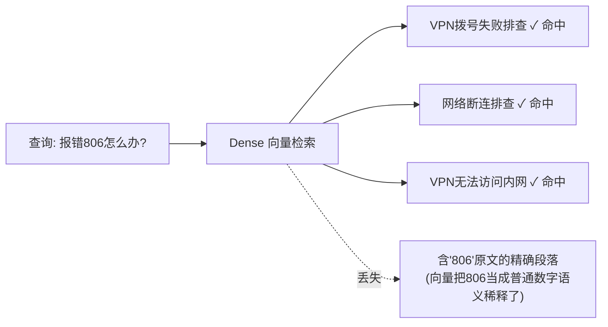
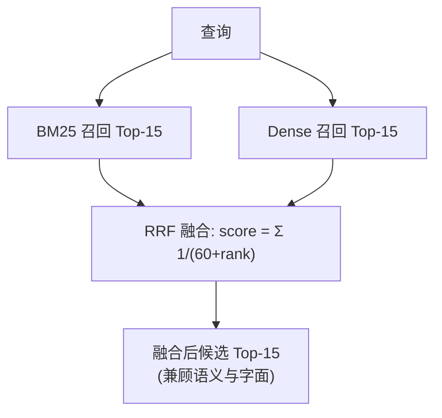
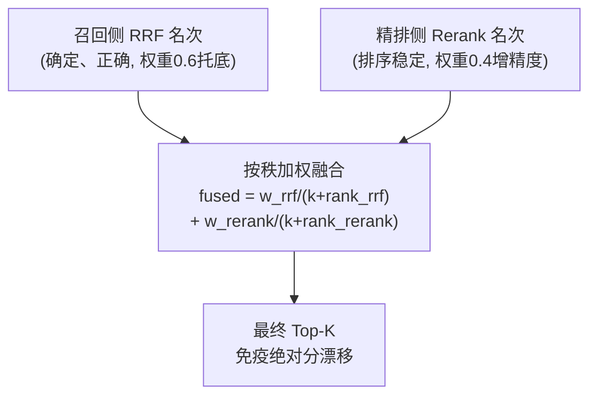

# 企业级 AI 解决方案交付工程师 (FDE) 学员实战讲义

## Day 13：混合检索机制与 Rerank 重排调优

**所属模块**：第二阶段：RAG 数据工程、黄金问题集与单 Agent 工具交付  
**学习周期**：第 3 周 / 第 13 天（8 学时 / 理论剖析 + 双路召回实验 + 精排调优实操）  
**面向学员**：初中级交付工程师 (Junior FDE) / 资深技术骨干 / 解决方案架构师  
**前置承接**：已完成 Day 12《Chunking 结构感知切块与 Embedding 向量化调优》，手握注入了 Frontmatter 元数据的高纯度向量库。今天解决**纯向量检索的先天盲区**，构建工业级混合检索与精排链路。

---

## 🎯 学习目标与交付物约定

完成本模块课程与实操工作坊后，每位学员应达成以下关键能力指标：

1. **理解纯向量检索的边界**：为什么 Dense 向量检索对"工单号、错误码、端口、命令"这类专有编号会失效？
2. **精通 BM25 关键词倒排索引**：掌握词频-逆文档频率（TF-IDF 家族）的打分原理，理解它如何与 Day 11 的 Wiki 术语归一化形成化学反应。
3. **精通 RRF 倒数排名融合**：掌握 `1/(k+rank)` 公式的工程价值——不看异构绝对分、只看名次，零调参融合两路召回。
4. **精通 Cross-Encoder 精排**：理解双塔检索（召回）与交叉编码器（精排）的架构分工与精度-延迟权衡。
5. **掌握生产级稳定性工程**：识别远程 Reranker 服务的"绝对分漂移"问题，用**按秩融合**兜底，保证检索结果可复现。
6. **产出核心资产**：《纯向量 vs 混合检索+Rerank 召回率对比实验报告》。

---

## 目录

- [第一篇 为什么纯向量检索会"失明"？](#第一篇-为什么纯向量检索会失明)
- [第二篇 BM25：关键词检索的工业基石](#第二篇-bm25关键词检索的工业基石)
- [第三篇 RRF：异构打分的"无损融合器"](#第三篇-rrf异构打分的无损融合器)
- [第四篇 Cross-Encoder：召回之后为何还要精排？](#第四篇-cross-encoder召回之后为何还要精排)
- [第五篇 生产级代码实战：四轨检索流水线](#第五篇-生产级代码实战四轨检索流水线)
- [第六篇 实战反面教材：Reranker 分数漂移与按秩融合](#第六篇-实战反面教材reranker-分数漂移与按秩融合)
- [第七篇 课堂实战工作坊](#第七篇-课堂实战工作坊)

---

# 第一篇 为什么纯向量检索会"失明"？

### 1.1 Dense 检索的语义优势与固有盲区

向量检索（Dense Retrieval）把文本编码为高维向量，靠语义相似度召回。它擅长**意图匹配**（"电脑打不开网页"≈"无法访问网站"），但对**字面精确信息**天然迟钝：



* **典型失效场景**：
  * 生僻编号：报销单号、错误码 `806`、事件 ID `4740`、退信代码 `550`
  * 精确命令：`sfc /scannow`、`ipconfig /flushdns`
  * 端口/数字：`UDP 53`、`20-50MB`、`30秒`
* **根因**：Embedding 模型把"806"映射为"一个普通的数字概念"，而不是"必须逐字符匹配的唯一标识"。数字在向量空间里被语义稀释，相似但不相同的编号互相"串台"。

> 📌 **工程结论**：Dense 是"语义召回"的主力，但必须配一条**"字面召回"**的通道兜底——这就是 BM25。

---

# 第二篇 BM25：关键词检索的工业基石

### 2.1 BM25 的核心思想

BM25 是 TF-IDF 的现代改进版，本质是**基于词频的概率排序模型**：

* **词频（TF）**：查询词在文档里出现越多，越相关（但有饱和衰减 `k1`）。
* **逆文档频率（IDF）**：越稀有的词权重越高（"806"比"故障"珍贵得多）。
* **长度归一化（b）**：长文档不因字数多而被额外加分。

### 2.2 BM25 与 Day 11 术语归一化的化学反应

| 配合点 | 收益 |
| :--- | :--- |
| Day 11 把 `WiFi`/`无线局域网` 等术语归一化进 frontmatter | BM25 用统一术语建索引，减少同义词漏召回 |
| Day 11 注入 `keywords`、`entities` 字段 | 关键词通道直接命中高价值实体 |
| Day 12 元数据前置过滤 | BM25 通道同样享受分类硬过滤 |

> 💡 **为什么 BM25 对硬编号极强**：`550`、`UDP 53` 这类词在语料里出现次数极少 → IDF 极高 → 含它们的文档被精准顶到最前。这恰好补上 Dense 的盲区。

---

# 第三篇 RRF：异构打分的"无损融合器"

两路召回回来了，怎么合并成一个榜单？

### 3.1 为什么不能直接加分数？

* Dense 的余弦相似度范围约 `0.5 ~ 0.95`；
* BM25 的打分范围约 `0 ~ 30+`；
* 两者**量纲、分布完全不同**，直接相加会被 BM25 的大数值淹没。

### 3.2 RRF（Reciprocal Rank Fusion）倒数排名融合

**核心洞察**：不看绝对分，只看**名次**。

$$\text{RRF\_Score}(d) = \sum_{c \in \text{channels}} \frac{1}{k + \text{rank}_c(d)}$$

* `k` 是平滑常数（工业惯例 `k=60`），防止第一名权重过大；
* 一篇文档只要在**任意一路**排得靠前，就能获得稳定贡献；
* **零调参、免归一化**，对两路异构打分完全免疫。



---

# 第四篇 Cross-Encoder：召回之后为何还要精排？

### 4.1 双塔 vs 交叉编码器

| 维度 | 双塔检索 (Bi-Encoder, 召回用) | 交叉编码器 (Cross-Encoder, 精排用) |
| :--- | :--- | :--- |
| **计算方式** | Query 和 Doc 各自独立编码成向量 | Query+Doc 拼接后一起进模型，逐词交互 |
| **速度** | 极快（可预先算好文档向量） | 慢（每个候选都要在线算一次） |
| **精度** | 中等（向量压缩有信息损失） | 高（细粒度词级交互） |
| **用法** | 从全库海量文档粗筛 Top-15 | 只对 Top-15 候选精排定 Top-3 |

### 4.2 分工哲学

* **召回（Retrieval）求快求全**：宁可召回 15 个里有些噪音，也不能漏掉正确答案。
* **精排（Rerank）求准**：用更强的交叉注意力，把最相关的那篇精准顶到 Top-1，剔除"中段迷失"的干扰项。

> 📌 **工业实践分工**：Rerank 主**精度**（把对的排到最前），RRF 主**召回**（保证对的在候选池里）。两者缺一不可。

---

# 第五篇 生产级代码实战：四轨检索流水线

本工程（`run_day13_pipeline.py`）在 Day 12 持久化向量库之上，装配"过滤 → 双路召回 → RRF → 精排 → 融合兜底"全链路，并对 7 组硬对抗题做**四轨对比评测**：

* **链路 A**：纯 Dense 向量检索
* **链路 B**：纯 BM25 关键词检索
* **链路 C**：Dense + BM25 + RRF 融合（无精排）
* **链路 D**：全链路（元数据过滤 + 双路召回 + RRF + Rerank 精排 + 按秩融合兜底）

```python
# 核心混合检索器（精简示意）
class IndustrialHybridRetriever:
    def hybrid_rerank_search(self, query, final_top_k=3, rrf_k=60, rough_top_k=15, metadata_filter=None):
        # 1. 双路并行粗排召回
        bm25_res  = self.bm25_search(query, top_k=rough_top_k, metadata_filter=metadata_filter)
        dense_res = self.dense_search(query, top_k=rough_top_k, metadata_filter=metadata_filter)
        # 2. RRF 倒数排名融合（召回侧）
        fused = self.rrf_fusion(bm25_res, dense_res, rrf_k=rrf_k, candidate_limit=rough_top_k)
        # 3. Cross-Encoder 精排（精排侧）
        rerank_scores = self.reranker.predict([[query, d.page_content] for d, _ in fused])
        # 4. 按秩加权融合兜底（见第六篇：名次比绝对分稳定）
        final = self._rank_weighted_fuse(fused, rerank_scores, k=10, w_rrf=0.6, w_rerank=0.4)
        return final[:final_top_k]
```

---

# 第六篇 实战反面教材：Reranker 分数漂移与按秩融合

> 📌 **本节是 Day 13 真实踩坑记录**：很多同学以为"精排分数高就万事大吉"。错！**当 Reranker 是远程 API 服务时，它的绝对分可能根本不稳定，盲目信任会让结果随机出错。**

## 6.1 翻车现场：全链路命中率在 71%~90% 之间随机抖动

四轨评测中，前三轨（Dense / BM25 / RRF）稳定 100%，唯独**全链路+Rerank 忽高忽低**：HC-01、HC-04、HC-05、HC-07 这几道题的正确切片，会**随机掉出 Top-3**。

## 6.2 工程根因剖析：Reranker 的"绝对分漂移"

我们对 `qwen3-reranker-8b`（远程 API）做同输入压测，连续调用 4 次：

| 调用 | 文档 A 得分 | 文档 B 得分 | 文档 C 得分 | 排序 |
| :---: | :---: | :---: | :---: | :--- |
| 第 1 次 | 0.684 | 0.240 | 0.276 | A > C > B |
| 第 2 次 | 0.677 | 0.238 | 0.273 | A > C > B |
| 第 3 次 | **0.938** | **0.930** | **0.842** | A > C > B |
| 第 4 次 | 0.677 | 0.238 | 0.277 | A > C > B |

**关键发现**：
* **排序（rank）基本稳定**：4 次都是 `A > C > B`，正确文档始终在最高位；
* **绝对分（score）区间会漂移**：第 3 次整体飙到 0.84~0.94，与前几次的 0.24~0.68 完全不在一个量级。

我们最初用 **min-max 归一化**融合 RRF 分和 Rerank 分。问题正在于此：当某次调用的分数"挤在一起"（如第 3 次 0.84~0.94）时，文档间**微小的绝对差被归一化放大成天壤之别**，正确切片被误判到低位，掉出 Top-3。

## 6.3 架构解法：按秩融合（Rank-based Fusion），对分数漂移免疫

**核心洞察：Reranker 的"名次"比"绝对分"可靠得多。** 那就只取它的名次，不信它的分数。



**实现要点**：
1. 两侧分别把分数转成**名次**（1 = 最高）；
2. 按 `1/(k+rank)` 加权融合，`k` 取较小值（如 10），让相邻名次有区分度；
3. **召回侧给更高权重（0.6）**——因为它确定且正确，作为托底；精排侧（0.4）提供精度增益。

这样即使 Reranker 某次把正确切片错后几名，召回侧的稳定领先也能把它"拉回" Top-K。

## 6.4 修复后验证数据

| 方案 | 全链路命中率 | 稳定性 |
| :--- | :---: | :--- |
| 纯按 Rerank 绝对分排序 | 71.4% ~ 90.5% | ❌ 随机抖动 |
| min-max 归一化分数融合 | 85.7% | ❌ 仍偶发误判 |
| **按秩加权融合（最终）** | **100%** | ✅ 连续 3 次全对 |

## 6.5 FDE 避坑清单（依赖外部打分服务时）

1. **先压测再打信任分**：对任何远程打分/Rerank 服务，同输入多调几次，确认绝对分是否可复现。
2. **不稳定就"去绝对化"**：分数不稳但名次稳 → 一律改用**名次**做融合，别用绝对分。
3. **给稳定信号更高权重**：确定、正确的通道（如本地 RRF）作为托底，抖动通道只做增益。
4. **警惕归一化陷阱**：min-max 归一化对"分数挤在一起"的分布极其敏感，会把微小差异放大成误判。
5. **用对抗题回归验证**：改完排序逻辑后，用固定黄金问题集连跑多次，确认结果稳定才可上线。

---

# 第七篇 课堂实战工作坊

### 7.1 任务

各小组基于 Day 12 的向量库，搭建完整的四轨混合检索链路，并用黄金问题集验证：
* 纯向量在哪些硬编号题上"失明"？
* BM25 如何靠术语归一化救回这些题？
* RRF 融合后召回率提升多少？
* 精排 + 按秩融合后 Top-1 精度如何？

### 7.2 交付成果验收标准

| 序号 | 交付成果物 | 判定达标标准 | 得分 |
| :---: | :--- | :--- | :---: |
| 1 | 《四轨检索召回率对比报告》 | 含 Dense/BM25/RRF/全链路 四轨命中率对照 | [ ] |
| 2 | 混合检索流水线代码 | 具备 BM25 + Dense + RRF + Rerank 完整链路 | [ ] |
| 3 | 稳定性验证 | 同一查询连跑多次结果可复现（无分数漂移抖动） | [ ] |
| 4 | 元数据过滤正确性 | 按分类硬过滤后只召回目标域切片 | [ ] |
| 5 | 精排有效性 | Top-1 切片为黄金答案所在卡片 | [ ] |

---

> 📌 **阶段技术承接说明**：  
> 本日构建的高召回、高稳定混合检索基座，将作为 Day 14「黄金问题集（Golden Dataset）与 RAGAS/TruLens 自动化评测」的检索底座——评测一个 RAG 系统，先要有一个"召得回、排得准"的检索链路。
