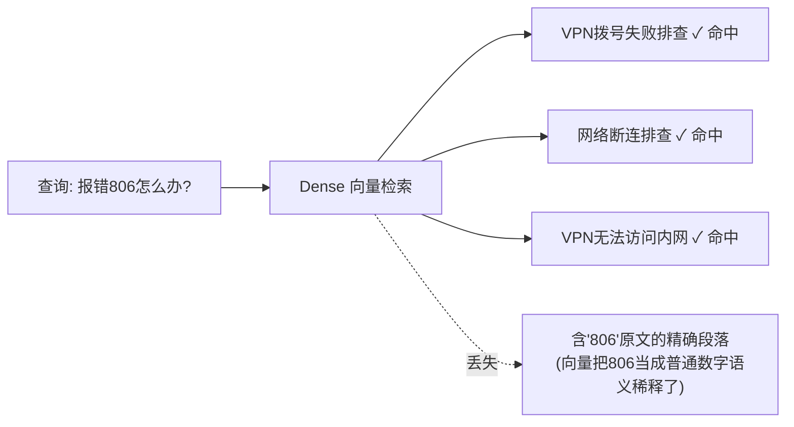
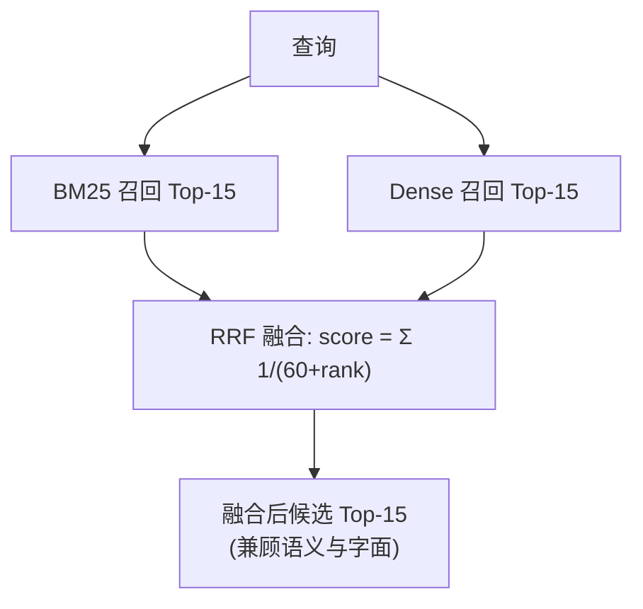
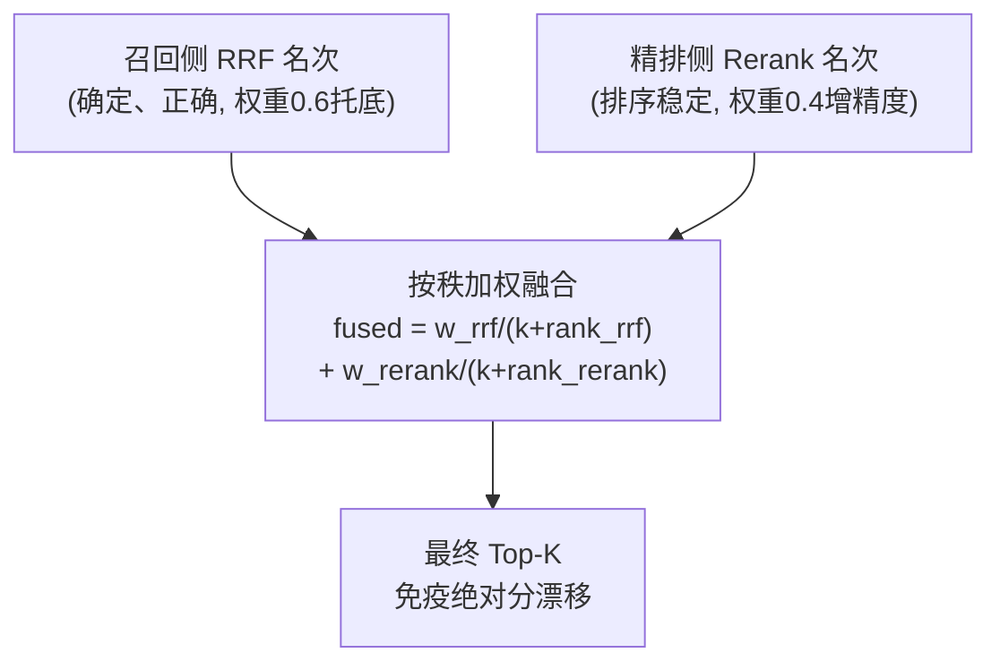

# 企业级 AI 解决方案交付工程师 (FDE) 学员实战讲义

## Day 13：混合检索机制与 Rerank 重排调优

**所属模块**：第二阶段：RAG 数据工程、黄金问题集与单 Agent 工具交付  
**学习周期**：第 3 周 / 第 13 天（8 学时 / 理论剖析 + 双路召回实验 + 精排调优实操）  
**面向学员**：初中级交付工程师 (Junior FDE) / 资深技术骨干 / 解决方案架构师  
**前置承接**：已完成 Day 12《Chunking 结构感知切块与 Embedding 向量化调优》，手握注入了 Frontmatter 元数据的高纯度向量库。今天解决**纯向量检索的先天盲区**，构建工业级混合检索与精排链路。

---

## 🎯 学习目标与交付物约定

完成本模块课程与实操工作坊后，每位学员应达成以下关键能力指标：

1. **理解纯向量检索的边界**：为什么 Dense 向量检索对"工单号、错误码、端口、命令"这类专有编号会失效？
2. **精通 BM25 关键词倒排索引**：掌握词频-逆文档频率（TF-IDF 家族）的打分原理，理解它如何与 Day 11 的 Wiki 术语归一化形成化学反应。
3. **精通 RRF 倒数排名融合**：掌握 `1/(k+rank)` 公式的工程价值——不看异构绝对分、只看名次，零调参融合两路召回。
4. **精通 Cross-Encoder 精排**：理解双塔检索（召回）与交叉编码器（精排）的架构分工与精度-延迟权衡。
5. **掌握生产级稳定性工程**：识别远程 Reranker 服务的"绝对分漂移"问题，用**按秩融合**兜底，保证检索结果可复现。
6. **产出核心资产**：《纯向量 vs 混合检索+Rerank 召回率对比实验报告》。

---

## 目录

- [第一篇 为什么纯向量检索会"失明"？](#第一篇-为什么纯向量检索会失明)
- [第二篇 BM25：关键词检索的工业基石](#第二篇-bm25关键词检索的工业基石)
- [第三篇 RRF：异构打分的"无损融合器"](#第三篇-rrf异构打分的无损融合器)
- [第四篇 Cross-Encoder：召回之后为何还要精排？](#第四篇-cross-encoder召回之后为何还要精排)
- [第五篇 生产级代码实战：四轨检索流水线](#第五篇-生产级代码实战四轨检索流水线)
- [第六篇 实战反面教材：Reranker 分数漂移与按秩融合](#第六篇-实战反面教材reranker-分数漂移与按秩融合)
- [第七篇 课堂实战工作坊](#第七篇-课堂实战工作坊)

---

# 第一篇 为什么纯向量检索会"失明"？

### 1.1 Dense 检索的语义优势与固有盲区

向量检索（Dense Retrieval）把文本编码为高维向量，靠语义相似度召回。它擅长**意图匹配**（"电脑打不开网页"≈"无法访问网站"），但对**字面精确信息**天然迟钝：



* **典型失效场景**：
  * 生僻编号：报销单号、错误码 `806`、事件 ID `4740`、退信代码 `550`
  * 精确命令：`sfc /scannow`、`ipconfig /flushdns`
  * 端口/数字：`UDP 53`、`20-50MB`、`30秒`
* **根因**：Embedding 模型把"806"映射为"一个普通的数字概念"，而不是"必须逐字符匹配的唯一标识"。数字在向量空间里被语义稀释，相似但不相同的编号互相"串台"。

> 📌 **工程结论**：Dense 是"语义召回"的主力，但必须配一条**"字面召回"**的通道兜底——这就是 BM25。

---

# 第二篇 BM25：关键词检索的工业基石

### 2.1 BM25 的核心思想

BM25 是 TF-IDF 的现代改进版，本质是**基于词频的概率排序模型**：

* **词频（TF）**：查询词在文档里出现越多，越相关（但有饱和衰减 `k1`）。
* **逆文档频率（IDF）**：越稀有的词权重越高（"806"比"故障"珍贵得多）。
* **长度归一化（b）**：长文档不因字数多而被额外加分。

### 2.2 BM25 与 Day 11 术语归一化的化学反应

| 配合点 | 收益 |
| :--- | :--- |
| Day 11 把 `WiFi`/`无线局域网` 等术语归一化进 frontmatter | BM25 用统一术语建索引，减少同义词漏召回 |
| Day 11 注入 `keywords`、`entities` 字段 | 关键词通道直接命中高价值实体 |
| Day 12 元数据前置过滤 | BM25 通道同样享受分类硬过滤 |

> 💡 **为什么 BM25 对硬编号极强**：`550`、`UDP 53` 这类词在语料里出现次数极少 → IDF 极高 → 含它们的文档被精准顶到最前。这恰好补上 Dense 的盲区。

---

# 第三篇 RRF：异构打分的"无损融合器"

两路召回回来了，怎么合并成一个榜单？

### 3.1 为什么不能直接加分数？

* Dense 的余弦相似度范围约 `0.5 ~ 0.95`；
* BM25 的打分范围约 `0 ~ 30+`；
* 两者**量纲、分布完全不同**，直接相加会被 BM25 的大数值淹没。

### 3.2 RRF（Reciprocal Rank Fusion）倒数排名融合

**核心洞察**：不看绝对分，只看**名次**。

$$\text{RRF\_Score}(d) = \sum_{c \in \text{channels}} \frac{1}{k + \text{rank}_c(d)}$$

* `k` 是平滑常数（工业惯例 `k=60`），防止第一名权重过大；
* 一篇文档只要在**任意一路**排得靠前，就能获得稳定贡献；
* **零调参、免归一化**，对两路异构打分完全免疫。



---

# 第四篇 Cross-Encoder：召回之后为何还要精排？

### 4.1 双塔 vs 交叉编码器

| 维度 | 双塔检索 (Bi-Encoder, 召回用) | 交叉编码器 (Cross-Encoder, 精排用) |
| :--- | :--- | :--- |
| **计算方式** | Query 和 Doc 各自独立编码成向量 | Query+Doc 拼接后一起进模型，逐词交互 |
| **速度** | 极快（可预先算好文档向量） | 慢（每个候选都要在线算一次） |
| **精度** | 中等（向量压缩有信息损失） | 高（细粒度词级交互） |
| **用法** | 从全库海量文档粗筛 Top-15 | 只对 Top-15 候选精排定 Top-3 |

### 4.2 分工哲学

* **召回（Retrieval）求快求全**：宁可召回 15 个里有些噪音，也不能漏掉正确答案。
* **精排（Rerank）求准**：用更强的交叉注意力，把最相关的那篇精准顶到 Top-1，剔除"中段迷失"的干扰项。

> 📌 **工业实践分工**：Rerank 主**精度**（把对的排到最前），RRF 主**召回**（保证对的在候选池里）。两者缺一不可。

---

# 第五篇 生产级代码实战：四轨检索流水线

本工程（`run_day13_pipeline.py`）在 Day 12 持久化向量库之上，装配"过滤 → 双路召回 → RRF → 精排 → 融合兜底"全链路，并对 7 组硬对抗题做**四轨对比评测**：

* **链路 A**：纯 Dense 向量检索
* **链路 B**：纯 BM25 关键词检索
* **链路 C**：Dense + BM25 + RRF 融合（无精排）
* **链路 D**：全链路（元数据过滤 + 双路召回 + RRF + Rerank 精排 + 按秩融合兜底）

```python
# 核心混合检索器（精简示意）
class IndustrialHybridRetriever:
    def hybrid_rerank_search(self, query, final_top_k=3, rrf_k=60, rough_top_k=15, metadata_filter=None):
        # 1. 双路并行粗排召回
        bm25_res  = self.bm25_search(query, top_k=rough_top_k, metadata_filter=metadata_filter)
        dense_res = self.dense_search(query, top_k=rough_top_k, metadata_filter=metadata_filter)
        # 2. RRF 倒数排名融合（召回侧）
        fused = self.rrf_fusion(bm25_res, dense_res, rrf_k=rrf_k, candidate_limit=rough_top_k)
        # 3. Cross-Encoder 精排（精排侧）
        rerank_scores = self.reranker.predict([[query, d.page_content] for d, _ in fused])
        # 4. 按秩加权融合兜底（见第六篇：名次比绝对分稳定）
        final = self._rank_weighted_fuse(fused, rerank_scores, k=10, w_rrf=0.6, w_rerank=0.4)
        return final[:final_top_k]
```

---

# 第六篇 实战反面教材：Reranker 分数漂移与按秩融合

> 📌 **本节是 Day 13 真实踩坑记录**：很多同学以为"精排分数高就万事大吉"。错！**当 Reranker 是远程 API 服务时，它的绝对分可能根本不稳定，盲目信任会让结果随机出错。**

## 6.1 翻车现场：全链路命中率在 71%~90% 之间随机抖动

四轨评测中，前三轨（Dense / BM25 / RRF）稳定 100%，唯独**全链路+Rerank 忽高忽低**：HC-01、HC-04、HC-05、HC-07 这几道题的正确切片，会**随机掉出 Top-3**。

## 6.2 工程根因剖析：Reranker 的"绝对分漂移"

我们对 `qwen3-reranker-8b`（远程 API）做同输入压测，连续调用 4 次：

| 调用 | 文档 A 得分 | 文档 B 得分 | 文档 C 得分 | 排序 |
| :---: | :---: | :---: | :---: | :--- |
| 第 1 次 | 0.684 | 0.240 | 0.276 | A > C > B |
| 第 2 次 | 0.677 | 0.238 | 0.273 | A > C > B |
| 第 3 次 | **0.938** | **0.930** | **0.842** | A > C > B |
| 第 4 次 | 0.677 | 0.238 | 0.277 | A > C > B |

**关键发现**：
* **排序（rank）基本稳定**：4 次都是 `A > C > B`，正确文档始终在最高位；
* **绝对分（score）区间会漂移**：第 3 次整体飙到 0.84~0.94，与前几次的 0.24~0.68 完全不在一个量级。

我们最初用 **min-max 归一化**融合 RRF 分和 Rerank 分。问题正在于此：当某次调用的分数"挤在一起"（如第 3 次 0.84~0.94）时，文档间**微小的绝对差被归一化放大成天壤之别**，正确切片被误判到低位，掉出 Top-3。

## 6.3 架构解法：按秩融合（Rank-based Fusion），对分数漂移免疫

**核心洞察：Reranker 的"名次"比"绝对分"可靠得多。** 那就只取它的名次，不信它的分数。



**实现要点**：
1. 两侧分别把分数转成**名次**（1 = 最高）；
2. 按 `1/(k+rank)` 加权融合，`k` 取较小值（如 10），让相邻名次有区分度；
3. **召回侧给更高权重（0.6）**——因为它确定且正确，作为托底；精排侧（0.4）提供精度增益。

这样即使 Reranker 某次把正确切片错后几名，召回侧的稳定领先也能把它"拉回" Top-K。

## 6.4 修复后验证数据

| 方案 | 全链路命中率 | 稳定性 |
| :--- | :---: | :--- |
| 纯按 Rerank 绝对分排序 | 71.4% ~ 90.5% | ❌ 随机抖动 |
| min-max 归一化分数融合 | 85.7% | ❌ 仍偶发误判 |
| **按秩加权融合（最终）** | **100%** | ✅ 连续 3 次全对 |

## 6.5 FDE 避坑清单（依赖外部打分服务时）

1. **先压测再打信任分**：对任何远程打分/Rerank 服务，同输入多调几次，确认绝对分是否可复现。
2. **不稳定就"去绝对化"**：分数不稳但名次稳 → 一律改用**名次**做融合，别用绝对分。
3. **给稳定信号更高权重**：确定、正确的通道（如本地 RRF）作为托底，抖动通道只做增益。
4. **警惕归一化陷阱**：min-max 归一化对"分数挤在一起"的分布极其敏感，会把微小差异放大成误判。
5. **用对抗题回归验证**：改完排序逻辑后，用固定黄金问题集连跑多次，确认结果稳定才可上线。

## 6.6 复盘勘误：漂移的真正根因是"网关双后端"，不是模型本身

> 📌 **本节是 6.1~6.5 之后的二次复盘**。6.2 的"绝对分漂移"现象是真的，但根因判断错了——而且复盘过程中我们还**错了一次**。两次误判都值得讲：**看到现象就给结论，是排障中最常见的错误。**

### 6.6.1 第一层真相：同一个模型名，背后是两种后端

对 `/rerank` 原始响应逐次落盘后发现：KSP 网关把同名的 `qwen3-reranker-8b` 请求**随机分流到两种后端**（约 7:3），响应头里没有上游标识、请求参数也影响不了分流，只能按响应格式识别：

| 后端 | 响应格式 | 流量占比 |
| :--- | :--- | :---: |
| Jina 风格 | `{"results": [...]}` | 约 70% |
| DashScope 风格 | `{"output": {"results": [...]}}` | 约 30% |

回看 6.2 的第 3 次调用——整体飙到 0.84~0.94——就是落到了另一个后端。

代码层面更隐蔽：旧适配器只解析顶层 `results`，落到 DashScope 后端时解析不到结果，**整组分数被静默补 0**，名次全部并列，这道题的精排等于没执行。"同一道题、同一份代码，每次跑排序都不一样"就是这么来的。

### 6.6.2 第二层真相：我们一开始钉错了后端

发现双后端后，第一反应是"钉住占多数、看起来更稳定的 Jina 后端"。结果评测显示精排判别力很差，几乎要得出"这个模型不行，换模型吧"的结论。

直到一次对照实验暴露了异常：**只去掉文档末尾的一个换行符**，Jina 后端给目标卡的分数就从 0.78 掉到 0.37；DashScope 后端对同样的改动几乎无感（0.85~0.90）。一个合格的 Cross-Encoder 不可能对末尾空白这么敏感——Jina 那一路**疑似没有套用 Qwen3-Reranker 规定的提示模板**，分数实际取决于文本最后一个 token。

把两个后端分别钉住，在 20 题（14 正样本 + 6 库外负样本）上用父块精排对比：

| 指标 | Jina 后端 | **DashScope 后端** |
| :--- | :---: | :---: |
| 纯精排卡级 MRR | 0.810 | **1.000** |
| 正样本 Top-1 原始分最低值 | 0.648 | **0.471** |
| 负样本 Top-1 原始分最高值 | 0.745（高于正样本） | **0.274** |
| 正负样本可分性（AUC） | 0.76 | **1.00** |
| 去掉文末溯源行后纯精排 MRR | 0.286（崩溃） | 1.000（不受影响） |

**结论：模型本身没问题，是网关上有一路部署不正确。** 如果当时直接换模型，问题会被掩盖而不是被解决。

**修复**（`rag_pipeline/retrieval/reranker.py` + `configs/pipeline.yaml` 的 `reranker.backend`）：
1. 两种格式都解析；解析不到结果直接抛异常，绝不补 0；
2. 只接受 DashScope 后端的打分，其余丢弃；
3. 用**并发对冲**代替串行重试：每轮同时发 4 个请求，取第一个命中目标后端的响应。串行重试长尾可达 7~8 秒，对冲后全链路平均约 0.4~0.6 秒；
4. 遇到 429 限流按 `x-ratelimit-reset-requests` 退避，并报出真实错误——对冲会放大请求量，embedding 与 rerank 共用同一份每分钟配额；
5. 治本方案是让网关侧下线或修复 Jina 那一路，客户端对冲只是止血。

**最终验证：换供应商直连**。把重排单独切到阿里云百炼直连（`.env` 中 `RERANK_BASE_URL` / `RERANK_API_KEY` / `RERANK_MODEL=qwen3-rerank`，嵌入与 LLM 仍走 KSP）后，20 道题的原始分与 KSP 网关 DashScope 后端**逐题逐位一致**——证实网关上"好的那一路"就是百炼的 qwen3-rerank，阈值无需重标。直连后每次打分只需 1 次请求（对冲时平均 4.6 次），全链路平均延迟从约 0.58 秒降到约 0.29 秒。本工程最终仍保留 KSP 网关作为默认重排通道（`.env` 中 `RERANK_*` 注释停用），百炼直连作为可随时切换的备选，阈值两边通用。

> 接入细节：百炼的 OpenAI 兼容重排接口在 `/compatible-api/v1/reranks`，**不是** Chat 用的 `/compatible-mode/v1`；换供应商后先跑 `python probe_reranker.py`（可复现性 / 文末换行扰动 / 排序三项验收）再跑评测。

### 6.6.3 修好之后：架构上的三处调整

**① 精排粒度改为父块（`retrieval.rerank_granularity: parent`）**：子块只是 150~300 字的单个小节，看不到整卡的"现象-根因-处置"上下文；改为子块召回、按卡去重后对整卡全文精排，返回 Top-K 张卡。

**② 按秩融合保留，但理由变了**：后端修好后，纯精排和按秩融合在本题集上都是 MRR 1.00，名次融合已不再是"防漂移"的必需品。保留它是为了**防御未来的精排退化**——这次事故证明，外部打分服务可能悄无声息地变差，召回侧的 RRF 名次是一道低成本保险。

**③ 启用低置信拒答（`retrieval.reject_threshold`，当时取 0.37，后经 6.7 修订为 0.40 并配合查询改写）**：这是精排真正的独有价值。按秩融合分只反映名次（上限 1/(k+1)），只能回答"谁更像"；原始相关度分才能回答"像不像"。

| 链路 | 正样本 MRR | 库外负样本误召回 | 平均延迟 |
| :--- | :---: | :---: | :---: |
| C：双路 + RRF | 1.00 | 6 / 6 | ~25ms |
| **D：全链路（父块精排 + 拒答，KSP 网关 + 对冲）** | **1.00** | **0 / 6** | ~0.5~0.6s |

在本库（35 张主题区分明显的卡）上，正样本排序 RRF 已经排对，精排没有再提升；但库外问题 RRF 必然把"最像的 3 张卡"塞给 LLM，而精排能识别出"都不相关"并拒答——**这才是 Day13 全链路值回延迟成本的地方**。

⚠️ 阈值标定只基于 14 正 / 6 负，离正样本最低分（0.471，HC-10 同义改写题）只有约 0.1 的余量；扩充题集、换后端或换模型后都必须按报告"原始 Rerank 分分布"一节重新标定。**——6.7 的留出验证证明，这个担心是对的。**

### 6.6.4 补充避坑清单

6. **先看原始响应，再下结论**：分数异常时，第一步是把 API 原始返回落盘看格式和响应头，而不是推测"模型不稳定"。
7. **解析失败要大声报错**：适配层拿不到结果时补默认值（如 0），会把故障伪装成"正常的低分"，这是最难排查的一类 bug。
8. **"稳定"不等于"正确"**：Jina 那一路同输入分数完全可复现，却是坏的那一路。可复现性只是必要条件，还要用对照实验（如扰动无关字符）检验判别力。
9. **降级要按次判定**：限流等瞬时故障只会让单次调用降级为启发式打分；依赖原始分的逻辑（如拒答阈值）必须看"本次"是否降级，而不是服务整体是否可用，否则两种量纲混用会误拒正样本。
10. **评测饱和时不要下结论**：四轨同时满分只说明题目太容易，要补近邻混淆题、库外负样本，才看得出精排的真实贡献。
11. **换模型放在最后**：先排除接入层 bug、部署问题、输入粒度、融合方式，再评估模型本身——本次如果先换模型，网关上那一路坏部署会一直藏着。

## 6.7 自己出题自己判卷：留出验证、查询改写与最终定稿

> 📌 6.6 的"0/6 误召回"是在**同一批题**上标定阈值、又在同一批题上验收得到的。本节演示正确做法：调参集与测试集分离，测试集封存、定稿后只跑一次。

### 6.7.1 三套题集，三种用途

| 题集 | 命令 | 构成 | 用途 |
| :--- | :--- | :--- | :--- |
| 主题集 | `--suite main` | 14 正 / 6 负 | 改题、调参、标定阈值 |
| 开发集 | `--suite dev` | 12 正 / 7 负 | 首轮作为留出集跑一次，之后降级为调参用 |
| 测试集 | `--suite test` | 16 正 / 10 负 | **调参前写好并封存，定稿后只跑一次**，结果如实记录 |

开发集与测试集的正样本专门设计成"近邻混淆"：问题里使用兄弟卡的词汇、甚至夹带用户自己的错误猜测（"是不是 DNS 坏了""是不是电脑开不了机了"）；负样本是"库外但有极近兄弟卡"的问题（"离职账号怎么交接"⇄ 账号锁定卡）。

### 6.7.2 留出验证暴露的两个问题

开发集首轮（未调参）结果：

| 链路 | 正样本 R@3 / MRR | 负样本误召回 |
| :--- | :---: | :---: |
| A/B/C 召回侧 | 9~10/12，0.74~0.75 | 7 / 7 |
| D：KSP qwen3-reranker-8b，阈值 0.37 | 11/12，0.88 | **2 / 7** |
| D：百炼 qwen3.7-text-rerank，阈值 0.64 | 11/12，0.83 | 0 / 7 |

1. **阈值不泛化**：KSP 模型在开发集上正样本最低 0.446、负样本最高 0.472，**正负重叠**——任何单一阈值都会误拒或误放。主题集上的 0/6 是"自测满分"。
2. **排序能力 ≠ 打分校准**：两个模型排序相近（KSP 甚至略好），但 qwen3.7 的分数有绝对意义（能答 ≥0.80、答非所问 ≤0.54），KSP 模型只会"比大小"。拒答依赖的是校准，不是排序。

失败题的共同规律：**用户在问题里写了自己对原因的猜测**，Cross-Encoder 顺着猜测给兄弟卡高分（如"是不是开不了机"→ 无法开机卡 0.71，真正答案外接显示器卡 0.40）；另有一题是**口语与卡片术语错位**（用户说"撤销对计算机所做的更改"，卡片只写"回滚"），双路前 15 个候选里都没有目标卡，精排无从救起。

### 6.7.3 调参过程（只用主题集 + 开发集）

用"全卡打分 + 离线模拟"一次评估所有组合（模拟结果与实跑逐位一致）：

| 尝试 | 结论 |
| :--- | :--- |
| 融合权重 0.6:0.4 → 0.0:1.0 | 越偏向精排越差，**保持 0.6:0.4** |
| 粗排池 15 → 60 | 能把漏召回的卡捞进池子，但精排仍排不上去，**无收益** |
| 精排 `instruct` 指令（按现象匹配、忽略猜测） | KSP 接受该字段，但兄弟卡分差反而拉大，**放弃** |
| **查询改写**（LLM 删猜测、补术语；原查询+改写查询四路召回，精排用改写查询） | 开发集 MRR 0.875→0.92、召回 11→12/12，拒答可分 ✅ **采用** |

改写示例：

| 原问题 | 改写后 |
| :--- | :--- |
| 每次开机都特别慢，屏幕上总显示「撤销对计算机所做的更改」，是电脑太老了需要清理或者加内存吗？ | 开机慢，显示「撤销对计算机所做的更改」Windows 更新安装失败回滚 |
| 自从隔壁组自己接了一个无线路由器，我们这一片电脑就时不时断网，是不是网速带宽都被他们占了？ | 隔壁组接入无线路由器后，本区域电脑频繁断网 |

改写模型对比（排序完全相同，差在拒答余量与延迟）：deepseek-v4-flash（约 3~4s，阈值 0.40 余量 0.10）、glm-5.3-flash（2.5~10s 不稳定，余量 0.035）、qwen-flash（约 0.5s，余量 0.034）。**定稿：deepseek-v4-flash + `reject_threshold: 0.40`**（主题集+开发集：误拒 0/26、误放 1/13）。

调参过程中顺带发现并修复的两个接入层问题：
- **长请求被截断**：KSP DashScope 后端单次请求约 2.7 万字时会截断文档，分数随之改变（同一张卡同批 1~16 张时恒为 0.4456，35 张时变 0.3371）。适配器改为按 1 万字分批请求。
- **限流吃掉重试预算**：429 被计入"未分到目标后端"的重试次数，一阵限流就让整题静默降级为启发式打分。改为 429 只退避等待（总时长上限 90 秒），不消耗重试预算。

### 6.7.4 测试集：只跑一次的结果

| 链路 | 正样本 R@3 | MRR | 负样本误召回 | 平均延迟 |
| :--- | :---: | :---: | :---: | :---: |
| A：纯 Dense | 16/16 | 1.00 | 8 / 10 | ~0.33s |
| B：纯 BM25 | 13/16 | 0.69 | 6 / 10 | ~1ms |
| C：双路 + RRF | 16/16 | 0.88 | 7 / 10 | ~0.33s |
| **D：全链路（改写 + 父块精排 + 拒答 0.40）** | **16/16** | **1.00** | **0 / 10** | **~5.3s** |

如实解读：
1. **拒答在未见过的题上成立**：10 道库外题全部拒答，16 道正样本无一误拒；
2. **但余量很薄**：正样本 TO-11（鼠标单击变双击）只得 0.409，离阈值仅 0.009；负样本最高 0.316。阈值换一批题仍可能误拒；
3. **排序上 D 与纯 Dense 打平**：测试集对排序的区分度不如开发集，D 的独有价值仍集中在拒答；
4. **延迟代价大**：改写（约 3.6s）+ 多路召回 + 分批精排 + 限流退避，平均约 5.3 秒，是 C 链路的 16 倍。

### 6.7.5 补充避坑清单

12. **调参集与测试集必须分离**：在同一批题上标定阈值又在同一批题上验收，得到的满分没有意义；测试集要在调参前写好、定稿后只跑一次。
13. **区分排序能力与打分校准**：拒答、过滤等依赖绝对分的功能，要单独评估"正负样本能否被一个阈值切开"，不能拿 MRR 代替。
14. **查询侧的问题在查询侧解决**：用户的错误猜测和口语术语，融合权重和精排指令都救不回来；改写查询才对症。
15. **离线模拟要先对齐实跑**：模拟器结果必须与一次真实运行逐位一致才可信——正是这一步揭穿了"长请求截断"。

---

# 第七篇 课堂实战工作坊

### 7.1 任务

各小组基于 Day 12 的向量库，搭建完整的四轨混合检索链路，并用黄金问题集验证：
* 纯向量在哪些硬编号题上"失明"？
* BM25 如何靠术语归一化救回这些题？
* RRF 融合后召回率提升多少？
* 精排 + 按秩融合后 Top-1 精度如何？

### 7.2 交付成果验收标准

| 序号 | 交付成果物 | 判定达标标准 | 得分 |
| :---: | :--- | :--- | :---: |
| 1 | 《四轨检索召回率对比报告》 | 含 Dense/BM25/RRF/全链路 四轨命中率对照 | [ ] |
| 2 | 混合检索流水线代码 | 具备 BM25 + Dense + RRF + Rerank 完整链路 | [ ] |
| 3 | 稳定性验证 | 同一查询连跑多次结果可复现（无分数漂移抖动） | [ ] |
| 4 | 元数据过滤正确性 | 按分类硬过滤后只召回目标域切片 | [ ] |
| 5 | 精排有效性 | Top-1 切片为黄金答案所在卡片 | [ ] |

---

> 📌 **阶段技术承接说明**：  
> 本日构建的高召回、高稳定混合检索基座，将作为 Day 14「黄金问题集（Golden Dataset）与 RAGAS/TruLens 自动化评测」的检索底座——评测一个 RAG 系统，先要有一个"召得回、排得准"的检索链路。
